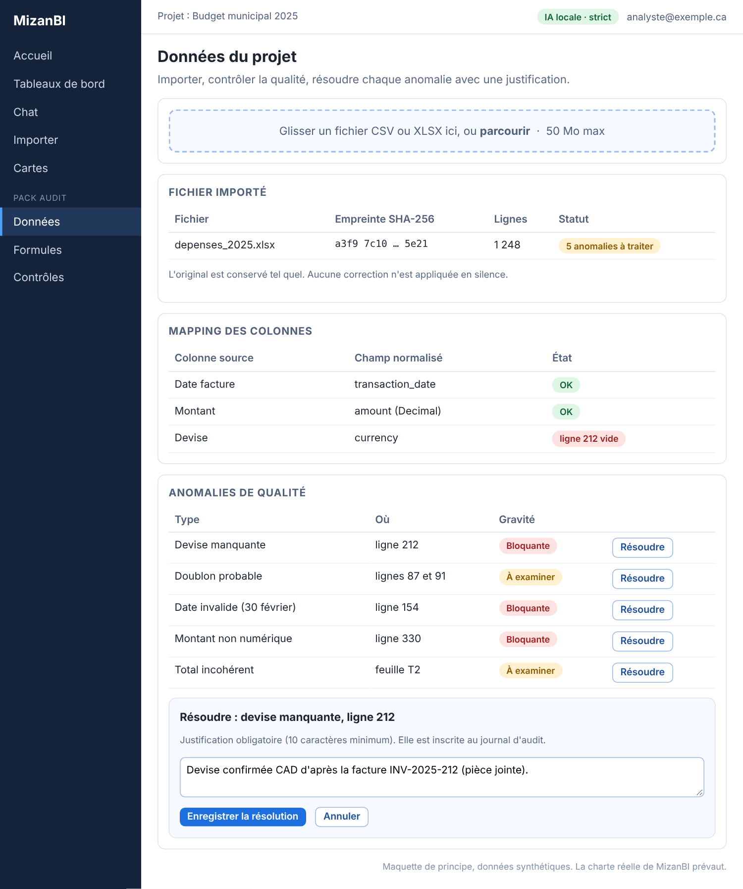
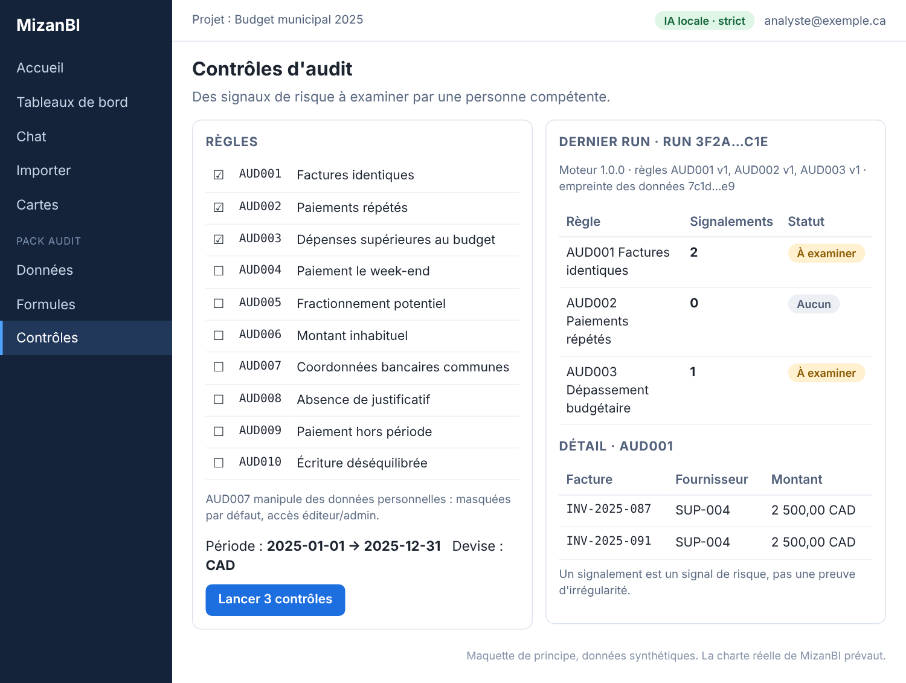

# Proposals hors-plan — MizanBI

Ajoutées le 2026-11-06. Chaque proposition inclut la raison et l'impact estimé.

---

## P-022 — Catalogue géospatial centralisé MizanGeo ✅

**Raison :** Les couches ADM1, ADM2 et quartiers existaient sans registre commun. Un catalogue centralisé permet de référencer chaque couche avec sa source, sa licence, ses avertissements qualité, et son statut de validation — base nécessaire avant tout moteur d'analyse spatiale.
**Impact :** Élevé — gouvernance des données géographiques, prérequis P-023 à P-029.
**Statut :** Livré 2026-11-08. `data/geo/catalog.yaml` (registre maître YAML, 3 couches DJ), `app/geo_catalog/` (models + registry avec cache + toggle), `GET /api/v1/geo/catalog` (liste + filtre enabled_only), `GET /api/v1/geo/catalog/{id}`, `PUT /api/v1/geo/catalog/{id}/toggle` (editor). `GeoCatalog.tsx` (cards statut/warning/toggle, viewer/editor). HeatmapTile livré en bonus. 24 pytest + 13 Vitest + 3 Vitest heatmap. 1178/1178 tests.

## P-022b — HeatmapTile (bonus, livré avec P-022)

**Raison :** Visualisation calendrier de chaleur 1D/2D pour données temporelles INSTAD (exportations par mois, flux par heure × région). Composant SVG pur, sans dépendance.
**Impact :** Faible/Moyen — nouveau type de tile utile pour séries temporelles.
**Statut :** Livré 2026-11-08. `HeatmapTile.tsx` (SVG, 4 palettes, 5 niveaux, mode 1D/2D), tile type `heatmap`, i18n `heatmap.*` (fr/en/ar/es). 3 pytest + 8 Vitest.

## P-023 — Moteur d'analyse spatiale DuckDB Spatial ✅

**Raison :** Après le catalogue, l'étape suivante est d'exécuter des requêtes spatiales sur les couches géographiques — aires, centroides, bounding boxes, proximité.
**Impact :** Élevé — analyse spatiale native sans PostGIS (DuckDB 1.5.6, `ST_Area_Spheroid`, `ST_Centroid`, `ST_Distance`).
**Statut :** Livré 2026-11-08. `app/geo_catalog/spatial_engine.py` (SpatialEngine, 5 analyses : area/centroid/bbox/nearest/summary, path guard projet root), `GET /api/v1/geo/analyze/types`, `POST /api/v1/geo/analyze`. `file_path` + `name_column` ajoutés à catalog.yaml + GeoLayer model. 23 pytest. 1201/1203 tests.

## P-024 — Import GeoJSON / GeoPackage / GeoParquet ✅ (2026-11-08)

**Raison :** Permettre à INSTAD d'importer ses propres données géographiques dans le catalogue.
**Impact :** Élevé pour l'autonomie utilisateur.
**Livré :** `importer.py` + `POST /api/v1/geo/import` + `GeoImport.tsx` + i18n 4 locales. 24 pytest + 10 Vitest. Formats : `.geojson/.json/.gpkg/.parquet`, 50 Mo max, enregistrement catalog.yaml en draft.

## P-025 — Analyses spatiales : buffers, proximité, intersections, densité ✅ (2026-11-08)

**Raison :** Cas d'usage concret INSTAD : « Quels districts sont à moins de 50 km d'un port ? »
**Impact :** Élevé — différenciateur BI+SIG.
**Livré :** `spatial_engine.py` +3 analyses (buffer/intersection/density), `layer_id_b` dans router. `SpatialAnalysis.tsx` (sélecteur analyse + couche, params contextuels : lon/lat/rayon, couche B, colonne valeur). i18n 4 locales. 16 nouveaux pytest (39 total spatial) + 11 Vitest. 1241/1243 pytest + 135/135 Vitest.

## P-026 — Interaction carte ↔ dashboards BI ✅ (2026-11-08)

**Raison :** Sélectionner une région sur la carte filtre automatiquement les KPIs et graphiques du dashboard.
**Impact :** Très élevé — expérience BI géospatiale unifiée.
**Livré :** `render_tile()` wrapping subquery avec WHERE clause + fallback gracieux si colonne absente. `?region=`/`?region_col=` validés (regex). `onRegionSelect`/`selectedRegion` props dans TileRenderer→MapLibreMap/MapAdm2. Badge région + bouton clear. `loadTileData` recharge sur changement région. MAP_TYPES exclus du filtre. i18n `map_filter.*` fr/en/ar/es. 11 pytest + 8 Vitest. 1252/1254 pytest · 143/143 Vitest.

## P-027 — Assistant GeoAI en langage naturel

**Raison :** « Affiche les régions où la densité est la plus élevée et compare avec le chômage » — interprété par le LLM, carte + KPIs générés.
**Impact :** Très élevé — différenciateur marché.
**Statut :** ✅ Livré 2026-11-08 (commit 7677a8e). `app/geo_catalog/geo_ai.py` + `app/routers/geo_ai.py` + `GeoAI.tsx`. 22 pytest + 8 Vitest. 1274/1276 pytest + 152/152 Vitest.

---

## Proposals mizanbi-client (frontend standalone React)

Le propriétaire a livré une version standalone React (`mizanbi-client/`) apportant les fonctionnalités P-028 à P-034.
App connectée au backend SovereignBI via `VITE_API_BASE`. Pas de MapLibre — cartes SVG inline. Stack : React 18, recharts, @tanstack/react-query, pdfjs-dist. Vitest ajouté pour P-034.

## P-028 — Thèmes OKLCH dynamiques ✅ (livré dans mizanbi-client)

**Raison :** 7 thèmes OKLCH (violet-green, teal-ochre, ocean, forest, sunset, plum-rose, light) + mode Auto (Djibouti→teal-ochre, Canada→violet-green) pour s'adapter à l'identité visuelle de chaque institution.
**Impact :** Élevé — identité de marque, démo institutionnelle.
**Statut :** ✅ Livré 2026-11-08. `src/lib/theme.ts` : `applyTheme()`, `colorForValue()`, `scaleFor()`, `textOnFill()`, `resolveTheme()`. Menu thème topbar (pastilles). `THEME_MODE_KEY` localStorage.

## P-029 — Cartes anciennes géoréférencées ✅ (livré dans mizanbi-client)

**Raison :** Visualiser les cartes historiques superposées aux contours administratifs modernes (utilisation pdfjs pour images raster + transformation affine).
**Impact :** Moyen — usage archivistique et pédagogique.
**Statut :** ✅ Livré 2026-11-08. `src/pages/AncientMaps.tsx` + `src/lib/ancientMaps.ts`. Upload PDF + contrôle de transparence + GCPs affines.

## P-030 — Bulletins d'information économique BIE 2001–2012 ✅ (livré dans mizanbi-client)

**Raison :** Données réelles du Ministère des Finances de Djibouti (snapshot local 8 nov. 2026). Évolution du PIB, inflation, recettes/dépenses, dette extérieure sur 12 ans.
**Impact :** Très élevé — données économiques nationales vérifiées, différenciateur pour INSTAD.
**Statut :** ✅ Livré 2026-11-08. `src/lib/bie.ts` + `src/data/bie/` (bie_series.json, bie_sources.json). Page `BiePage` avec graphiques ComposedChart (réel + prévisions ministère + modèle MizanBI), tableau récapitulatif annuel.

## P-031 — Tableau de bord national Canada (StatCan) ✅ (livré dans mizanbi-client)

**Raison :** Données StatCan (Licence ouverte, snapshot 2026-11-07) : chômage, emploi, IPC, population par province. Marché cible Canada.
**Impact :** Élevé — cohérence marché Canada.
**Statut :** ✅ Livré 2026-11-08. `src/lib/statcan.ts` + `src/data/statcan/` (5 JSON). Page `CanadaNationalPage` : chômage par province, variation emploi oct. 2026, IPC.

## P-032 — Utilisateur de démonstration Robleh Hassan ✅ (livré dans mizanbi-client)

**Raison :** Mode démo affiche "Robleh Hassan" (initiales RH) au lieu d'un placeholder générique. `DEMO_USER` exporté depuis `data/demo.ts`.
**Impact :** Faible — cosmétique/identité pilote.
**Statut :** ✅ Livré 2026-11-08. `DEMO_USER = { name: 'Robleh Hassan', initials: 'RH' }`. Token 'demo' → setUserName(DEMO_USER.name). localStorage `mizan_user_name`.

## P-033 — BCD 2024 + INSTAD RGPH-3 ✅ (livré dans mizanbi-client)

**Raison :** Données réelles : BCD Rapport Annuel 2024 (Synthèse p. 2-3) — 16 KPIs bancaires incluant crédits +35,4%, monnaie électronique ×4,3. INSTAD RGPH-3 (résultats définitifs juin 2025) — 1 066 568 habitants.
**Impact :** Très élevé — données bancaires et démographiques nationales vérifiées.
**Statut :** ✅ Livré 2026-11-08. `src/lib/bcd.ts` + `src/data/bcd/bcd_2024.json` + `src/data/instad/rgph3.json`. Page `BcdPage` : KPI cards, graphiques recharts.

## P-039 — Écran « changer mon mot de passe » + CI GitHub Actions ✅ (livré 2026-11-09)

## P-040 — Attribution de source sur les tuiles ✅ (livré 2026-11-11)
**Raison :** Les tableaux de bord institutionnels (INSTAD, BCD) doivent citer leurs sources sur chaque tuile, dans le Bulletin HTML, le PPTX et le CSV. Standard rapports officiels.
**Impact :** Moyen — `Tile.source`, `PUT /source`, affichage tuile, bulletin CSS `::before`, PPTX 8pt, CSV `# Source :`. 12 pytest. 1448/1448 tests.

## P-041 — Intégration données SIG CERD Djibouti-ville ✅ (livré 2026-11-11)
**Raison :** 10 couches vecteur UTM 38N fournies par le propriétaire (CERD) : écoles, équipements socio-éco, secteurs d'adressage, communes, îlots, bus, voirie, ouvrages, typologies urbaines. Conversion EPSG:32638 → WGS84 GeoJSON, enregistrement catalog.yaml en draft, 10 routes `/api/v1/geo/dj/cerd_*`.
**Impact :** Élevé — données urbaines Djibouti-ville pour analyse spatiale et visualisation. `tools/convert_cerd_shp.py`. 49 pytest. 1517/1517 tests.

## P-042 — Intégration données Santé INSTAD Djibouti 2020 ✅ (livré 2026-11-11)
**Raison :** Données XLSX Annuaire Statistiques Sanitaires 2020 (structures sanitaires, indicateurs de santé, PCIME enfants) fournies par le propriétaire. 73 structures, 65 avec GPS, 39 indicateurs, 66 structures PCIME.
**Impact :** Élevé — données santé réelles DJ. 3 tables DuckDB, GeoJSON `/structures_sante`, dashboard `sante-djibouti-2020.yaml`. 20 pytest. 1468/1468 tests.

## P-043 — Suppression arabe volet SIG (mizanbi-client) ✅ (livré 2026-11-11)
**Raison :** Pas de traduction arabe validée pour l'interface cartographique et spatiale. `SIG_LANGS = ['fr', 'en']`, auto-switch vers FR si langue AR quand on entre dans le volet SIG.
**Impact :** Faible — cosmétique + exactitude linguistique. 0 test impacté.

---

## P-050 — Fusion frontend/ + mizanbi-client/ : Phase 1 — base mizanbi-client

**Raison :** Deux frontends React coexistent, créant une dette de maintenance : features dans l'un absentes de l'autre, deux CI builds, deux bases i18n divergentes. Base retenue : `mizanbi-client/` (design dark OKLCH, population/BIE/BCD Canada, GeoAI, Admin, Auth).
**Impact :** Élevé / risqué — semaine de travail. Prérequis : tous les P-05x.
**Plan :** Mettre en place l'infrastructure commune (API client, types partagés, structure routes) dans `mizanbi-client/` avant de porter les composants.
**Statut :** ✅ Livré 2026-11-11 — `api.ts` types+méthodes, `i18n.ts` section dashboard (fr/en/ar), `LiveTileRenderer.tsx` (kpi/bar/line/pie/table/grid/grid-facettes). Fix curly-quote bug i18n (double-quote switch). 142→257 Vitest.

## P-051 — Fusion : Phase 2 — DashboardPage complète dans mizanbi-client

**Raison :** `frontend/` a toute la logique dashboard (tile CRUD, SQL editor pinné, export, source, annotations, tags, favoris, sharing, freshness). La migrer dans le design `mizanbi-client/`.
**Impact :** Élevé — c'est le cœur fonctionnel BI. Composants à porter : `DashboardPage.tsx`, `TableTile.tsx`, `SqlEditor.tsx`, `TileFreshnessBar.tsx`.
**Dépend de :** P-050
**Statut :** ✅ Livré 2026-11-11 — `Dashboards.tsx` réécrit (640 lignes) : liste+tags+favoris, vue détail, tile CRUD drag-and-drop, notes, source, freshness, AI insight, export bulletin/PPTX/CSV, clone, region filter badge. Mode démo préservé. 115 nouveaux tests → 257 Vitest.

## P-052 — Fusion : Phase 3 — Tiles avancées (map-bivariate, heatmap, trade-flow)

**Raison :** `BivariateChoropleth`, `HeatmapTile`, `TradeFlowMap`, `MapAdm2` existent dans `frontend/` mais pas dans `mizanbi-client/`. Composants autonomes, portage direct.
**Impact :** Moyen — spécialisation INSTAD et démos institutionnelles.
**Dépend de :** P-051
**Statut :** ✅ Livré 2026-11-11 — `BivariateChoropleth.tsx`, `HeatmapTile.tsx`, `TradeFlowMap.tsx`, `SparklineKpi.tsx`, `TableTile.tsx` portés dans `mizanbi-client/src/components/`. `maplibre-gl` + `pmtiles` ajoutés. ChatBI drawer flottant + palette pro 12 couleurs (P-052b+c). 257/257 Vitest.

## P-053 — Fusion : Phase 4 — Exports (Bulletin HTML, CSV par tuile)

**Raison :** Les boutons export de `frontend/` étaient absents de `mizanbi-client/`. Fonctionnalité principale pour les démos institutionnelles.
**Impact :** Élevé pour l'adoption — les rapports sont la valeur perçue principale.
**Dépend de :** P-051
**Statut :** ✅ Livré 2026-11-11 — `lib/exports.ts` (tileDataToCsv, dashboardToBulletinHtml, triggerDownload), `DemoDashboardDetail` pur JS (plus d'appel API), bouton CSV par tuile. 14 nouveaux tests. Commit `b0cb391`.

## P-054 — SIG complet : GeoImport, GeoCatalog, SpatialAnalysis dans mizanbi-client

**Raison :** `frontend/` avait ces composants UI (import drag-and-drop, moteur DuckDB Spatial). `mizanbi-client/` a déjà le volet SIG cartographique mais pas l'interface d'administration des couches.
**Impact :** Moyen — complète le volet SIG de mizanbi-client.
**Statut :** ✅ Livré 2026-11-13 — `GeoCatalog.tsx`, `GeoImport.tsx`, `SpatialAnalysis.tsx` créés avec guard `isApiConfigured()`, i18n fr+en complétées (57 clés), intégrés dans `Sig.tsx` + `App.tsx` (prop `isEditor`), 17 tests Vitest. Commit `8999f3c`.

## P-056 — Validation cartographique Djibouti-ville ✅ (livré 2026-11-13)

**Raison :** Données géographiques `dj_quartiers.geojson` et `cerd_communes.geojson` contenaient deux erreurs : (1) `density_km2` = copie de `population_est` au lieu de la vraie valeur calculée ; (2) labels CERD "4/5 eme arrondissement" sans préciser la commune ; (3) catalogue indiquait 2 communes au lieu de 3 (Boulaos, Ras-Dika, Balbala). Le propriétaire a demandé une image cartographique de référence à soumettre aux autorités djiboutiennes pour validation.
**Impact :** Moyen — exactitude des données, prérequis validation institutionnelle.
**Livré :** `dj_quartiers.geojson` (+density_km2 UTM 38N, +area_km2, +commune attribution provisoire, +validation_status) ; `cerd_communes.geojson` (relabels Balbala 4ème/5ème +commune_nom +arrondissement +note) ; `catalog.yaml` (description 3 communes, warning Boulaos/Ras-Dika absents). Image PNG cartographique `/tmp/djibouti_admin_map.png` livrée pour validation terrain. 1517/1517 tests. Commit `b39e24e`.

## P-057 — Découpage officiel CERD admin_pol (91 quartiers, 3 communes) ✅ (livré 2026-11-14)

**Raison :** Les shapefiles CERD ne couvraient que Balbala (arr. 4 et 5) ; le centre-ville (Boulaos, Ras-Dika) n'avait que 11 quartiers OSM approximatifs en rectangles. Le propriétaire a fourni `admin_pol.shp` (CERD, photogrammétrie 1/2 500, 2014).
**Impact :** Élevé — premier fond de carte complet et officiel de Djibouti-ville.
**Livré :** conversion ITRF2005 → WGS84 (`.shx` régénéré), `data/geo/admin_quartiers.geojson` (91) + `admin_communes.geojson` (3), routes `/api/v1/geo/dj/admin_quartiers|admin_communes`, entrées `catalog.yaml` (licence CERD, `draft`), fond partagé `VilleBaseLayers` pour les 4 cartes Djibouti-ville, `getQuartierForPoint` sur les vrais quartiers. Commits `da5bda7`, `aaaa3cb`, `5be5dae`.

## P-058 — Routes et bâtiments OSM de Djibouti-ville ✅ (livré 2026-11-14)

**Raison :** Complément en attendant les données CERD des arrondissements 1 à 3 (voirie du centre absente).
**Impact :** Moyen — voirie du centre (1 875 tronçons) + 98 239 bâtiments (ODbL, Geofabrik 2026-11-14).
**Livré :** `osm_centre_voirie` (embarquée), `osm_batiments.geojson.gz` (remplacé le 2026-11-15 par le levé CERD, voir P-063), catalogue + attribution ODbL. Commits `810b8c3`, `71d6bb0`, `5a37e64`. **Reste :** vérification visuelle de la couche bâtiments contre l'API réelle (après redéploiement Oracle).

## P-059 — Attribution automatique des sources de cartes ✅ (livré 2026-11-14)

**Raison :** Les pieds de carte « Source : … » étaient codés en dur dans chaque composant ; une correction de licence demandait d'éditer plusieurs fichiers.
**Impact :** Moyen — une seule source de vérité (`catalog.yaml`).
**Livré :** `tools/sync_geo_attribution.py` → `geo_attribution.json` → composant `GeoSources` (3 cartes Djibouti-ville) ; `tests/test_geo_attribution_sync.py` échoue si désynchronisé. **Reste :** généraliser `GeoSources` aux autres cartes (`DjiboutiMap`, `EcolesMap`, `Bulletins`…). Commit `5a37e64`.

## P-061 — Documents juridiques, cookies et acceptation des CGU ✅ (livré 2026-11-14)

**Raison :** Le propriétaire a fourni quatre documents juridiques (confidentialité, CGU, cookies, mentions légales). L'audit a relevé : texte « les données ne quittent jamais votre serveur » faux avec un fournisseur d'IA externe, « cookie de session » inexact (le jeton est en `sessionStorage`), pages légales et bannière visibles seulement après connexion, lien « politique » de la bannière qui refusait au lieu d'ouvrir la page, polices de cartes chargées depuis un serveur tiers, aucune acceptation des CGU enregistrée.
**Impact :** Élevé — prérequis de toute diffusion à de vrais utilisateurs.
**Livré :** pages Confidentialité / CGU / Cookies / Mentions légales fr+en (`legalContent.ts`, config unique `legalConfig.ts`, bandeau « version de travail », placeholders surlignés), accessibles avant connexion ; bannière corrigée + « Gérer mes cookies » ; `TermsGate` + `POST /compliance/consent/self` (allowlist de finalités `cgu|privacy:AAAA-MM`, identité de la session, pas d'IP) ; `/compliance/notice` reflète `LLM_PROVIDER` ; glyphes de cartes hébergés localement ; tests de garde (clés de stockage documentées, aucun tiers, garde-fou de publication). **Reste (propriétaire) :** compléter `legalConfig.ts`, validation par un juriste, durées de conservation, procédure d'incident, choix du fournisseur d'IA et du droit applicable, puis `draft: false`. **À relire par un humain :** la route `/compliance/consent/self` (contrôle d'accès).

## P-062 — Durcissement web MizanBI et outil d'audit de lancement ✅ (livré 2026-11-14)

**Raison :** Cahier des charges « points techniques 3 à 20 » du propriétaire. Audit : clé API injectable dans le navigateur, mesure d'audience appelée sans consentement, image OG en SVG (non rendue par LinkedIn/Facebook), sitemap invalide, favicons incomplets, « soft 404 », un seul titre pour toute l'application, 3,8 Mo de JavaScript au premier chargement.
**Impact :** Élevé — sécurité (point 3), conformité cookies (point 5), partage et SEO (6-9, 15), performance (12).
**Livré :** voir CLAUDE.md « Durcissement web » ; `tools/web_launch_audit.py` (15 tests, réutilisable sur tous les projets web) ; `tools/make_brand_assets.py`. Premier audit des sites déjà en ligne : Vigile (aucune balise OG, robots, sitemap ni page légale) et Code de la Route DJ (lien cassé `/fr/verify`, image de 493 Ko, pas de robots/sitemap/OG/pages légales). **Reste (propriétaire) :** décider site vitrine séparé vs application (URLs `/features`, `/pricing`, `/docs`, `/contact` impossibles dans l'application actuelle sans URL par page) ; renseigner `VITE_SITE_URL` en production ; Lighthouse sur l'URL publique ; HSTS et redirection HTTPS côté serveur de production (non vérifiables depuis le dépôt).

## P-065 — Mesures réutilisables et synonymes dans la couche sémantique ✅ (livré 2026-11-15)

**Raison :** Inspiré de DAX (Power BI) et des couches sémantiques (Wren AI, dbt) : définir une fois chaque mesure (taux de chômage, chiffre d'affaires…) avec ses synonymes, pour que « chômage », « sans-emploi » et « taux de chômage » renvoient au même calcul. Gain mesuré de +17 à +23 points de précision avec une couche sémantique (PLAN.md §1.2).
**Impact :** Élevé — précision de l'IA ; Moyen en développement (extension de `semantic/model.yaml`, tests d'éval).
**Livré :** `app/semantic/resolver.py` (reconnaissance déterministe des termes avant l'appel au LLM : insensible à la casse, aux accents et au pluriel, plus longue expression d'abord, synonymes de 3 caractères ou moins sensibles à la casse pour que « ça » ne devienne pas « CA »), `app/semantic/validate.py` (doublons, alias ambigus, SQL illisible, colonnes/tables inconnues), modèle étendu (filtres nommés, synonymes de valeurs, alias de colonnes, unités), routes `GET /semantic/validate` et `GET /semantic/resolve` (viewer), `semantic/model.yaml` enrichi (3 filtres, 4 régions avec synonymes, unités). Les définitions reconnues sont placées en tête du prompt. 32 tests.
**Défauts corrigés en chemin :** (1) `get_graph` ne transmettait au LLM que le glossaire et les règles : les mesures, tables et jointures du modèle v2 n'étaient jamais dans le prompt ; (2) un secteur activé passait un objet `SemanticModel` qui s'affichait comme sa représentation Python (`SemanticModel(...)`) au lieu de son texte. **Non mesuré :** l'effet sur la précision (aucun modèle de génération installé sur cette machine ; la ligne de base de `eval/BASELINE.md` n'a jamais été établie). À mesurer sur une machine avec modèle local avant d'annoncer un gain. Le prompt est plus long qu'avant (modèle complet) : à surveiller avec un petit modèle.

## P-066 — Métadonnées d'indicateurs et import/export SDMX-CSV ✅ (livré 2026-11-15)

**Raison :** Les instituts de statistique (cible INSTAD) échangent via SDMX (.Stat Suite, MIT). Associer à chaque indicateur sa source, périodicité, définition et unité ; importer/exporter en SDMX-CSV/ML.
**Impact :** Élevé pour le marché institutionnel ; Moyen/Élevé en développement.
**Livré :** (1) métadonnées d'indicateur sur les mesures du modèle sémantique (`code`, `source`, `frequency` en codes SDMX A/S/Q/M/W/D/H/B/N, `definition`, `methodology`, `topic`, `last_updated`, `unit`) validées par `validate_model` (code unique, périodicité, date) ; `GET /semantic/indicators[/{code}]` (catalogue du modèle actif, avec la liste de ce qui manque) ; modèle INSTAD : 4 indicateurs documentés. (2) `app/sdmx/csv_format.py` : écriture et lecture **SDMX-CSV 2.0** (lecture de la 1.0 aussi), identifiants de composants normalisés, périodes SDMX (2024, 2024-Q1, 2024-03, 2024-03-15), neutralisation des formules (`=`, `+`, `@`), erreurs avec numéro de ligne. (3) `GET /dashboards/{id}/tiles/{id}/export/sdmx-csv` (colonnes temps et valeur déduites ou précisées, `structure_id`, `unit`, `freq`). (4) `POST /sdmx/import` (éditeur) : validation, `dry_run`, table `sdmx_*` à préfixe forcé (aucune table existante ne peut être écrasée), `replace`, limite de taille, refus du XML et de l'action D. 66 tests.
**Limites assumées :** SDMX-CSV seulement (**pas de SDMX-ML**, pas d'API REST SDMX, pas de DSD ni de codelists réelles) ; une observation par ligne ; fichier produit non validé avec l'outil officiel d'un registre SDMX (à faire avant diffusion) ; agence par défaut `MIZANBI`, à remplacer par l'agence réelle de l'institut ; pas d'interface (bouton d'export) dans le client. Défaut corrigé en chemin : DuckDB renvoie les décimaux en `Decimal`, ce qui empêchait de reconnaître la colonne de valeurs. **Reste :** SDMX-ML, bouton dans le client, page publique de diffusion (idée 13 du benchmark).
**Bouton d'export dans le client (livré 2026-11-15) :** « ↓ SDMX » à côté de « ↓ CSV » sur chaque tuile d'un tableau de bord (`components/SdmxExportButton.tsx`, `lib/sdmx.ts`). Petit formulaire : identifiant du jeu (AGENCE:ID(VERSION)), unité, périodicité (A, S, Q, M, W, D) ; champs vides = valeurs déduites par le serveur. Validation côté client alignée sur le serveur (bouton désactivé tant qu'un champ est invalide), erreurs du serveur affichées telles quelles, noms de fichier et identifiants assainis (aucune injection dans l'URL). La note du formulaire rappelle l'agence par défaut MIZANBI et que le fichier n'est pas validé avec un registre officiel. 20 tests Vitest. **Vérifié dans un navigateur réel** (backend isolé) : formulaire, refus d'un identifiant invalide, téléchargement d'un fichier SDMX-CSV correct. **Non vérifié en navigateur :** l'affichage d'une erreur du serveur (tuile sans colonne numérique). Bouton d'import livré ensuite (voir ci-dessous).
**Import dans le client (livré 2026-11-15) :** carte « Import SDMX-CSV » sur la page Import (éditeur ou admin) : `components/SdmxImport.tsx`, `lib/sdmxImport.ts`. **Deux temps** : « Vérifier le fichier » (`dry_run`, rien n'est chargé : résumé du jeu, nombre d'observations, colonnes, table cible `sdmx_…`) puis « Charger dans la base », **actif seulement pour la requête exactement vérifiée** (changer le fichier, le nom de table ou la case « Remplacer » oblige à revérifier). Refus côté client du XML (SDMX-ML), des fichiers vides ou de plus de 50 Mo, des noms de table invalides ; messages du serveur affichés tels quels (numéro de ligne) ; table existante → invite à cocher « Remplacer ». La note rappelle : pas de SDMX-ML, pas de validation contre une structure (DSD) officielle, une table non importée en SDMX n'est jamais écrasée. 11 tests Vitest (418 au total). **Vérifié dans un navigateur réel** (backend isolé) : fichier valide (vérification sans chargement, puis chargement), changement de nom exigeant une revérification, doublon (409), fichier invalide (« Ligne 3 : OBS_VALUE non numérique »), fichier XML refusé. **Non testé :** import d'un fichier volumineux (limite 50 Mo), SDMX-CSV 1.0 depuis le navigateur (couvert côté serveur seulement).
**Pas d'import dans le client pour :** SDMX-ML, ni l'action D (suppression), ni plusieurs fichiers à la fois.

## P-067 — Abonnements courriel aux bulletins ✅ (livré 2026-11-15)

**Raison :** Inspiré des abonnements Power BI et de Tableau Pulse : bulletin envoyé à date fixe, « les chiffres du jour » sans poser de question. S'appuie sur le Bulletin HTML (P-002) et le moteur d'alertes existants.
**Impact :** Moyen — valeur d'usage immédiate ; Faible/Moyen en développement (envoi de courriels à configurer).
**Livré :** abonnement d'une adresse à un tableau de bord (quotidien, hebdomadaire ou mensuel, heure UTC, jour) ; `POST/GET/DELETE /subscriptions` et `POST /subscriptions/{id}/send-now` (éditeur : les adresses sont des données personnelles) ; `GET /subscriptions/status` ; envoi planifié par le planificateur existant (tâche chaque minute, l'échéance réelle est calculée par `is_due`, une seule tentative par échéance, l'échec d'un abonné n'arrête pas les autres, l'erreur reste visible). Bulletin = `generate_bulletin_html` existant, titre échappé. SMTP avec STARTTLS obligatoire ; **sans `SMTP_HOST`, rien n'est envoyé** : les messages vont dans `data/outbox/*.eml`. Désabonnement par jeton HMAC par abonné (GET = formulaire seulement, POST = suppression, car les antivirus de messagerie préchargent les liens) ; seule route sans `RequireRole`, exception voulue. Garde-fous : rejet des retours à la ligne (injection d'en-têtes), liste blanche de domaines optionnelle, 50 abonnés max par tableau, fichier en 0600, erreurs SMTP sans détails ni identifiants. 28 tests.
**Limites assumées :** jamais testé contre un vrai serveur SMTP (seulement l'échec et la boîte d'envoi) ; pas de consentement du destinataire (double opt-in) : l'éditeur qui ajoute une adresse en est responsable, à encadrer dans le DPA (P-064) et la Loi 25/PIPEDA ; pas de « résumé IA » dans le courriel (le bulletin n'inclut un commentaire IA que s'il est fourni) ; pas d'interface dans le client ; stockage JSON (pas de base) ; une instance du serveur seulement (deux instances enverraient en double) ; ni pièces jointes PDF ni rejeu après panne prolongée (l'échéance manquée est envoyée une fois au retour). **Reste :** double opt-in, interface, résumés IA, file d'envoi avec reprise.
**Écran dans le client (livré 2026-11-15) :** bouton « ✉ Abonnements » dans la barre d'outils d'un tableau de bord (éditeur ou admin seulement), panneau `components/SubscriptionsPanel.tsx` + `lib/subscriptions.ts` : liste des abonnés (calendrier en clair, dernier envoi, dernière erreur), ajout (adresse, fréquence, heure UTC, jour), « Envoyer maintenant » et « Supprimer » avec confirmation en deux temps. **Le panneau dit clairement quand SMTP n'est pas configuré** (« aucun courriel réel n'est envoyé ») ; l'ajout exige une case « le destinataire a accepté de recevoir ce bulletin » (pas de double opt-in côté serveur) ; la note rappelle la Loi 25/PIPEDA et que la sécurité par ligne refuse les bulletins. 14 tests Vitest. **Vérifié dans un navigateur réel** (backend isolé) : ouverture du panneau, ajout, envoi vers la boîte d'envoi locale (message correct, fichier 0600), suppression. **Non revérifié en navigateur** après coup : le libellé « Chaque semaine / Chaque mois » du menu de fréquence (corrigé, couvert par un test de rendu). **Non testé :** envoi réel par SMTP, et l'affichage d'une erreur du serveur (doublon 409, bulletin refusé).
**Défaut existant corrigé en passant (hors plan, 1 ligne) :** la sous-navigation (`App.tsx`) était `sticky` avec `top: 56` alors que `<main>` est déjà le conteneur de défilement sous l'en-tête : elle restait collée 56 px trop bas et **recouvrait la barre d'outils des tableaux de bord** (Bulletin, Dupliquer, PPTX, Tuile et le nouveau bouton étaient inaccessibles à la souris). `top: 0` corrige : vérifié en navigateur (boutons cliquables).

## P-068 — Sécurité par ligne ✅ livrée 2026-11-15 (jeux de données certifiés : P-069 proposée)

**Raison :** Un utilisateur ne voit que sa région ou son périmètre (à vérifier d'abord : l'existence d'une sécurité par ligne dans le code n'est pas confirmée) ; pastille « validé par l'INSTAD » sur chaque source, liée au certificat de précision.
**Impact :** Élevé pour banques et administrations ; Moyen/Élevé en développement.
**Statut :** accord reçu 2026-11-15, **en attente de 3 décisions de conception** (voir ci-dessous). Constat du code : **aucune sécurité par ligne n'existe**. (a) `RequireRole` ne renvoie que le rôle ; l'identité de l'utilisateur n'atteint pas les routes. (b) Les clés API (viewer/editor/admin) n'ont pas d'identité, donc pas de périmètre. (c) ~10 endroits exécutent du SQL (`/ask`, tuiles, exports, bulletins, alertes, MCP, abonnements) : un filtre oublié sur un seul = fuite. (d) Les bulletins courriel (P-067) s'exécutent sans utilisateur : ils enverraient toutes les lignes. Piste sûre : réécriture sqlglot (chaque table protégée devient `(SELECT * FROM t WHERE col IN (...))`) appliquée à **un seul point d'étranglement**, échec fermé.

**Livré (décisions du propriétaire : comptes web seulement ; échec fermé ; bulletins refusés sur tables protégées) :** `app/security/row_policy.py` (règles `data/row_policies.yaml` : table, colonne, périmètre), réécriture sqlglot de **chaque** référence à une table protégée en sous-requête filtrée dans `DataStore.execute` (seul passage vers DuckDB) et dans les exemples envoyés au LLM ; `PrincipalMiddleware` (identité → ContextVar) ; périmètres par compte en base d'authentification ; `GET /security/row-policies` (diagnostic), `GET/PUT /security/users/{id}/scopes[/{scope}]` (admin, audités sans les valeurs). Admin (compte ou clé) voit tout ; compte non-admin voit son périmètre ; **sans périmètre, clé API viewer/editor, jeton d'intégration/partage, planificateur, courriel : refus.** Caches partagés coupés tant que des règles existent (`/ask`, `/export/pdf-cached`, insights) ; cache persistant purgé au démarrage ; remplacement d'une table protégée par un non-admin refusé ; fonctions de table refusées. Fichier de règles invalide, clé mal écrite, vide ou chemin explicite introuvable = **actif et refus** (jamais « sans protection »). `AccessDenied` → 403. 45 tests.
**Relecture `security-reviewer` (2026-11-15) :** aucun contournement de la réécriture trouvé (CTE, récursif, LATERAL, FROM-first, `TABLE`, `SUMMARIZE`, erreurs de cast, injection par valeur de périmètre, propagation du contexte dans LangGraph/threadpool). 7 constats corrigés : fichier mal formé = protection coupée en silence (HIGH), `/export/pdf-cached` (MEDIUM), comptes de lignes du MCP (MEDIUM), remplacement de table (LOW), fonctions de table (LOW), clé de cache (LOW), garde défensive. **Relecture du propriétaire encore due** (règle du dépôt).
**Limites :** la sécurité s'applique aux **valeurs exactes** d'une colonne (comparaison texte, sensible à la casse) ; une colonne de périmètre doit exister dans chaque table protégée ; les clés API viewer/editor ne voient aucune table protégée (par décision) ; les noms de colonnes et de tables restent visibles ; l'admin voit tout, y compris dans les exemples du prompt IA ; les agrégats d'une table non protégée dérivée de données protégées ne sont pas couverts ; DuckDB est en processus unique avec le serveur (pas d'isolation OS) ; le conteneur Excel/add-in n'a pas été testé avec des règles ; règles lues sur le disque du serveur (pas d'éditeur dans l'interface).

## P-065 — Mesures réutilisables et synonymes dans la couche sémantique ✅ (livré 2026-11-15)

**Raison :** Inspiré de DAX (Power BI) et des couches sémantiques (Wren AI, dbt) : définir une fois chaque mesure (taux de chômage, chiffre d'affaires…) avec ses synonymes, pour que « chômage », « sans-emploi » et « taux de chômage » renvoient au même calcul. Gain mesuré de +17 à +23 points de précision avec une couche sémantique (PLAN.md §1.2).
**Impact :** Élevé — précision de l'IA ; Moyen en développement (extension de `semantic/model.yaml`, tests d'éval).
**Livré :** `app/semantic/resolver.py` (reconnaissance déterministe des termes avant l'appel au LLM : insensible à la casse, aux accents et au pluriel, plus longue expression d'abord, synonymes de 3 caractères ou moins sensibles à la casse pour que « ça » ne devienne pas « CA »), `app/semantic/validate.py` (doublons, alias ambigus, SQL illisible, colonnes/tables inconnues), modèle étendu (filtres nommés, synonymes de valeurs, alias de colonnes, unités), routes `GET /semantic/validate` et `GET /semantic/resolve` (viewer), `semantic/model.yaml` enrichi (3 filtres, 4 régions avec synonymes, unités). Les définitions reconnues sont placées en tête du prompt. 32 tests.
**Défauts corrigés en chemin :** (1) `get_graph` ne transmettait au LLM que le glossaire et les règles : les mesures, tables et jointures du modèle v2 n'étaient jamais dans le prompt ; (2) un secteur activé passait un objet `SemanticModel` qui s'affichait comme sa représentation Python (`SemanticModel(...)`) au lieu de son texte. **Non mesuré :** l'effet sur la précision (aucun modèle de génération installé sur cette machine ; la ligne de base de `eval/BASELINE.md` n'a jamais été établie). À mesurer sur une machine avec modèle local avant d'annoncer un gain. Le prompt est plus long qu'avant (modèle complet) : à surveiller avec un petit modèle.

## P-066 — Métadonnées d'indicateurs et import/export SDMX-CSV ✅ (livré 2026-11-15)

**Raison :** Les instituts de statistique (cible INSTAD) échangent via SDMX (.Stat Suite, MIT). Associer à chaque indicateur sa source, périodicité, définition et unité ; importer/exporter en SDMX-CSV/ML.
**Impact :** Élevé pour le marché institutionnel ; Moyen/Élevé en développement.
**Livré :** (1) métadonnées d'indicateur sur les mesures du modèle sémantique (`code`, `source`, `frequency` en codes SDMX A/S/Q/M/W/D/H/B/N, `definition`, `methodology`, `topic`, `last_updated`, `unit`) validées par `validate_model` (code unique, périodicité, date) ; `GET /semantic/indicators[/{code}]` (catalogue du modèle actif, avec la liste de ce qui manque) ; modèle INSTAD : 4 indicateurs documentés. (2) `app/sdmx/csv_format.py` : écriture et lecture **SDMX-CSV 2.0** (lecture de la 1.0 aussi), identifiants de composants normalisés, périodes SDMX (2024, 2024-Q1, 2024-03, 2024-03-15), neutralisation des formules (`=`, `+`, `@`), erreurs avec numéro de ligne. (3) `GET /dashboards/{id}/tiles/{id}/export/sdmx-csv` (colonnes temps et valeur déduites ou précisées, `structure_id`, `unit`, `freq`). (4) `POST /sdmx/import` (éditeur) : validation, `dry_run`, table `sdmx_*` à préfixe forcé (aucune table existante ne peut être écrasée), `replace`, limite de taille, refus du XML et de l'action D. 66 tests.
**Limites assumées :** SDMX-CSV seulement (**pas de SDMX-ML**, pas d'API REST SDMX, pas de DSD ni de codelists réelles) ; une observation par ligne ; fichier produit non validé avec l'outil officiel d'un registre SDMX (à faire avant diffusion) ; agence par défaut `MIZANBI`, à remplacer par l'agence réelle de l'institut ; pas d'interface (bouton d'export) dans le client. Défaut corrigé en chemin : DuckDB renvoie les décimaux en `Decimal`, ce qui empêchait de reconnaître la colonne de valeurs. **Reste :** SDMX-ML, bouton dans le client, page publique de diffusion (idée 13 du benchmark).

## P-067 — Abonnements courriel aux bulletins ✅ (livré 2026-11-15)

**Raison :** Inspiré des abonnements Power BI et de Tableau Pulse : bulletin envoyé à date fixe, « les chiffres du jour » sans poser de question. S'appuie sur le Bulletin HTML (P-002) et le moteur d'alertes existants.
**Impact :** Moyen — valeur d'usage immédiate ; Faible/Moyen en développement (envoi de courriels à configurer).
**Livré :** abonnement d'une adresse à un tableau de bord (quotidien, hebdomadaire ou mensuel, heure UTC, jour) ; `POST/GET/DELETE /subscriptions` et `POST /subscriptions/{id}/send-now` (éditeur : les adresses sont des données personnelles) ; `GET /subscriptions/status` ; envoi planifié par le planificateur existant (tâche chaque minute, l'échéance réelle est calculée par `is_due`, une seule tentative par échéance, l'échec d'un abonné n'arrête pas les autres, l'erreur reste visible). Bulletin = `generate_bulletin_html` existant, titre échappé. SMTP avec STARTTLS obligatoire ; **sans `SMTP_HOST`, rien n'est envoyé** : les messages vont dans `data/outbox/*.eml`. Désabonnement par jeton HMAC par abonné (GET = formulaire seulement, POST = suppression, car les antivirus de messagerie préchargent les liens) ; seule route sans `RequireRole`, exception voulue. Garde-fous : rejet des retours à la ligne (injection d'en-têtes), liste blanche de domaines optionnelle, 50 abonnés max par tableau, fichier en 0600, erreurs SMTP sans détails ni identifiants. 28 tests.
**Limites assumées :** jamais testé contre un vrai serveur SMTP (seulement l'échec et la boîte d'envoi) ; pas de consentement du destinataire (double opt-in) : l'éditeur qui ajoute une adresse en est responsable, à encadrer dans le DPA (P-064) et la Loi 25/PIPEDA ; pas de « résumé IA » dans le courriel (le bulletin n'inclut un commentaire IA que s'il est fourni) ; pas d'interface dans le client ; stockage JSON (pas de base) ; une instance du serveur seulement (deux instances enverraient en double) ; ni pièces jointes PDF ni rejeu après panne prolongée (l'échéance manquée est envoyée une fois au retour). **Reste :** double opt-in, interface, résumés IA, file d'envoi avec reprise.

## P-068 — Sécurité par ligne et jeux de données certifiés 📋 (proposée 2026-11-15)

**Raison :** Un utilisateur ne voit que sa région ou son périmètre (à vérifier d'abord : l'existence d'une sécurité par ligne dans le code n'est pas confirmée) ; pastille « validé par l'INSTAD » sur chaque source, liée au certificat de précision.
**Impact :** Élevé pour banques et administrations ; Moyen/Élevé en développement.
**Statut :** proposée, **ne pas implémenter sans accord**.

## P-064 — Contrat de traitement des données (DPA), incidents, export/suppression 📋 (proposée 2026-11-15)

**Raison :** Pour vendre à des banques, ONG et administrations, les CGU ne suffisent pas : il faut un DPA (responsable/sous-traitant, instructions du client, mesures de sécurité, sous-traitants techniques, transferts internationaux, suppression/restitution, gestion des incidents). Audit du dépôt : mesures de sécurité réelles et documentées, mais aucun outil de purge/export de compte (le registre de demandes accepte « delete »/« export » sans procédure), aucune procédure ni registre d'incident, sauvegardes seulement en objectifs (RTO < 1 h, RPO < 24 h). La politique de confidentialité nomme l'entreprise responsable du traitement même pour les données importées par le client (à scinder : responsable pour comptes/journaux, sous-traitant pour les données importées).
**Impact :** Élevé pour la vente B2B ; Moyen en développement (outil d'export/suppression + registre d'incidents).
**Proposé :** DPA type fr/en avec annexes alignées sur le code (annexes sous-traitants/transferts après décision hébergement et fournisseur d'IA) ; séparation des rôles dans `legalContent.ts` ; procédure d'incident ; outil d'export et de suppression des données d'un compte. À valider par un juriste. **Ne pas implémenter sans accord du propriétaire.**

## P-063 — Levé topographique CERD 1/2 500 (bâtiments, routes, hydro, rail, sites) ✅ (livré 2026-11-15)

**Raison :** Le propriétaire a fourni l'archive complète du levé photogrammétrique CERD (même projet que `admin_pol`, 2014) : 112 417 bâtiments typés, routes, hydrographie, voie ferrée, réseaux. Plus précis et mieux classé que les données OSM.
**Impact :** Élevé — fond officiel complet de Djibouti-ville, bâtiments par usage (écoles, mosquées, santé, administrations, commerces…).
**Livré :** `tools/convert_cerd_topo.py`, 5 couches `cerd_*.geojson.gz` + catalogue (licence CERD, `draft`, avertissement « levé de 2014 »), routes API, `lib/topoLayers.ts` + `TopoCanvas`, légende des catégories, attribution automatique ; l'OSM des bâtiments est supprimé (l'OSM des routes du centre reste). 16 tests pytest + 6 Vitest. **Reste :** intégrer si besoin `centre_lin` (axes, noms RN1/RN2…), `contour` (courbes de niveau), `road_lin`, `utilit_*`, `vegetation` ; valider la licence par écrit.

## P-060 — Carte ADM2/quartiers (`MapAdm2`) sur les quartiers officiels ✅ (livré 2026-11-14)

**Raison :** Le niveau « quartiers » utilisait les 11 quartiers OSM approximatifs (avertissement « données approximatives »).
**Impact :** Moyen — 91 quartiers officiels, jointure tolérante aux accents/casse/apostrophes (`lib/adm2Levels.ts`), popup échappé (commune, superficie).
**Livré :** `MapAdm2` sur `admin_quartiers` (propriété `nom`), 7 tests Vitest. **Attention :** les jeux de données existants clés sur les anciens noms (« Balbala Nord », « Centre-ville »…) ne se joindront plus ; les tuiles `map-adm2` au niveau quartiers doivent utiliser les noms officiels. `dj_quartiers` reste dans le catalogue (non utilisé par le client).

## P-055 — Suppression frontend/ et finalisation CI

**Raison :** `frontend/` devenu redondant une fois `mizanbi-client/` complet. Éliminer la dette de maintenance.
**Impact :** Faible (cleanup) — irréversible mais snapshot git conservé.
**Statut :** ✅ Livré 2026-11-11 — `frontend/` supprimé (74 fichiers), service `mizanbi-client` activé dans `docker-compose.server.yml`, Q-002 et Q-003 fermées. Commit `5cb2627`.

**Raison :** `POST /auth/password` existait (P-037) sans interface utilisateur ; les 48+ commits n'avaient aucun workflow CI.
**Impact :** Moyen — autonomie utilisateur (tout rôle peut changer son propre mot de passe) + CI sur push/PR.
**Statut :** ✅ Livré 2026-11-09. `ChangePasswordModal.tsx` (champs current/new/confirm, toggle show/hide, messages d'erreur localisés, état succès). `accounts.ts` : `changePassword()` dans l'interface + API (POST /auth/password, mappage 403→wrongPassword) + démo (validation seule). `i18n.ts` : section `changePwd` fr/en/ar. `App.tsx` : bouton cadenas près du déconnexion (masqué en mode démo). `.github/workflows/ci.yml` : lint ruff + py_compile → pytest unitaires → tsc + Vitest + npm build. Ruff 0 violations dans app/. 127/127 Vitest, 1436/1436 pytest.

## P-038 — Écran administrateur des comptes ✅ (livré 2026-11-08)

**Raison :** P-037 exposait la gestion des comptes uniquement par API/CLI ; l'INSTAD a besoin d'un écran.
**Impact :** Élevé — autonomie des administrateurs du pilote.
**Statut :** ✅ Livré 2026-11-08. `mizanbi-client` : page `Admin.tsx` (liste, création, rôle en ligne, désactivation en deux temps, réinitialisation de mot de passe), `lib/accounts.ts` (service API + simulation démo aux mêmes règles), `ApiError` (statut + détail), i18n fr/en/ar, entrée de navigation visible aux seuls admins (rôle lu via `/auth/me`). **Bug serveur trouvé en testant dans un vrai navigateur :** CORS n'autorisait pas `PATCH`, donc le changement de rôle aurait échoué en production (corrigé + tests de pré-contrôle). 39 tests Vitest. Vérifié en navigateur : démo, connecté (vrai backend), arabe/RTL, compte lecteur (entrée masquée, API 403). **À faire relire par un arabophone.**

## P-037 — Gestion des comptes par rôle ✅ (livré 2026-11-08)

**Raison :** Après la revue (rôle par utilisateur), il n'existait aucun moyen de créer un compte autre qu'`admin` (seul `seed_admin`).
**Impact :** Élevé — prérequis multi-utilisateurs du pilote INSTAD.
**Statut :** ✅ Livré 2026-11-08. `app/auth/users_router.py` (`GET/POST /auth/users`, `PATCH /auth/users/{id}`, `PUT /auth/users/{id}/password`, `POST /auth/password`), garde dernier admin atomique, révocation de sessions, audit chaîné, `tools/create_user.py`. Relu security-reviewer (0 critique/élevé ; 2 moyens + 8 faibles corrigés). 100+ tests dédiés. **Reste hors périmètre :** interface d'administration des comptes (proposition ouverte).

## P-036 — i18n GeoAI (fr/en/ar) ✅ (livré 2026-11-08)

**Raison :** Les textes de la page GeoAI et ses réponses de démonstration étaient codés en français.
**Impact :** Moyen — cohérence trilingue de l'app standalone (Arabe/RTL pour l'INSTAD).
**Statut :** ✅ Livré 2026-11-08. Section `geoai` dans `i18n.ts` (fr/en/ar), démos localisées (nombres par langue, chiffres latins en arabe), détection des questions en 3 langues, garde anti-injection fr/ar, langue transmise au backend. Prose « pauvreté » corrigée (une affirmation non vérifiée retirée). **Bug préexistant corrigé en vérifiant dans le navigateur :** `buildDjiboutiMap` plantait l'app entière (Polygon traité comme MultiPolygon). **À faire relire par un arabophone** avant diffusion (traductions ar rédigées sans relecture humaine).

## P-034 — Bulletins enrichis multi-sources ✅ (livré 2026-11-08)

**Raison :** La page Bulletins n'utilisait que les données démo. Intégration des données réelles BIE (macro DJ), BCD 2024 (système bancaire DJ) et StatCan (emploi Canada) en 3 onglets analytiques avec export HTML multi-sections.
**Impact :** Élevé — bulletin de synthèse prêt à distribuer aux institutionnels.
**Statut :** ✅ Livré 2026-11-08. `src/lib/bulletins.ts` (fonctions pures : `bieBulletinSection`, `bcdBulletinSection`, `statcanBulletinSection`, `renderBulletinHtml`). `Bulletins.tsx` refactorisé : 4 onglets (Hebdomadaire/Économie DJ/Banques DJ/Canada), export HTML auto-suffisant multi-sections. Vitest setup (`vitest.config.ts`, `package.json test`). 21/21 tests.

## P-035 — Page GeoAI dans mizanbi-client ✅ (livré 2026-11-08)

**Raison :** Bridger le backend GeoAI (P-027 `POST /api/v1/geo/ai-query`) avec l'interface standalone mizanbi-client. Mode démo précalculé depuis REGIONS (3 questions : chômage / population+densité / pauvreté > 30 %).
**Impact :** Élevé — IA géospatiale accessible dans l'app standalone, sans MapLibre.
**Statut :** ✅ Livré 2026-11-08. `src/lib/geoai.ts` (types, `guardInjection` 10 patterns, `parseGeoAIResult`, 3 démos depuis REGIONS). `src/pages/GeoAI.tsx` (questions rapides, textarea 500 chars, mode démo/connecté, prose card, MapHint + lien SIG, table résultats, raisonnement collapsible). Route `geoai` dans `App.tsx`. 16 tests Vitest. 37/37 tests total mizanbi-client.

---

## P-001 — Small multiples (tile type `grid`) ✅
**Raison :** Pour les 6 régions de Djibouti, afficher 6 mini-graphiques côte à côte est plus lisible qu'un seul barplot. Standard ONS UK, INSEE, KNBS.  
**Impact :** Moyen — pur frontend, 2-3 jours. Idéal pour les dashboards INSTAD.  
**Statut :** Livré 2026-11-06 (commit 5617e1a). `options.facet_by` + `options.chart_type` (bar|line).

## P-002 — Bulletin narratif HTML ✅
**Raison :** Le benchmark montre que les INS (ONS UK, Statistics Canada) remplacent leurs PDF par des bulletins web narratifs. MizanBI génère un HTML auto-suffisant depuis les YAML de dashboard.  
**Impact :** Élevé — artefact distribuable sans accès à la plateforme, ouvrable offline.  
**Statut :** Livré 2026-11-06 (commit 8061c6d). `GET /dashboards/{id}/export/bulletin` + bouton "↓ Bulletin" i18n.

## P-003 — Offline tiles Protomaps PMTiles ✅
**Raison :** Pour la démo terrain Djibouti (connectivité limitée), ajouter une carte de base offline (rues, bâtiments) en plus du choroplèthe ADM1 déjà livré.  
**Impact :** Moyen — bbox DJ : `41.7,10.9,43.6,12.8`, environ 10-30 Mo. 1-2 jours d'intégration.  
**Statut :** Livré 2026-11-06. `MapLibreMap.tsx` (MapLibre GL BSD-3 + pmtiles Apache-2), basemap PMTiles + couche choroplèthe auto-update, `GET /tiles/{file}.pmtiles`, `tools/download_pmtiles.py`. 982/984 pytest + 44/44 Vitest.

## P-004 — Choroplèthe bivariée ✅
**Raison :** 2 variables sur la même carte (pauvreté × chômage, 3×3 classes) est un standard des INS modernes.  
**Impact :** Faible/Moyen — surtout utile pour les rapports, pas pour la démo pilote.  
**Statut :** Livré 2026-11-06. `BivariateChoropleth.tsx` (MapLibre GL), type `map-bivariate`, palettes `classic` / `teal-orange`, terciles égaux, légende 3×3, hover popup dual. 982/984 pytest + 46/46 Vitest (+2 tests).

## P-005 — Flux commerciaux Kepler.gl ✅
**Raison :** Visualiser les flux port de Djibouti → Éthiopie serait un atout fort pour les démos institutionnelles (UNCTAD, Banque mondiale).  
**Impact :** Faible en pilote, élevé en phase expansion. Kepler.gl MIT, s'intègre en iframe.  
**Statut :** Livré 2026-11-07. `TradeFlowMap.tsx` (MapLibre + SVG arcs animés, CARTO dark basemap), 5 corridors DJ→ET (Addis/Dire Dawa/Mekele/Dessie/Hawassa), `GET /api/v1/trade-flows`, tile bento HomePage span 4. 10 tests pytest + 8 Vitest. 1025/1027 pytest + 54/54 Vitest (2 pre-existing).

## P-006 — Connecteurs KNBS Kenya / NISR Rwanda ✅
**Raison :** APIs ouvertes disponibles gratuitement, données téléchargeables directement. Stratégique pour l'expansion Afrique de l'Est.  
**Impact :** Moyen — 2-3 jours par connecteur. À faire après le pilote Djibouti.  
**Statut :** Livré 2026-11-06. `KNBSClient` + `NISRClient` (CKAN, SSRF guard, circuit breaker, licence check), 4 routes (`/connectors/knbs/search`, `/connectors/knbs`, `/connectors/nisr/search`, `/connectors/nisr`), CLIs `tools/ingest_knbs.py` + `tools/ingest_nisr.py`. 33 tests. 1015/1017 pytest (2 pre-existing).

## P-007 — Template narratif ONS (scrollytelling) ✅
**Raison :** `ONSvisual/svelte-scrolly` est open source (MIT), utilisé par l'ONS UK pour les bulletins web. Adapter en React pour les rapports INSTAD.  
**Impact :** Élevé pour les publications officielles INSTAD, neutre pour le pilote.  
**Statut :** Livré 2026-11-07. `ScrollySection` (IntersectionObserver, sticky figure + scrolling steps), `ScrollyPage` rapport Djibouti chômage 5 étapes (trend/choropleth/barh/youth/forecast), lien "Lire l'analyse →" dans HomePage. `employment_dj.ts` module partagé. 12 Vitest. 66/66 tests.

## P-008 — MCP server MizanBI ✅
**Raison :** Exposer les dashboards comme outils pour agents LLM (pattern Rill Data). Permettrait à Claude Code ou tout agent MCP de lire et créer des dashboards programmatiquement.  
**Impact :** Élevé à terme pour l'écosystème, neutre pour le pilote.  
**Statut :** Livré 2026-11-07. `GET /mcp/info` (public), `POST /mcp/rpc` (JSON-RPC 2.0, auth requise), 5 outils (`mizan_list_dashboards`, `mizan_get_dashboard`, `mizan_get_tile_data`, `mizan_list_tables`, `mizan_create_dashboard`), stdio wrapper `tools/mcp_server.py` pour Claude Code. 17 tests. 1042/1044.

## P-009 — Sparkline + Delta badge pour tuiles KPI ✅
**Raison :** Standard Power BI/ThoughtSpot : afficher la variation vs période précédente (↑ +12,3%) et une mini-sparkline sur les KPIs. Crucial pour les indicateurs INSTAD (chômage, PIB, inflation). Zéro LLM — calcul SQL pur DuckDB.  
**Impact :** Élevé pour les dashboards institutionnels, immédiat.  
**Statut :** Livré 2026-11-07. `app/dashboards/delta.py` (détection colonne date, agrégation MoM/YoY/WoW, 12/5/10 points), `GET /dashboards/{id}/tiles/{id}/delta`, `SparklineKpi.tsx` (SVG pur + badge ↑↓→), opt-in via `options.sparkline=true` dans TileRenderer. 12 pytest + 8 Vitest. 1054/1056 pytest, 74/74 Vitest.

## P-010 — Export PowerPoint (PPTX) ✅
**Raison :** Les institutions (INSTAD, IGAD, OIM) font leurs rapports en PowerPoint. `python-pptx` (MIT) permet de générer des slides depuis les YAML de dashboard — titre sur fond coloré, KPI centré géant, tableau ou liste, disclaimer de conformité sur chaque slide.  
**Impact :** Élevé pour les institutions, complémentaire au bulletin HTML (P-002).  
**Statut :** Livré 2026-11-07. `app/dashboards/pptx_export.py`, `GET /dashboards/{id}/export/pptx`, bouton "↓ PPTX" i18n (fr/en/ar/es). 11 pytest. 1065/1067.

## P-011 — Traffic light KPI (seuils colorés) ✅
**Raison :** Visualisation standard pour les indicateurs à seuils réglementaires (chômage ≤ 10% vert, ≤ 20% orange, > 20% rouge). Sans IA, purement déterministe : liste ordonnée de règles, première correspondance gagne, entrée sans op/value = fallback par défaut.  
**Impact :** Faible/Moyen — ajout de valeur immédiat pour les dashboards INSTAD et les rapports de conformité.  
**Statut :** Livré 2026-11-07. `app/dashboards/threshold.py` (`evaluate_threshold`, 6 opérateurs, DEFAULT_COLOR gris), `GET /dashboards/{id}/tiles/{id}/status`, `TileOptions.thresholds` + `evalThreshold()` dans `TileRenderer.tsx` (couleur appliquée sur `data-testid="tile-kpi-value"`). 12 pytest + 4 Vitest.

## P-012 — Export CSV par tuile ✅
**Raison :** Standard universel BI : permettre aux statisticiens INSTAD de télécharger les données brutes d'une tuile (Excel-compatible via BOM UTF-8). Complémentaire aux exports Bulletin/PPTX (P-002/P-010) : les institutions ont souvent besoin des données tabulaires, pas seulement des visuels.  
**Impact :** Faible/Moyen — ajout de valeur immédiat, zéro dépendance nouvelle.  
**Statut :** Livré 2026-11-07. `GET /dashboards/{id}/tiles/{id}/export/csv` (BOM UTF-8, `Content-Disposition: attachment`), bouton "↓ CSV" par tuile (`data-testid="export-csv-{id}"`) dans `DashboardPage`, i18n `export_csv` (fr/en/ar/es). 6 pytest + 1 Vitest.

## P-013 — Clonage de dashboard ✅
**Raison :** Standard BI universel — créer un dashboard District A, le cloner pour District B en changeant uniquement le scope ou les filtres SQL. Évite de recréer manuellement tous les tiles.  
**Impact :** Faible — 1 route + 1 bouton, zéro dépendance nouvelle.  
**Statut :** Livré 2026-11-07. `POST /dashboards/{id}/clone` (body optionnel `{new_id, title}`, conflict 409, invalid id 422, editor-only), bouton "⎘ Cloner" dans DashboardPage, i18n fr/en/ar/es. 7 pytest.

## P-014 — Favoris de dashboard ✅
**Raison :** Standard BI — marquer les dashboards les plus utilisés. Stockage léger JSON keyed par SHA-256 de l'API key (pas de DB nécessaire), isolation par utilisateur.  
**Impact :** Faible — UX immédiat, zéro dépendance.  
**Statut :** Livré 2026-11-07. `app/dashboards/favorites.py` (`toggle_favorite`, `get_favorites`, SHA-256 key hash), `POST /dashboards/{id}/favorite` (toggle), champ `is_favorite` dans `GET /dashboards`, bouton ★ per-item en liste, i18n fr/en/ar/es. 5 pytest.

## P-015 — Fraîcheur des données (freshness badge) ✅
**Raison :** Les tableaux de bord institutionnels (INSTAD) ont besoin de savoir si les données sont à jour. Badge coloré vert/orange/rouge dans chaque tuile, sans cache serveur — enregistrement de l'horodatage à chaque appel `/data`.  
**Impact :** Faible — UX immédiat, zéro dépendance externe.  
**Statut :** Livré 2026-11-07. `app/dashboards/tile_cache.py` (`record_execution`, `age_seconds`), `GET /dashboards/{id}/tiles/{id}/freshness`, badge `data-testid="freshness-dot-{id}"` dans DashboardPage, i18n fr/en/ar/es. 6 pytest.

## P-016 — Partage public de dashboard (lien en lecture seule) ✅
**Raison :** Permettre à INSTAD de partager un dashboard avec une agence externe (IGAD, Banque mondiale) sans compte. Token HMAC-SHA256 avec TTL, révocable. Routes publiques `/shared/{token}` sans authentification.  
**Impact :** Moyen — fonctionnalité de collaboration externe, zéro dépendance.  
**Statut :** Livré 2026-11-07. `app/dashboards/share.py` (`generate_share_token`, `validate_share_token`, `revoke_share_token`), `POST /dashboards/{id}/share` (editor, TTL configurable), `GET /dashboards/shared/{token}` + `/tiles/{id}/data` (public). 9 pytest.

## P-017 — Annotations textuelles sur les tuiles ✅
**Raison :** Les statisticiens INSTAD ont besoin d'annoter chaque tuile avec sa source (Recensement 2023, EDIM, etc.), sa méthodologie ou des mises en garde. Standard BI : Power BI et Tableau supportent les notes/descriptions par visuel.  
**Impact :** Faible/Moyen — ajoute de la valeur immédiate pour les rapports institutionnels, zéro dépendance.  
**Statut :** Livré 2026-11-07. `Tile.note` (str|None, 1 000 chars max), `PUT /dashboards/{id}/tiles/{id}/note` (editor-only), affichage italique gris sous le contenu, bouton ✎ inline pour éditer, `setTileNote()` dans `api/client.ts`, i18n fr/en/ar/es. 8 pytest + 2 Vitest.

## P-018 — Tri et filtrage des tables en navigateur ✅
**Raison :** Les tableaux de bord INSTAD affichent des tableaux de données brutes (par région, par secteur). Pouvoir trier par colonne (clic sur entête) et filtrer les lignes (recherche texte) sans requête serveur est un standard BI (Excel, Power BI, Tableau).  
**Impact :** Faible/Moyen — pur frontend, amélioration immédiate de l'utilisabilité, zéro dépendance.  
**Statut :** Livré 2026-11-07. Nouveau composant `TableTile.tsx` (sort asc/desc/none, filtre case-insensitive, état vide), `data-testid` sur chaque entête, `tile.table_filter_placeholder` i18n (fr/en/ar/es). 6 Vitest.

## P-019 — Étiquettes (tags) de dashboard ✅
**Raison :** À mesure que le nombre de dashboards croît (emploi, population, commerce, pilote, régions…), une catégorisation simple par étiquette permet de filtrer la liste sans chercher par titre. Standard BI (Tableau Server, Metabase).  
**Impact :** Faible — 1 route + 1 champ modèle + 1 input, zéro migration (YAML).  
**Statut :** Livré 2026-11-07. `Dashboard.tags: list[str]`, `PUT /dashboards/{id}/tags` (editor, max 20 × 50 chars), `GET /dashboards?tag=` filtre, chips cliquables + input édition dans `DashboardPage`, i18n fr/en/ar/es. 8 pytest.

## P-020 — Connecteur UN Comtrade Plus (flux commerciaux réels DJ) ✅
**Raison :** Les corridors P-005 sont fictifs. Comtrade Plus API (gratuit, 500 req/jour) fournit les vraies valeurs USD export/import de Djibouti (reporter 262) par partenaire. Fallback automatique sur données illustratives si la clé est absente.  
**Impact :** Moyen — données officielles ONU pour les démos institutionnelles (UNCTAD, Banque mondiale). Clé API gratuite.  
**Statut :** Livré 2026-11-07. `app/data/comtrade_client.py` (httpx, circuit breaker 3/60s, 10 partenaires géolocalisés), route `GET /api/v1/trade-flows?year=&flow=X|M` mise à jour (source=comtrade|demo), `tools/ingest_comtrade.py` (--dry-run, cache JSON), `COMTRADE_API_KEY` dans `.env.example`. 12 pytest.

## P-021 — Choroplèthe ADM2 + Quartiers Djibouti-Ville ✅
**Raison :** Au-delà des 6 régions ADM1 déjà disponibles, les décideurs INSTAD ont besoin de visualiser des indicateurs à l'échelle des districts enrichis (population, densité) et des quartiers de Djibouti-ville (11 quartiers — Balbala, Centre-ville, Arhiba, etc.). Données : GADM v4.1 (CC BY 4.0) + OSM Overpass (ODbL) ; délimitations quartiers approximatives à valider avec la mairie.  
**Impact :** Élevé pour les démos institutionnelles (planification urbaine, eau, santé). Zéro dépendance nouvelle.  
**Statut :** Livré 2026-11-07. `data/geo/dj_adm2.geojson` (6 districts + pop/densité), `data/geo/dj_quartiers.geojson` (11 quartiers), `GET /api/v1/geo/dj/{adm1|adm2|quartiers}`, `MapAdm2.tsx` (choroplèthe ADM2 + toggle niveau + tooltip population), tile type `map-adm2`, `tools/download_dj_geo.py` (GADM + Overpass), i18n `map.*` (fr/en/ar/es). 13 pytest + 6 Vitest.

---

## Livrées cette session

| Référence | Description | Commit |
|-----------|-------------|--------|
| **Choroplèthes ADM1** | ECharts + GeoJSON Djibouti, 4 palettes, 4 tiles INSTAD | f58fdf9 |
| **Tile data endpoint** | GET /dashboards/{id}/tiles/{id}/data — SQL exécuté côté serveur | 1fbf6e4 |
| **Insight IA** | GET /dashboards/{id}/tiles/{id}/insight — phrase LLM + badge IA | 1fbf6e4 |
| **P-001 Small multiples grid** | type: grid — mini-charts par facette, 2 tiles INSTAD | 5617e1a |
| **P-002 Bulletin HTML** | GET /export/bulletin — HTML auto-suffisant, tables, insights, disclaimer | 8061c6d |


## P-069 — Jeux de données certifiés ✅ livré 2026-11-15 (API + pastille client)

**Raison :** dernière partie de l'idée 4 du benchmark, séparée de P-068 : afficher une pastille sur une table ou un indicateur quand l'institut (ex. INSTAD) l'a validé, liée au certificat de précision existant (`app/accuracy/certificate.py`, HMAC).
**Impact :** Moyen (confiance, diffusion officielle) ; Faible en développement (registre signé + affichage).
**Livré :** registre `app/certification/registry.py` + `POST /certification` (admin : table, institution, référence de la validation, date de fin optionnelle), `POST /certification/{id}/revoke`, `GET /certification` et `GET /certification/{table}` (viewer : pastille `certified | stale | expired | revoked | tampered | none`, sans donnée de ligne), `GET /certification/{table}/history` (admin). **L'empreinte du contenu (lignes + schéma, indépendante de l'ordre) est calculée à la certification : dès que les données changent, la pastille passe à « stale »** (une certification ne couvre jamais des données qu'elle n'a pas vues). Signature HMAC (même secret que le certificat de précision) : toute modification du fichier de registre donne `tampered`. Historique conservé, audit sans le nom de l'institution, fichier en 0600, registre illisible jamais écrasé. 20 tests.
**Ce que la pastille ne prouve PAS :** un administrateur du serveur enregistre qu'une institution a validé ; **MizanBI ne vérifie pas l'institution** (message renvoyé à chaque appel). La confiance est celle accordée à l'administrateur. La signature n'est pas vérifiable par un tiers sans le secret du serveur. Ne pas la présenter comme une certification officielle de l'INSTAD tant que l'INSTAD n'a pas confirmé par écrit le processus.
**Écran d'administration (livré) :** section « Jeux de données certifiés » dans Paramètres › Comptes (admin) : liste des tables avec leur pastille, formulaire (table, institution, référence, date de fin facultative, case de confirmation obligatoire), bouton Révoquer avec motif. Bouton d'enregistrement désactivé tant que le formulaire est incomplet ; messages du serveur affichés tels quels ; mode démo : message, aucun formulaire. **Vérifié dans un navigateur réel** (backend temporaire + Playwright) : enregistrement, pastille verte sur l'accueil, passage à « Modifié depuis la validation » après changement des données, révocation. Défaut trouvé à cette occasion et corrigé : la couleur « validé » suivait le thème (ocre dans le thème Teal/Ocre, confondable avec un avertissement) ; teintes fixes désormais. 19 tests Vitest au total pour la certification.
**Pastille dans le client (livrée) :** `mizanbi-client/src/lib/certification.ts` (logique pure), `components/CertificationBadge.tsx`, textes fr/en, affichée à côté de chaque table chargée sur l'accueil. Icône + texte (jamais la couleur seule), infobulle avec institution, référence, date et la mention « MizanBI ne vérifie pas l'institution » ; un statut inconnu ou une réponse mal formée n'affiche **rien** (jamais un « validé » par défaut) ; échec de l'appel (non connecté, droits) = pas de pastille, pas d'erreur. 13 tests Vitest. Vérifiée dans un navigateur réel ; en mode démo, sans API, aucune pastille n'apparaît.
**Limites / reste :** pastille seulement sur l'accueil (pas dans le chat, les tuiles ni les bulletins) ; l'écran n'affiche pas l'historique des certifications (API `GET /certification/{table}/history`) ; pas d'écran pour les abonnements courriel ni l'export SDMX (boutons non demandés) ; l'empreinte relit toute la table (coût proportionnel à sa taille à chaque consultation de la liste) ; pas de lien avec les tuiles/bulletins ni les exports SDMX ; une table remplacée par des données identiques reste « certified » (c'est voulu) ; pas de signature asymétrique (clé publique) pour une vérification externe.


## P-070 — Mode strict de l'IA ✅ (livré 2026-11-15 ; actif par défaut avec un LLM externe, décision du propriétaire)

**Raison :** de nombreux clients (banques, administrations) refusent qu'un fournisseur d'IA externe (Kimi K3 notamment) reçoive leurs données. Constat du code : sans réglage, l'IA reçoit 3 lignes d'exemple par table, jusqu'à 50 lignes de résultat, des extraits de documents, les lignes de chaque tuile (insights demandés **automatiquement** à l'ouverture d'un tableau de bord), les réponses précédentes du chat et des messages d'erreur citant des valeurs.
**Livré :** `SOVEREIGN_AI_STRICT` — `app/ai_policy.py`. **Activation : `1` actif, `0` désactivé, vide/absent = automatique, c'est-à-dire actif dès que `LLM_PROVIDER` n'est pas `ollama`** (une valeur mal orthographiée compte comme externe), inactif avec le modèle local ; un avertissement est émis au démarrage si le mode est désactivé à la main avec un LLM externe. En mode strict : schéma seul dans le prompt SQL (plus d'exemples de lignes) ; réponse rédigée **localement** (aucun résultat envoyé, un appel de moins) ; extraits de documents retirés ; valeurs citées dans les erreurs de retry masquées ; insights IA refusés (403) et cache coupé ; historique du chat réduit aux questions de l'utilisateur ; avis de confidentialité et DPA mis à jour ; avertissement au démarrage si LLM externe sans mode strict. tests « témoin » prouvant que sans le mode les valeurs partent bien (une valeur secrète ne doit apparaître dans aucun prompt en mode strict). `docs/securite.md`, `.env.example`.
**Ce qui part encore :** la question, les noms de tables et de colonnes, le modèle sémantique (mesures, filtres, synonymes), les questions/SQL des exemples d'apprentissage. Ces éléments peuvent être sensibles : le mode strict **réduit** la fuite, il ne remplace pas un modèle local.
**Contreparties :** réponses moins rédigées (« 2 lignes (colonnes : …) » au lieu d'une phrase), moins de contexte sur les formats de valeurs, donc probablement une précision SQL moindre — **non mesurée** (aucun modèle de génération local pour lancer `eval.run_eval`). Pas de bouton dans l'interface (variable d'environnement seulement) ; le chat « général » reçoit toujours les noms de tables ; le géo-IA n'envoyait déjà aucune ligne (la prose est construite localement).
**Décision du propriétaire (2026-11-15) : actif par défaut avec un LLM externe.** Conséquences à connaître pour un déploiement qui utilise déjà `LLM_PROVIDER=kimi` (dont le pilote Djibouti) : à la prochaine mise à jour, les réponses deviennent « N lignes (colonnes : …) » au lieu d'une phrase, les insights IA des tuiles disparaissent (l'interface ignore l'erreur 403) et la précision du SQL peut baisser (**non mesurée**). Pour revenir au comportement précédent : `SOVEREIGN_AI_STRICT=0` (déconseillé, à documenter dans le DPA du client). 35 tests au total.
**Annexe D du DPA (livrée 2026-11-15) :** `docs/legal/dpa-fr.md` — fournisseur d'IA : identification, trois configurations (A local, B externe strict, C externe non strict), **tableau fonction par fonction des données transmises**, engagements à obtenir du fournisseur par écrit (entraînement, conservation, lieu, accès des autorités, incident, sous-traitants, suppression : **tous laissés à remplir, l'éditeur n'affirme rien à la place du fournisseur**), mesures techniques réelles, changements, limites, accord. Test `tests/test_dpa_consistency.py` : chaque variable et chaque route citée dans le DPA et la procédure d'incident doit exister dans le code. Il a trouvé **quatre erreurs de ma part** (une variable `KIMI_RPM` qui n'existe pas ici, `GET /audit/verify` qui n'existe pas ici, `PUT` au lieu de `PATCH` pour les comptes, `PUT` sans identifiant) : corrigées, et à l'origine de **P-071** (aucune vérification d'intégrité du journal d'audit n'existe).
**Indicateur dans l'interface (livré 2026-11-15) :** pastille dans l'en-tête (`components/AiModeBadge.tsx`, `lib/aiMode.ts`) lue depuis `GET /compliance/notice` (nouveaux champs `ai_provider` et `ai_external`) : « ● IA locale », « ◐ IA externe · strict » (vert), « ⚠ IA externe · non strict » (orange, seul état d'alerte). Infobulle : fournisseur, lieu des données et description complète du traitement. **Un état inconnu, une réponse mal formée ou une erreur n'affiche rien** (jamais un état rassurant par défaut). Icône + texte, teintes fixes. 11 tests Vitest (429 au total). **Vérifié dans un navigateur réel** pour les trois états (backend isolé, relancé avec chaque configuration) ; l'avertissement de démarrage a aussi été constaté. **Limite :** la pastille n'est visible que connecté et en mode API ; à largeur réduite, le bouton de thème passe sur plusieurs lignes à côté d'elle (cosmétique).
**Outil de mesure de la précision (livré 2026-11-15) :** `eval/compare_strict.py` (mesure appariée strict / ouvert, voir `eval/BASELINE.md`), 12 tests (statistiques connues, faux modèle qui n'a besoin des lignes d'exemple que pour réussir, reprise, restauration de l'environnement, question à référence cassée exclue). Les tests ont révélé deux défauts de l'outil, corrigés : colonnes de date lues comme du texte (7 requêtes de référence inexécutables) et référence cassée comptée contre le modèle. **Aucune mesure exploitable n'existe encore** : un seul essai de fonctionnement avec `llama3.2` (1 paire, inconclusif, 7 à 12 min par génération sur cette machine). **À faire sur une machine avec le modèle visé.**

## P-071 — Vérification d'intégrité du journal d'audit ✅ (livré 2026-11-15)

**Raison :** le journal `data/audit.jsonl` est chaîné par SHA-256 mais aucune fonction ne vérifiait la chaîne (`GET /audit/verify` appartenait à LexBouti ; le DPA et la procédure d'incident le citaient à tort, corrigé). Sans vérification, la chaîne ne prouve rien lors d'un incident.
**Livré :** `verify_audit_chain()` (`app/feedback.py`), `GET /audit/verify` (admin, méta-audité sans contenu), `tools/verify_audit.py` (sans l'application, code de sortie 1 si altération). Détecte : entrée modifiée, supprimée au milieu ou au début, insérée, réordonnée, ligne illisible, champs inattendus ; ne divulgue jamais le contenu d'une entrée ; sûr pendant les écritures concurrentes (4 écrivains + 1 vérificateur, 240 entrées, aucune fausse alerte). **Ancrage :** `anchor_entries` + `anchor_hash` (valeurs `entries`/`head` notées hors du serveur) détectent la suppression des dernières entrées et une réécriture complète. 32 tests, dont des tests qui **verrouillent les limites**. Vérifié sur le vrai journal (2 entrées, intact) et sur une copie altérée (exit 1). Procédure d'incident, DPA et `docs/securite.md` mis à jour.
**Limites assumées :** la chaîne **n'est pas signée par un secret** : quelqu'un qui peut écrire le fichier et connaît l'algorithme peut la recalculer ; sans ancrage externe, la suppression des dernières entrées est invisible. C'est une preuve d'altération maladroite ou accidentelle, pas contre un administrateur malveillant du serveur.
**Pas fait (décision à prendre) :** signature par secret (HMAC) ou ancrage automatique hors du serveur ; changer le format casserait la chaîne existante (migration à prévoir). Aucun affichage dans l'interface.


## P-072 — Carte imprimable de Djibouti-ville (PDF) + précision de la couverture CERD ✅ (livré 2026-11-18, à la demande du propriétaire)

**Raison :** le propriétaire a demandé une carte propre à imprimer. En la produisant, le contrôle par commune a montré que « couverture CERD : Balbala seulement » est **vrai pour les couches CERD anciennes** (voirie, îlots, équipements, secteurs, typologies, bus) mais **faux pour le levé topographique** (bâtiments, routes, hydro, rail : 3 communes, centre compris).
**Livré :** `tools/make_djibouti_ville_map.py` (PDF A3, vue d'ensemble ou `--commune`, `--no-licence-warning`) ; catalogue `osm_centre_voirie`, note de `DjiboutiVilleMap.tsx` et item (5) de `CLAUDE.md` corrigés ; `tests/test_geo_cerd_coverage.py` (12 tests) + 1 test Vitest qui échouent volontairement quand des données CERD du centre arrivent. 1859 pytest, 430 Vitest.
**Pas fait / à décider :** la couche OSM du centre reste cochée par défaut (`centre: true`) ; la décocher maintenant que le levé topographique couvre le centre. Licence CERD toujours non confirmée par écrit (la carte porte l'avertissement par défaut). Le script n'a pas de test unitaire propre (génération vérifiée à l'œil sur les 5 PDF).

## Livrables de mise en service (2026-11-15)

`docs/mise-en-service.md` : checklist à cocher par installation (décisions préalables, secrets, IA, accès par ligne, courriel, conformité, journal, sauvegardes, réseau, recette, exploitation), chaque case avec une commande ou un contrôle vérifiable ; **contrôlée par `tests/test_dpa_consistency.py`** (chaque route et chaque variable citées existent dans le code). Elle signale deux choses jamais faites : la **restauration d'une sauvegarde** et la **mesure de précision du modèle retenu**. `docs/courrier-instad-validation.md` : brouillon de courrier (non envoyé) demandant à l'INSTAD une confirmation **écrite** avant l'usage de la mention « validé par l'INSTAD », avec formulaire de réponse. `.env.example` complété (`LLM_PROVIDER`, `KIMI_*`, chemins facultatifs).

---

## P-078 — Remplacement de Kimi pour le marché canadien : modèle local par défaut, option hébergée au Canada

> Brouillon à coller dans `docs/proposals.md`. Je n'ai pas vu ce fichier : adapter l'en-tête à son format.

- [ ] En attente d'accord (règle CLAUDE.md : hors plan, ne jamais implémenter sans accord)

## Raison

- Kimi (via Groq) est un fournisseur externe. Même en mode strict (P-070), le schéma et la question quittent l'infrastructure du client, hors Canada. Pour des clients soumis à la Loi 25 ou du secteur public canadien, c'est un transfert à documenter et un point de friction à l'achat.
- Le pack Audit (P-073 à P-077, décision D-1) exige une IA locale.
- La précision text-to-SQL n'a jamais été mesurée (`eval.compare_strict` existe mais exige le modèle visé). Le choix du remplaçant doit se fonder sur une mesure, pas sur des comparatifs de blogues.

## Décision proposée

1. **Par défaut : Ollama local** avec un modèle sous licence MIT ou Apache 2.0 (cohérent avec la règle « Licences » de CLAUDE.md).
2. **Option : fournisseur hébergé au Canada** (candidat : Cohere via Bell AI Fabric) pour les clients sans GPU, activé par contrat, jamais par défaut.
3. **Kimi** : conservé uniquement pour le pilote Djibouti existant, retiré des déploiements canadiens. **DeepSeek** reste dev uniquement (`tools/dev_llm.py`), inchangé.

## Contenu

### A. Banc d'essai (d'abord, avant tout changement de code produit)

- Jeu de questions : 60 à 100, **majorité en français**, le reste en anglais, sur des données synthétiques canadiennes (budgets municipaux, comptes publics). Inclure des questions destructives (doivent être refusées) et des questions avec synonymes de la couche sémantique.
- Modèles candidats (à confirmer au moment du test, la liste évolue vite) :
  - famille Qwen3-Coder (Apache 2.0), plusieurs tailles ;
  - OmniSQL 14B (Apache 2.0) ;
  - un modèle généraliste Apache 2.0 de taille comparable ;
  - Kimi, comme référence de comparaison.
- Mode : strict (schéma + question seulement) pour tous, puis ouvert pour Kimi seulement.
- Mesures par modèle : exactitude d'exécution (résultat identique à la requête de référence), taux de SQL invalide après 3 tentatives, taux de refus des requêtes destructives, latence médiane et p95, mémoire GPU/RAM, qualité des réponses en français.
- Outils : `python -m eval.run_eval` et `python -m eval.compare_strict`. Consigner le matériel de référence utilisé (aucune promesse de performance universelle).
- Point d'attention : certains modèles text-to-SQL spécialisés sont entraînés sur des questions en anglais seulement ; le français doit être testé explicitement.

### B. Fournisseur hébergé au Canada (optionnel)

- Ajouter une valeur de `LLM_PROVIDER` pour le fournisseur retenu, derrière l'abstraction existante.
- Soumis au mode strict (`ai_policy.strict()`) : aucune ligne de données, résultat ni extrait de document envoyé.
- Toute nouvelle URL de base est ajoutée au lookahead de `tests/test_network_isolation.py` (règle CLAUDE.md).
- Avant d'écrire du code : vérifier par écrit les conditions du fournisseur (rétention des requêtes, entraînement sur les données clients, lieu de traitement, juridiction applicable, sous-traitants) et la licence d'usage. La résidence canadienne des données n'implique pas, à elle seule, l'absence d'accès par des autorités étrangères : à traiter dans le contrat et le DPA.

### C. Alignement produit et conformité

- `LLM_PROVIDER` : valeur par défaut `ollama` pour toute nouvelle installation.
- `AiModeBadge` : distinguer « IA locale », « externe (Canada) » et « externe (hors Canada) ».
- `legalConfig.ts` : renseigner le fournisseur d'IA ; `docs/legal/dpa-fr.md` : ajouter le sous-traitant et les transferts le cas échéant.
- `THIRD_PARTY.md` : licences du ou des modèles retenus (les licences de modèles et les obligations de redistribution se vérifient une à une).
- Documenter le matériel minimal par taille de modèle dans `docs/` (guide d'installation).

## Critères d'acceptation

- Un rapport de banc d'essai versionné (`docs/eval-llm-2026-11.md`) avec les mesures ci-dessus, le matériel et les dates.
- Un modèle local par défaut retenu, avec un seuil d'exactitude fixé à l'avance par le propriétaire (aucun seuil annoncé tant que la mesure n'est pas faite).
- Une installation neuve sans variable d'environnement démarre en mode local, sans appel réseau externe (test d'isolation réseau vert).
- Si l'option hébergée est livrée : une requête n'emporte que schéma et question (test dédié), et le badge l'indique correctement.
- Suite verte : pytest, Vitest, `py_compile`.

## Impact

- Code : petit (nouveau fournisseur optionnel, badge, réglages). Le gros du travail est la mesure.
- Effet pour un client sans GPU : le mode local peut être lent ou imprécis sur petit matériel. D'où l'option hébergée.
- Changement visible pour le pilote Djibouti : aucun, tant que Kimi y reste configuré.

## Dépendances et risques

- Dépend de P-070 (mode strict) et P-065 (couche sémantique, dont le gain reste à mesurer).
- Risque : aucun modèle local ne répond au seuil sur le matériel cible. Dans ce cas, l'option hébergée devient le chemin principal pour ces clients, avec les conditions contractuelles ci-dessus.
- Les comparatifs de modèles trouvés en ligne (blogues) ne sont pas des sources fiables : seul le banc d'essai maison fait foi.

---

## Propositions P-073 à P-077 — Pack Audit (intégration AuditCalc dans MizanBI)


## Contexte et décision de cadrage

AuditCalc (cahier des charges v1.0, 2026-11-19) est intégré à MizanBI comme **pack optionnel « Audit »**, sous forme de modules dans le même dépôt. Il ne devient pas un produit séparé.

Déjà couvert par MizanBI (retiré du périmètre AuditCalc) : authentification et rôles, sécurité par ligne, tableaux de bord, exports PDF/Excel/bulletin, journal d'audit chaîné, certification de jeux de données, pages légales, déploiement Docker.

À construire (le cœur d'AuditCalc) : moteur de formules versionnées en Decimal, import et qualité des données, moteur de règles de contrôle, gestionnaire de preuves, rapport d'audit documenté.

**Principe central (non négociable)** : aucun résultat financier n'est publié sans formule identifiable, données sources, méthode de calcul, version du moteur et possibilité de reproduction.

### Décisions transversales à valider

- **D-1 IA locale pour le pack Audit.** Les données d'audit ne quittent jamais l'infrastructure. Le pack exige `LLM_PROVIDER=ollama`. Avec un fournisseur externe (Kimi), les fonctions IA du pack sont désactivées, même en mode strict. Le calcul reste déterministe, sans IA.
- **D-2 Distinction calcul certifié / exploration.** Un chiffre issu d'un run versionné reçoit la pastille « calculé » (liée à P-069). Un chiffre issu du text-to-SQL est étiqueté « exploratoire, non certifié ».
- **D-3 Lecture des données.** Toute lecture passe par `DataStore.execute` (sécurité par ligne P-068). Aucun `store.con.execute` pour des lignes. Tables du pack préfixées `audit_` (même logique que `sdmx_`).
- **D-4 Licences.** MIT/Apache/BSD uniquement. Éviter PyMuPDF (AGPL). Mettre à jour `THIRD_PARTY.md`.
- **D-5 Positionnement.** « Pack audit » optionnel de MizanBI, pas un nouveau produit. Il vise un autre acheteur (audit interne) que la BI souveraine Loi 25 : le valider avec un premier utilisateur avant de développer au-delà de P-075.

### Hors périmètre (volontairement)

Authentification et rôles (déjà faits), assistant IA dédié, tableaux de bord dédiés, packaging, PDF scannés et OCR, pack France (M57, M4, M21, M22), multi-utilisateur avancé, PostgreSQL, Qdrant. Ils pourront faire l'objet de propositions ultérieures.

### Prérequis recommandés avant données réelles

Ces points existent déjà dans « Reprise » et ne sont pas de nouvelles propositions, mais le pack Audit promet la restauration testée et la reproductibilité :
1. Tester la restauration d'une sauvegarde.
2. Mesurer la précision text-to-SQL sur le modèle visé (`eval.run_eval`).
3. Relecture humaine de `app/auth/` et test d'intrusion tiers.

---

## P-073 — Moteur de formules financières versionnées ✅ livré 2026-11-18 (sauf liaison avec le chat)

- [x] Livré. Documentation d'usage : `docs/formules-financieres.md`.

**Livré :** `app/financial/` (évaluateur `ast` à liste blanche sans `eval`, registre YAML `rules/financial/` versionné avec `definition_hash`, moteur Decimal, persistance `audit_analysis_runs` / `audit_calculation_results`), `app/routers/financial.py` (`/financial/formulas`, `/financial/runs`, comparaison), 11 formules v1 (8 budget, 3 recettes), champ `formula` sur les mesures sémantiques (validé par `GET /semantic/validate`), `COPY rules rules` dans les deux Dockerfiles. Les trois cas de référence (95 %, 114 %, 90 %) sont des tests.
**Relecture `security-reviewer` : 2 ÉLEVÉS, 3 MOYENS, 3 FAIBLES, tous traités sauf F2 :** E1 les runs issus d'une table ne sont lisibles que par leur auteur et l'admin (sinon la sécurité par ligne se contournait par la lecture de l'historique) ; E2 noms `audit_analysis_runs` / `audit_calculation_results` réservés dans `DataStore` (upload refusé en 400, tables exclues de `store.tables` donc invisibles de l'IA après redémarrage) ; M1 entrées bornées (|exposant| ≤ 30, 38 chiffres) ; M2 audit écrit AVANT le run, 503 si le journal est indisponible ; M3 erreurs DuckDB et entiers démesurés en 422 ; F1 identifiants échappés ; F3 constantes d'expression validées au chargement. **F2 non traité** (un éditeur peut distinguer « table inconnue » de « table protégée » : le schéma est déjà exposé ailleurs).
**Limites assumées :** (1) le chat n'appelle pas le moteur : une mesure peut pointer vers une formule, mais le text-to-SQL génère toujours son propre SQL, donc un chiffre du chat reste exploratoire (décision D-2 : étiquetage à faire) ; (2) la pastille « calculé » (P-069) n'est pas branchée sur les runs ; (3) le `result_hash` n'est pas signé : le champ `integrity` détecte une altération partielle, pas un forgeage complet par quelqu'un qui écrit dans la base (HMAC possible, `SOVEREIGN_CERT_SECRET` existe) ; (4) l'auteur d'un run par clé API est `api_key:<rôle>` : deux clés du même rôle ne se distinguent pas ; (5) pas de limite de débit propre à `POST /financial/runs`.

**Raison.** C'est le cœur d'AuditCalc : des chiffres reproductibles et traçables. MizanBI a des mesures sémantiques (P-065), mais pas de registre de formules versionnées ni de runs reproductibles.

**Contenu.**
- `app/financial/` : registre lu depuis `rules/financial/*.yaml`. Chaque formule : code, version, variables, unités, précision, règle pour valeurs manquantes, comportement en division par zéro, négatifs.
- Calcul en `decimal.Decimal` hors pandas ; mode d'arrondi explicite et documenté ; montants sérialisés en chaînes dans l'API.
- Tables `audit_analysis_runs` (`engine_version`, `ruleset_version`, `input_snapshot_hash`, statut) et `audit_calculation_results`.
- Première bibliothèque : 8 formules budgétaires et 3 formules de recettes (taux d'exécution, dépassement, écart budget/réalisé, taux de recouvrement…). Les autres familles (dette, trésorerie, performance, comparaison) viennent plus tard.
- Exposition dans la couche sémantique : une mesure peut pointer vers une formule du registre. Le chat appelle le moteur au lieu de générer le calcul en SQL.
- Routes : lister les formules, détail d'une formule, lancer un calcul, lire un résultat, comparer. Toutes derrière `RequireRole`.

**Critères d'acceptation (tests de référence).**
- Budget 120 M, dépenses 114 M → 95 % d'exécution.
- Budget 50 M, dépenses 57 M → 114 %.
- Recettes prévues 60 M, encaissées 54 M → 90 % de recouvrement.
- Modifier une formule crée une nouvelle version, l'ancienne reste consultable.
- Même analyse et mêmes paramètres → même résultat (et même hash).
- Division par zéro et données manquantes traitées explicitement, jamais en silence.

**Impact.** Nouveau module et 2 tables. Aucune modification des routes existantes. Dépendance : P-065 (couche sémantique), P-069 (pastille).

---

## P-074 — Import tabulaire et contrôle de qualité des données ✅ livré 2026-11-18

- [ ] En attente d'accord

**Raison.** Sans données normalisées et contrôlées, les formules et les règles ne valent rien. Le périmètre est volontairement limité à CSV/XLSX, sans PDF ni OCR (risque technique élevé, reporté).

**Contenu.**
- Import CSV et XLSX (openpyxl, MIT) : aperçu, détection de colonnes, mapping, reconnaissance des dates, montants et devises.
- Conservation de l'original, empreinte SHA-256, table `audit_documents`. Original jamais écrasé.
- Sécurité des fichiers : vérification réelle du type, limite de taille, noms neutralisés, protection contre la traversée de chemins (réutiliser le garde de l'import géo P-024), refus des exécutables.
- Table normalisée `audit_financial_records` (date, compte, montants Decimal, devise, exercice, document source).
- Contrôles qualité : valeurs manquantes, doublons, dates invalides, devises inconnues, montants non numériques, totaux incohérents, colonnes manquantes, valeurs hors limites. **Aucune correction silencieuse** ; chaque anomalie est listée et résoluble (`resolve`) avec justification.

**Critères d'acceptation.**
- Données sans devise → erreur ou validation requise.
- Réimport du même fichier → même empreinte, détecté comme doublon.
- Fichier aberrant (faux type, archive piégée, nom hostile) → refusé et journalisé.

**Impact.** 2 tables, 1 routeur. Dépendance : P-073 pour consommer les enregistrements normalisés.

**Livré (2026-11-18).** `app/audit_data/{files,parse,normalize,repo}.py`, `app/routers/audit_data.py` (`/audit-data`), `app/security/actor.py` (acteur + audit partagés avec P-073). Tables `audit_documents` et `audit_quality_issues` (réservées, invisibles de l'IA) et `audit_financial_records` (DECIMAL(38,6), interrogeable, upload interdit). Dépôt CSV/XLSX avec type réel vérifié, bombes ZIP, macros, liens externes, objets incorporés refusés ; original conservé sous son SHA-256 (0400), doublon détecté ; séparateur décimal et format de date déclarés (jamais devinés) ; devise obligatoire (colonne ou défaut explicite tracé) ; aucune correction silencieuse (valeur illisible = NULL + anomalie) ; résolution d'anomalie avec justification (hash au journal), « error » réservée à un admin autre que l'importeur. 152+ tests P-074, 2142/2142 au total.
Relu `security-reviewer` : 0 critique, 1 élevé (aperçu/anomalies/résumés hors sécurité par ligne → contenu réservé à l'admin et métadonnées expurgées quand des règles existent), moyens (bornes mémoire CSV/XLSX, ratio ZIP, journal « committed/failed », séparation des tâches, garde Content-Length) et faibles corrigés.
**Reste ouvert.** (1) `defusedxml>=0.7` à AJOUTER à `pyproject.toml` (fichier en lecture seule : modification refusée, à faire par le propriétaire ; installé dans l'env actuel mais non déclaré). (2) Caddy : ajouter `request_body { max_size 25MB }` (le garde `Content-Length` ne couvre pas un client sans en-tête). (3) Originaux en clair au repos (volume à chiffrer en production). (4) Toute future sortie CSV/XLSX doit préfixer d'une apostrophe les cellules commençant par `= + - @`. (5) Règle de sécurité par ligne par défaut sur `audit_financial_records` à documenter.


---

## P-075 — Moteur de règles de contrôle d'audit (10 contrôles) ✅ livré 2026-11-18

- [x] Livré (détail ci-dessous)

**Raison.** Détecter des opérations à examiner, de façon explicable. On commence à 10 contrôles, pas 30 : la pertinence se valide avec de vrais utilisateurs avant d'en ajouter.

**Contenu.**
- `app/audit_rules/` : règles lues depuis `rules/audit/*.yaml` (code, version, paramètres, seuils, description, interprétation).
- Exécution déterministe en SQL paramétré via `DataStore.execute`. Aucune IA dans la détection.
- AUD001 factures identiques ; AUD002 paiements répétés ; AUD003 dépenses supérieures au budget ; AUD004 paiement le week-end ; AUD005 fractionnement potentiel ; AUD006 montant inhabituel ; AUD007 coordonnées bancaires communes ; AUD008 absence de justificatif ; AUD009 paiement hors période ; AUD010 écriture déséquilibrée.
- Table `audit_findings` : rattachée à un run, une règle et sa version, avec gravité et statut.
- Formulation : « signal de risque à examiner », jamais « fraude ». Pas de conclusion automatique.

**Critères d'acceptation.**
- Deux factures strictement identiques → signalement.
- Deux paiements distincts de même montant → pas de conclusion automatique.
- Dépenses sans budget disponible → signalement à examiner.
- Chaque anomalie renvoie à une règle identifiable et à sa version.
- AUD004 est présenté comme indicatif, pas comme une irrégularité.

**Impact.** 1 module, 1 table. AUD007 manipule des données personnelles : masquage par défaut, accès éditeur/admin, mention dans le registre de vie privée et le DPA.

**Livré (2026-11-18).** `app/audit_rules/{registry,engine,store}.py`, `app/routers/audit_rules.py` (`/audit-rules`), `rules/audit/AUD001..010.yaml`, doc `docs/controles-audit.md`. Tables réservées `audit_rule_runs` et `audit_findings` (run + règle + version + `ruleset_hash`, statut `to_review`). Aucun seuil ni budget supposé (AUD003/AUD005 exigent leurs paramètres, sinon `not_applicable` avec raison) ; AUD007 `not_applicable` tant qu'aucun champ bancaire n'existe (donc aucune donnée personnelle traitée) ; AUD004 marqué indicatif ; lignes en erreur d'import exclues et comptées. 43 tests, 2185/2185 au total.
Relu `security-reviewer` : aucune injection ni fuite ; corrigés : littéraux numériques géants (plafond), AUD005 quadratique → fenêtre analytique, délai par règle (interruption), un seul run à la fois (429), doublons de règles, paramètres invalides non renvoyés, ordre déterministe, filtre `has_error` exigé au chargement.
**Reste ouvert.** (1) Clés API : tous les porteurs d'une clé `editor` partagent l'identité `api_key:editor` et voient mutuellement leurs runs (comme P-073) — préférer les sessions nominatives. (2) Tout éditeur peut lancer des contrôles sur tout document importé (cohérent avec P-074 sans règles par ligne) — à confirmer. (3) `rules/audit/` doit rester non inscriptible par l'application (rechargement à chaud). (4) Pertinence non validée par un utilisateur réel : **D-5, arrêt ici avant P-076/P-077**.


---

## P-076 — Gestionnaire de preuves et revue humaine des anomalies

- [ ] En attente d'accord

**Raison.** Relier chaque conclusion à ses sources et exiger une validation humaine. Réutilise la chaîne d'audit P-071 au lieu de créer un nouveau journal.

**Contenu.**
- Tables `audit_evidence` et `audit_finding_evidence` (relation N–N) : document, page ou ligne, empreinte.
- Route de vérification d'intégrité d'une preuve (recalcul du SHA-256 et comparaison).
- Revue humaine d'une anomalie : statuts nouveau → en revue → confirmé / écarté, **justification obligatoire**, auteur et date. Rôles existants : editor revoit, admin valide ou révoque.
- Chaque action (import, run, revue, vérification) est écrite dans le journal chaîné P-071. Rappel de la limite connue : la chaîne n'est pas signée ; ancrer `entries` et `head` hors du serveur.

**Critères d'acceptation.**
- Modifier un fichier de preuve sur le disque fait échouer la vérification.
- Une anomalie ne peut pas passer « confirmée » sans justification et sans preuve liée.
- Aucun écrasement silencieux de données originales.

**Impact.** 2 tables. Dépendance : P-071 (chaîne), P-068 (sécurité par ligne).

---

## P-077 — Rapport d'audit documenté

- [ ] En attente d'accord

**Raison.** Le livrable final. Réutilise l'infrastructure d'export existante (PDF, Excel, bulletin HTML) au lieu d'un nouveau moteur de rapports.

**Contenu.**
- Gabarit « rapport d'audit » : méthodologie, version du moteur et des règles, sources avec empreintes, formules et calculs, anomalies avec statut de revue, limites, annexes.
- **Refus de publier** un résultat qui n'a pas de run, de formule, de version et de données sources (application du principe central).
- Mention fixe : l'outil fournit des signaux de risque ; il ne remplace ni un auditeur légal ni une institution de contrôle.
- Application de la décision D-1 : si `LLM_PROVIDER` n'est pas `ollama`, aucune fonction IA du pack n'est active ; la pastille `AiModeBadge` l'indique.

**Critères d'acceptation.**
- Générer deux fois le même rapport depuis le même run donne le même contenu chiffré.
- Un rapport sans run valide est refusé avec un message explicite.
- Le PDF indique la version du moteur, des règles et les empreintes des sources.

**Impact.** Extension de l'export existant, aucun nouveau service. Dépendance : P-073 à P-076.

---

## Ordre et dépendances

P-073 → P-074 → P-075 → P-076 → P-077. P-073 et P-074 peuvent avancer en parallèle après la définition des tables. Après P-075, faire valider l'utilité des contrôles par un premier utilisateur (D-5) avant P-076/P-077.


---

## Propositions P-079 et P-080 — Interface du pack Audit et chat branché sur le moteur

Statut : **en attente d'accord** (hors plan : ne rien implémenter sans accord). Maquettes de principe, données synthétiques : la charte réelle de `mizanbi-client/` prévaut.

> **Écarts constatés avec le code livré (P-073 à P-075), à trancher avant de coder P-079 :**
> - Taille max : l'API limite à 20 Mo (`SOVEREIGN_AUDIT_MAX_MB`), pas 50 Mo.
> - « Période et devise » au lancement d'un contrôle : l'API prend des paramètres **par règle** (ex. AUD005 `threshold`, AUD009 `period_start/end`, AUD003 `budgets`), pas une période/devise globale.
> - « Un fichier avec anomalie bloquante non résolue ne peut pas alimenter un contrôle » : **non appliqué côté serveur** aujourd'hui (les lignes en erreur sont exclues et comptées, le run reste possible). À ajouter côté API si voulu.
> - AUD007 est « non applicable » (aucun champ bancaire importé) : l'écran n'aura rien à masquer tant qu'un champ dédié n'existe pas.
> - « Comparer » : `GET /financial/runs/{a}/compare/{b}` existe ; « Reproduire » : à vérifier s'il faut une route dédiée ou relancer via `POST /financial/runs`.
> - Les résolutions d'anomalie « error » exigent un admin différent de l'importeur : l'écran doit l'expliquer.

---

## P-079 — Interface minimale du pack Audit (mizanbi-client)

- [x] **Livrée 2026-11-19** (code + tests ; **acceptation en attente d'une session d'essai avec un auditeur/analyste**, qui conditionne P-076/P-077).
  - Écrans : Données (dépôt, correspondance, simulation/import, anomalies, intégrité), Contrôles (AUD001–010, paramètres par règle, signalements), Formules (calcul, « Reproduire », comparaison). Menu « Pack Audit », fr/en, rôles viewer/editor/admin.
  - Vérifié en navigateur réel (données fictives, serveur isolé) : dépôt → simulation → import (2 erreurs détectées) → résolution admin avec justification ≥ 10 car. → contrôles (AUD003/AUD004 signalés, autres « non applicable » avec cause) → BUD001 114 M / 120 M = 95,00 % → Reproduire = « Résultat identique ». Un éditeur ne voit pas la résolution des erreurs bloquantes ; le serveur refuse (403) upload/import/résolution/contrôles/formules à un viewer.
  - Défaut trouvé et corrigé pendant la vérification : la réponse du dépôt est `{duplicate, document{…}}` (l'id était lu au mauvais endroit) ; ajout d'un message « doublon détecté » ; test ajouté.
  - Écarts : limite de dépôt 20 Mo ; paramètres saisis règle par règle ; blocage « anomalie bloquante » non imposé par le serveur (lignes exclues + avertissement) ; AUD007 non applicable (pas de champ bancaire) ; « Reproduire » limité aux valeurs saisies explicitement.
  - Non vérifié : accessibilité clavier/Lighthouse ; session Bearer réelle (le test a utilisé des clés API jetables via un harnais retiré ensuite).
  - Tests : Vitest 461, pytest 2221, tsc et build propres.

### Raison

P-073, P-074 et P-075 n'existent aujourd'hui que par appels d'API. Sans écran, personne ne peut essayer le pack, donc la validation par un premier utilisateur (décision D-5 de P-073 à P-077) est impossible. P-076 (preuves et revue) a aussi besoin d'un écran de signalements. On livre le strict minimum pour qu'un auditeur ou analyste puisse faire le parcours complet.

### Périmètre

Trois écrans et une section de navigation « Pack Audit » (Données, Formules, Contrôles), dans `mizanbi-client/`. Pages en `React.lazy` (comme le reste), titre d'onglet par écran (`lib/pageTitle.ts`), textes en français d'abord, anglais ensuite.

**Hors périmètre** : preuves et revue (P-076), rapport (P-077), édition de règles ou de formules, nouveaux tableaux de bord.

### Écran 1 — Données (`/audit-data`)



- Dépôt d'un fichier CSV ou XLSX (50 Mo max, extensions listées), avec affichage de l'empreinte SHA-256 et du nombre de lignes.
- Mapping des colonnes : colonne source → champ normalisé, avec l'état de chaque champ.
- Liste des anomalies de qualité : type, emplacement, gravité (Bloquante / À examiner).
- Résolution d'une anomalie : **justification obligatoire** (10 caractères minimum), inscrite au journal d'audit. Aucune correction silencieuse ; l'original n'est jamais modifié.
- Un fichier avec anomalie bloquante non résolue ne peut pas alimenter un calcul ni un contrôle.
- États à gérer : vide, chargement, fichier refusé (faux type, trop gros, nom hostile), erreur serveur.

### Écran 2 — Contrôles (`/audit-rules`)



- Choix des règles AUD001 à AUD010 (cases à cocher), période et devise, bouton « Lancer ».
- Résultat du run : identifiant, version du moteur, version de chaque règle, empreinte des données.
- Pour chaque règle, le nombre de signalements et le détail (facture, fournisseur, montant).
- Libellé fixe : « signal de risque, pas une preuve d'irrégularité ». Jamais le mot « fraude ».
- AUD007 : coordonnées bancaires masquées par défaut ; affichage réservé aux éditeurs et admins.
- AUD004 (week-end) est présenté comme indicatif.

### Écran 3 — Formules (`/financial`)


- Détail d'une formule : code, version, expression, variables, arrondi, comportement en division par zéro et en valeurs manquantes.
- Résultat avec pastille « Calculé », version du moteur, empreinte des données.
- Boutons « Reproduire » (relance le même run et vérifie que le résultat et l'empreinte sont identiques) et « Comparer » (deux versions ou deux périodes).
- Historique des runs d'une formule.

### Règles transversales

- Rôles : viewer lit ; editor importe, résout, lance ; admin a tout. Aucune action de mutation sans `RequireRole` côté serveur ; l'interface masque les boutons, elle ne remplace pas le contrôle serveur.
- Montants affichés depuis les chaînes Decimal de l'API : **aucun calcul financier dans React**, aucun `Number()` sur un montant.
- Accessibilité : navigation au clavier, libellés explicites, contraste vérifié (Lighthouse ou Playwright, comme noté dans l'audit web).
- Toute clé de stockage local ajoutée est documentée dans la page cookies (un test échoue sinon). Aucun service tiers chargé.

### Critères d'acceptation

- Parcours complet, vérifié en navigateur avec des données synthétiques : import → résolution des anomalies avec justification → lancement de 3 contrôles → lecture des signalements → affichage d'un calcul (95,00 % pour 114 M sur 120 M) → « Reproduire » donne le même résultat.
- Un viewer ne peut ni importer, ni résoudre, ni lancer (refus serveur vérifié, pas seulement boutons masqués).
- Tests Vitest sur les trois écrans (états vide, erreur, succès) ; `tsc --noEmit` propre ; build Vite propre ; suite pytest inchangée verte.
- Une session d'essai avec un utilisateur réel (auditeur, analyste ou comptable) ; retours consignés dans `docs/`. C'est la condition pour décider de continuer avec P-076 et P-077.

### Impact

Frontend seulement, aucune modification des règles ni des formules. Dépendance : P-073 à P-075. Risque : les retours de l'utilisateur d'essai peuvent remettre en cause le choix ou la formulation des contrôles ; c'est le but.

---

## P-080 — Chat branché sur le moteur de formules

- [x] **Livrée 2026-11-19** (code + tests, relue par `security-reviewer` ; **aucune précision de reconnaissance annoncée**).
  - Fait : `formula_inputs` sur les mesures (validé par `/semantic/validate`) ; `app/pipeline/formula_route.py` (reconnaissance **déterministe**, sans modèle de langage ; une seule fonction autorisée `perform_run`) ; calcul partagé `app/financial/service.py` (le chiffre du chat = celui de `/financial/runs`, même `result_hash`, test automatisé) ; branché sur `/ask`, `/api/v1/chatbot`, `/api/v1/ask` ; champ `provenance` (`calculated` / `exploratory` / `formula_unavailable`) ; pastille + « Voir le calcul » dans le chat ; exports Excel/PDF marqués « Exploratoire, non certifié » ; jeu `eval/formula_routing.jsonl` (11 cas, `python -m eval.run_formula_routing`).
  - Écarts avec la proposition : (1) le modèle ne « reconnaît » pas la question, c'est le résolveur sémantique P-065 (plus sûr, mais dépend des alias déclarés) ; (2) les paramètres viennent de `formula_inputs`, **jamais lus dans la question** ; sans liens déclarés le chat dit ce qui manque ; (3) un viewer n'obtient pas de calcul (lancer un run est réservé aux éditeurs, comme `/financial/runs`) ; (4) `embed`, `addin` et l'export PDF/Excel passent toujours par le text-to-SQL (exploratoire) ; (5) aucun seuil de confiance : plusieurs formules reconnues ou aucune ⇒ exploratoire.
  - Revue sécurité : 0 critique/élevé ; FAIBLE-1 (détails de schéma dans les erreurs), FAIBLE-2 (cas sans table), FAIBLE-3 (échec du graphe) corrigés. **MOYEN-1 laissé en décision propriétaire** : « Calculé » certifie le moteur, pas les données ; `/upload` est ouvert au rôle viewer et remplace une table du même nom, donc une table liée peut être falsifiée avant un calcul. Options : réserver l'upload aux éditeurs, refuser le remplacement d'une table référencée par `formula_inputs`, ou inscrire une empreinte de table dans les `sources` du run.
  - **MOYEN-1 clos (2026-11-19, décision propriétaire : option du compte rendu + 2 précisions).**
    - Source de confiance : un chiffre « Calculé » ne lit que des tables du pack Audit créées par le code du produit au démarrage (`DataStore.load_trusted_table`, ensemble `store.trusted`, espace `audit_` fermé aux uploads) ou un jeu **certifié à jour** (P-069). `audit_financial_records` (alimentée par des imports d'utilisateurs) n'est jamais de confiance d'office. Un contrôle de `semantic/validate` refuse une mesure dont la table source n'est ni `audit_*` ni certifiée (`untrusted_formula_source`).
    - Remplacement : refusé pour **tous les rôles** (409, message explicite) pour toute table référencée par `formula_inputs`, dans le modèle par défaut **et tous les secteurs** ; la garde échoue fermée si le modèle est illisible ; refus inscrit au journal (`table_replace_refused`). Un seul contrôle (`assert_user_loadable`) sert upload, connecteurs, SDMX, add-in **et la synchro planifiée**.
    - Empreinte : chaque entrée du run enregistre `table_fingerprint` et `table_rows`, calculés sur le **contenu réel** (somme de hachages de lignes + schéma), pas sur le nom du fichier ; elle entre dans le `result_hash`. Test : modifier une ligne d'une autre entité change l'empreinte du run.
    - Périmètre : `formula_inputs` porte table, colonne, agrégation (`sum`) et filtres fixes (devise) ; `formula_scope` (entité, exercice) doit figurer dans la question, sinon le chat **demande** (« valeurs possibles : … ») sans deviner ; deux valeurs citées = ambigu = on demande. Un filtre fixe prime sur la portée ; recoupement refusé à la validation.
    - Table de démonstration **synthétique** `audit_ref_budget` (`data/audit_reference/`, activée par `SOVEREIGN_AUDIT_REFERENCE_DIR`) : trois cas de référence rejoués (120/114 → 95 %, 50/57 → 114 %, 60/54 → 90 %) + un autre exercice pour prouver l'absence de mélange. Aucune donnée BIE/BCD/CERD (Q-001).
    - Mesures déclarées dans `semantic/model.yaml` : taux d'exécution budgétaire (BUD001), dépassement budgétaire (BUD002), taux de recouvrement (REC001).
  - **Revue sécurité 2 (2026-11-19)** : 1 critique, 2 élevés, 5 moyens, 5 faibles, tous traités. CRITIQUE : la synchro planifiée (`app/sync/sync_engine.py`) faisait `DROP/CREATE TABLE` sans passer par les gardes → désormais `load_dataframe` + validation de `target_table` à la création. ÉLEVÉ : `audit_financial_records` de confiance d'office ; garde de remplacement qui échouait ouverte. Moyens : tables `audit_*` héritées d'un fichier persistant, filtre de portée écrasant un filtre fixe, absence de journal, etc. Tests de non-régression dans `tests/test_formula_trusted.py`.
  - **Vérifié dans un navigateur réel** (client Vite + API locale, jeton de session réel, compte fictif) : « Calculé » 95,00 % et 90,00 % avec lien « Voir le calcul » ; « Calcul non effectué » quand l'entité manque. Pytest 2279.
  - **Question du propriétaire — pourquoi un viewer peut-il déposer une table ?** Réponse honnête : `/upload` est protégé par `_VIEWER` depuis l'origine du produit (usage « analyse libre de mes fichiers »), c'est un choix historique non remis en cause jusqu'ici ; il contredit la règle « aucune route de mutation publique ». Les tables déposées et celles du pack ne sont séparées que par le nom (`audit_` fermé aux uploads) et par la garde ci-dessus. **Non fait, proposé : P-085** (réserver `/upload` aux éditeurs, ou espace personnel par utilisateur avec schéma distinct). Décision propriétaire requise.
  - Non vérifié : parcours navigateur réel du chat (la pastille est testée en rendu statique) ; précision de reconnaissance sur formulations libres ; précision du text-to-SQL par modèle (P-078).
  - Tests : pytest 2237 (suite complète avant corrections de revue) + 380 ciblés après ; Vitest 466 ; tsc et build propres.


### Raison

Aujourd'hui le chat produit du text-to-SQL ; ses chiffres sont exploratoires. Si le moteur de formules et le chat donnent deux valeurs différentes pour la même notion, la confiance disparaît. Cette proposition applique la décision D-2 : un chiffre issu d'une formule versionnée est « Calculé » (avec formule, version et run) ; tout le reste est « Exploratoire, non certifié ».

### Contenu


- **Lien sémantique ↔ formule.** Une mesure de `semantic/model.yaml` peut déclarer `formula: TAUX_EXECUTION`. `GET /semantic/validate` échoue si la formule n'existe pas dans le registre (P-073).
- **Routage dans le pipeline.** Si la question correspond à une mesure liée à une formule, le pipeline appelle le moteur par une **fonction autorisée** (lire un résultat, lancer un calcul sur des paramètres résolus). Sinon, il suit le chemin text-to-SQL actuel et étiquette la réponse « Exploratoire, non certifié ».
- **Le modèle ne calcule jamais.** Il reconnaît la question et rédige la réponse ; les chiffres viennent du moteur. En mode strict (P-070), aucune ligne de données n'est envoyée au modèle.
- **Paramètres manquants** (période, projet, devise) : le chat pose la question, il ne devine pas.
- **Transparence** : chaque réponse « Calculé » affiche formule, version, run et un lien « Voir le calcul » vers l'écran Formules ; chaque réponse exploratoire permet de voir la requête SQL.
- **Sécurité** : liste blanche de fonctions, aucun SQL ni commande arbitraire fournis par le modèle ; `RequireRole` ; lectures par `DataStore.execute` (sécurité par ligne P-068, échec fermé) ; actions inscrites au journal chaîné ; les instructions contenues dans des documents importés sont traitées comme des données non fiables.

### Critères d'acceptation

- Pour une question liée à une formule, le chiffre du chat est **identique** à celui de `/financial` pour le même run (test automatisé).
- Question sans formule correspondante : réponse étiquetée « Exploratoire », jamais « Calculé ».
- Division par zéro ou donnée manquante : message d'erreur explicite, aucun chiffre inventé.
- Tentative d'injection dans un document importé : aucune fonction non autorisée n'est appelée.
- Jeu d'évaluation étendu dans `eval/` (cas calculés, exploratoires, ambigus, injections) ; résultats consignés par modèle testé dans P-078. Aucune précision annoncée avant mesure.
- Pastille visible dans l'interface (« Calculé » / « Exploratoire, non certifié ») et dans les exports qui reprennent une réponse du chat.

### Impact et risques

- Dépendances : P-073 (moteur), P-065 (couche sémantique), P-070 (mode strict) ; P-079 pour le lien « Voir le calcul ».
- Le chiffre lui-même ne dépend pas du modèle de langage, mais **la reconnaissance de la question en dépend** : mesurer avec le banc d'essai de P-078.
- Risque principal : associer la mauvaise formule à une question proche. Parades : toujours afficher la formule et les paramètres retenus, seuil de confiance, et dans le doute répondre « exploratoire » plutôt que « calculé ».
- Sans modèle local disponible, le calcul via l'interface reste utilisable ; seul le chat est dégradé.

---

> Propositions P-081 à P-084 reprises du document consolidé `docs/proposals_pack-audit_P073-P084.md` (2026-11-19). **MOYEN-1 de P-080** (upload viewer pouvant remplacer une table liée à une formule) : voir la section P-080 ; à traiter avant P-084.

## P-081 — Packs pays : référentiels fiscaux et comptables versionnés (Canada, Djibouti, France)

- [ ] En attente d'accord

### Raison

Chaque pays a ses impôts, ses taxes, son plan comptable et son calendrier fiscal. Si ces règles sont écrites dans le code, chaque changement de taux oblige à modifier l'application, et les anciens résultats ne sont plus reproductibles. On sépare donc :

- **le moteur universel** (formules, contrôles de qualité, contrôles d'audit sans droit fiscal), déjà livré par P-073 à P-075 ;
- **le pack pays**, un ensemble de données versionnées, datées, sourcées et approuvées, qui paramètre le moteur.

Cela réalise la table `standard_packs` du cahier des charges AuditCalc (section 5 et 11) : « référentiels versionnés, datés, appliqués selon la catégorie d'organisme, développés à partir de sources officielles ».

### Principes (non négociables)

1. **Aucune valeur fiscale en dur dans le code.** Tout taux, seuil ou règle locale vient d'un pack.
2. **Aucune valeur de mémoire.** Chaque taux et chaque règle cite une source officielle consultée, avec date.
3. **Aucun défaut silencieux.** Pas de taux applicable à la date de la transaction → erreur explicite, jamais un taux « par défaut ».
4. **Reproductibilité.** Chaque run enregistre la version du pack (et son empreinte). Un changement de taux crée une nouvelle version ; les anciens runs restent inchangés et rejouables.
5. **L'outil détecte des écarts. Il ne donne ni conseil fiscal ni avis juridique.** Mention reprise dans les rapports (P-077).
6. **Pas de copie de textes protégés.** On stocke des paramètres et des références, pas les textes de loi.

### Contenu d'un pack

Arborescence (reprend `standards/` du cahier des charges, avec Djibouti ajouté) :

```
standards/
  common/                 # catégories standard, formats communs
  canada/<pack>/          # ex. fédéral + une province
  djibouti/<pack>/
  france/<pack>/
    pack.yaml             # identité, version, statut, approbation
    taxes.yaml            # taxes, taux, dates d'effet, sources
    accounts_map.yaml     # comptes locaux → catégories standard (modèle)
    fiscal_calendar.yaml  # exercice, échéances, date du fait générateur
    formats.yaml          # dates, nombres, devise, formats d'identifiants
    rules/                # règles de contrôle locales (YAML)
    provenance.md         # sources, dates de consultation, auteur, relecteur
```

#### `pack.yaml` (exemple de structure)

```yaml
code: CA-FED-QC            # exemple de forme, à définir avec le premier client
country: CA
subdivisions: [FED, QC]
accounting_framework: PSAS # cadre applicable à la catégorie d'organisme
version: 0.1.0
status: draft              # draft | reviewed | approved
effective_from: "[À RENSEIGNER]"
reviewed_by: "[À RENSEIGNER]"
approved_by: "[À RENSEIGNER]"
languages: [fr, en]
```

#### Fiche de taux (`taxes.yaml`) — structure uniquement, aucune valeur réelle

```yaml
- tax_code: "[À RENSEIGNER]"      # code interne du pack
  jurisdiction: "[À RENSEIGNER]"  # fédéral, province, région…
  label_fr: "[À RENSEIGNER]"
  rate: "[À RENSEIGNER]"          # chaîne Decimal, jamais un flottant
  base_type: "[À RENSEIGNER]"     # sur quoi la taxe se calcule
  effective_from: "[À RENSEIGNER]"
  effective_to: null              # null = toujours en vigueur
  tax_point: "[À RENSEIGNER]"     # date qui détermine le taux (facture, livraison, paiement…)
  rounding: "[À RENSEIGNER]"      # mode d'arrondi et tolérance de contrôle
  source_ref: "[À RENSEIGNER]"    # référence officielle
  source_url: "[À RENSEIGNER]"
  source_consulted_on: "[À RENSEIGNER]"
```

**Garde-fou, comme `legalConfig.ts`** : tant qu'un champ contient `[À RENSEIGNER]`, le pack ne peut pas passer au statut `reviewed` ni `approved`, et un test échoue.

### Modèle de données (tables préfixées `audit_`)

- `audit_standard_packs` : id, pays, code, version, statut, dates d'effet, approbateur, date d'approbation, empreinte du contenu.
- `audit_tax_rates` : pack, juridiction, code de taxe, taux (chaîne Decimal), base, `effective_from`, `effective_to`, source.
- `audit_account_mappings` : projet, pack, compte local, catégorie standard, auteur, justification.
- `audit_fx_rates` : date, devise source, devise cible, taux, **source**.
- `projects` : ajouter pays, subdivision, cadre comptable, pack et version.
- `audit_analysis_runs` : ajouter la version et l'empreinte du pack.

### Fonctionnement d'une analyse

1. À la création du projet : pays, subdivision, cadre comptable, exercice, devise → un pack et une version sont liés.
2. Import (P-074) puis **mapping des comptes locaux vers les catégories standard**, validé avec justification, réutilisable ensuite.
3. Exécution :
   - formules universelles sur les catégories standard ;
   - formules et règles du pack (ex. taxe recalculée = base × taux applicable à la date) ;
   - contrôles d'audit existants (AUD001 à AUD010).
4. Rapport (P-077) : version du moteur, des règles **et du pack**, statut du pack (`draft` affiche un bandeau « référentiel non validé »).

#### Contrôles locaux proposés (à confirmer avec un expert par pays)

- **Écart de taxe** : taxe déclarée ≠ taxe recalculée au-delà de la tolérance d'arrondi du pack.
- **Taux inapplicable** : taux utilisé absent du pack pour la date et la juridiction.
- **Format d'identifiant** : numéro d'enregistrement fiscal ne respecte pas le format du pack. Le contrôle porte sur le format uniquement : il ne confirme pas l'existence de l'entité.

### Comparaison entre pays

- Devise commune obligatoire avec taux de change datés et sourcés ; taux manquant → erreur.
- Cadres comptables différents (ex. PSAS, M57, plan comptable local) : tant qu'aucune table de correspondance validée n'existe, l'indicateur est marqué **« non comparable »**, jamais calculé en silence.
- Changements de périmètre, de devise ou de méthode signalés (exigence AC-05).

### Gouvernance d'un pack

- Statuts : `draft` → `reviewed` (relu par une personne compétente du pays) → `approved`.
- En production, seuls les packs `approved` sont sélectionnables par défaut ; un `draft` est utilisable en test avec bandeau visible.
- Un changement de taux ou de règle = nouvelle version, avec date d'effet et fiche de provenance mise à jour. Une veille périodique sur les sources officielles est planifiée par pack.
- Les données propres à un pays peuvent être pilotées par un expert local sans toucher au code : il édite des fichiers YAML relus et testés.
- Pour Djibouti, les textes officiels peuvent provenir de la veille du projet Lex.Dji, sous réserve de leur statut de publication ; certaines données ne sont pas disponibles sous forme exploitable et devront être saisies à partir de la source officielle.

### Livraison par étapes

| Étape | Contenu | Condition de sortie |
|---|---|---|
| P-081a | Schéma, tables, migrations, chargeur de pack, garde-fou `[À RENSEIGNER]`, pack `common` (catégories standard) | Tests verts, aucun taux dans le code |
| P-081b | Pack Canada : fédéral + **une** province (choisie avec le premier client) | Relu par une personne compétente |
| P-081c | Pack Djibouti | Relu par une personne compétente localement |
| P-081d | Pack France | Relu par une personne compétente |
| P-081e | Comparaisons entre pays | Table de correspondance validée |

Ordre suggéré : Canada, Djibouti (pilote), France. Un pays à la fois.

### Critères d'acceptation

- Même fichier analysé avec deux versions d'un pack → deux runs distincts, chacun reproductible (même résultat, même empreinte).
- Transaction hors de toute plage de dates de taux → erreur explicite.
- Pack contenant `[À RENSEIGNER]` → impossible à passer en `reviewed` ou `approved` (test automatisé).
- Taux de change absent pour une comparaison → erreur ; cadres non mappés → « non comparable ».
- Aucun taux, seuil ou règle fiscale ne figure dans `app/` (test de recherche dans le code).
- Le rapport indique le pays, le pack, sa version et son statut.
- Suite verte : pytest, Vitest, `py_compile`.

### Impact

- Backend : nouveau module, 4 tables, migration de `audit_analysis_runs`.
- Interface (P-079) : choix du pays et du pack à la création du projet, écran de correspondance des comptes. Hors maquettes de P-079 ; à ajouter après P-081a.
- Dépendances : P-073, P-074, P-075 ; P-077 pour l'affichage dans le rapport.
- Licences : les sources de référence ne sont pas redistribuées ; seuls les paramètres et références sont stockés.

### Hors périmètre

Déclarations fiscales, transmission aux administrations, calcul complet de l'impôt sur le revenu ou sur les sociétés, paie, retenues à la source, conseil fiscal.

### Risques

- **Coût de validation** : chaque pack exige une relecture par une personne compétente du pays. C'est le facteur limitant, pas le code.
- **Disponibilité des données** : variable selon le pays, en particulier Djibouti.
- **Obsolescence** : taux et plans comptables changent ; sans veille, un pack approuvé devient faux. La date de dernière vérification doit être visible.
- **Dérive de périmètre** : le pack ne doit pas devenir un outil de conformité fiscale. Les rapports le rappellent.

---

## P-082 — Neutralisation des formules dans tous les exports (injection CSV/Excel)

- [x] **Livrée 2026-11-19** (code + tests ; aucune relecture sécurité exigée par le plan).
  - Fait : `app/export/sanitize.py` (fonction unique `neutralize_cell` / `neutralize_row` : préfixe `'` si une cellule TEXTE commence par `=`, `+`, `-`, `@`, tabulation, CR ou LF ; nombres, dates, booléens, None intacts). Branchée sur : export Excel (en-têtes, cellules, note ; nombres désormais écrits comme **nombres**, plus comme texte ; cellules texte forcées en type chaîne), CSV de tuile (dont la ligne « Source »), SDMX-CSV (ancien `_safe_text` partiel remplacé). `tests/test_export_sanitize.py` : 11 charges d'attaque dans chaque format, aller-retour lisible, nombres inchangés, **test d'inventaire** (un module qui écrit un CSV ou un classeur sans importer la fonction fait échouer la suite).
  - Inventaire des exports : Excel, CSV de tuile, SDMX-CSV = couverts. PDF, PPTX et bulletin HTML ne sont pas des tableurs (aucune formule exécutable) ; les abonnements courriel n'ont pas de pièce jointe tabulaire ; l'export de compte (P-064) est du JSON. Tout futur export du pack Audit (P-077) devra utiliser la fonction (le test d'inventaire le vérifie).
  - Changement de comportement : le test SDMX existant tolérait `-ok` ; `-` est maintenant neutralisé (exigence de P-082). Limite documentée : un texte comme « -5 » stocké en chaîne apparaît avec une apostrophe.
  - Correction d'une erreur de P-080 : l'en-tête `X-Provenance: exploratory` avait été posé aussi sur `/export/pdf-offline` (données fournies par l'appelant, pas une réponse du chat) ; retiré.
  - Non vérifié : ouverture réelle des fichiers dans Excel/LibreOffice (vérifié par lecture openpyxl et csv seulement).
  - Tests : pytest 2255.


### Raison

Signalé par la revue lors de P-080, antérieur à cette proposition : les exports ne neutralisent pas les cellules texte qui commencent par `=`, `+`, `-` ou `@`. Le pack Audit importe des fichiers de tiers (fournisseurs, bénéficiaires, descriptions) puis les ré-exporte. Une cellule du type formule peut alors s'exécuter à l'ouverture dans Excel ou LibreOffice (appel externe, fuite de données, lancement d'une commande selon la configuration). C'est un vecteur réaliste dans un outil d'audit.

### Contenu

- Une **fonction unique de neutralisation**, appliquée à toute cellule de type texte avant écriture dans un export : si la valeur commence par `=`, `+`, `-`, `@`, tabulation ou retour chariot, elle est préfixée d'une apostrophe.
- Exports à couvrir (inventaire à confirmer dans le code) : CSV, Excel, export de tuiles, bulletin, **SDMX-CSV** (P-066), pièces jointes des **abonnements courriel** (P-067), et tout futur export du pack Audit (P-077).
- Pour Excel, écrire les textes comme cellules de type chaîne explicite, en plus du préfixe.
- Les **valeurs numériques réelles** (types numériques, montants Decimal exportés comme nombres) ne sont pas modifiées : seule une cellule de type texte est neutralisée.
- L'import reste intact : l'original n'est jamais modifié (principe d'AuditCalc). La neutralisation se fait uniquement à la sortie.
- Documenter la limite : un texte comme `-5` stocké comme chaîne apparaîtra avec une apostrophe, par prudence.

### Critères d'acceptation

- Jeu de charges de test (formules d'appel de lien, appel externe, `@SUM`, `+1`, `-1`, tabulation, retour chariot) : aucune cellule d'un export ne commence par un caractère déclencheur, dans chaque format.
- Aller-retour visible : le texte lisible par l'utilisateur reste identique, hors l'apostrophe.
- Les montants numériques exportés restent des nombres exploitables.
- Test d'inventaire : tout nouvel export qui n'utilise pas la fonction fait échouer la suite.
- pytest, Vitest, `py_compile` verts.

### Impact

Petit correctif transversal, sans nouvelle table. Peut toucher des tests existants qui comparent le contenu exact des exports. Dépendances : aucune. À faire avant que le pack Audit ne produise des rapports (P-077).

---

## P-083 — Identité par personne pour les actions éditeur (fin des clés partagées)

- [x] **Livrée 2026-11-19, en attente de votre relecture humaine de `app/auth/`** (addendum dans `docs/auth-review.md`).
  - Fait : table `api_keys` (empreinte SHA-256 seule, préfixe `mzb_`, une clé = un propriétaire, expiration, dernière utilisation limitée à 1/min, révocation et son auteur, rotation) ; rôle relu à chaque requête ; clés désactivées avec le compte (désactivation, effacement P-064, changement de mot de passe) ; création par session seulement, l'admin révoque sans créer ; résolution d'anomalie, modification du modèle sémantique et gestion des comptes réservées aux sessions ; journal avec `auth_method`, `key_id`, `key_ref` (non écrasables) ; clés d'environnement « héritées » : acteur `legacy:<rôle>:<empreinte>`, échéance ferme, lecture seule par défaut en production, refus au démarrage des clés de test/par défaut et sans échéance ; avertissement au démarrage + `GET /auth/keys/legacy-status`. Test d'inventaire : tout module qui écrit une table est listé et justifié.
  - Revue `security-reviewer` : 0 critique, 2 élevés (routeur `/admin` hors politique ; ContextVar perdu dans une dépendance synchrone), 4 moyens (clés non révoquées au changement de mot de passe, absence de limite de création, détection de production trop stricte, en-têtes dupliqués), plusieurs faibles : corrigés. **Non traités, à décider** : F4 empreinte de 8 hex d'une clé héritée faible (proposé : HMAC avec secret serveur + longueur minimale en production), F7 rotation concurrente, F8 favoris des tableaux de bord indexés par hachage de `x-api-key` (à indexer par `user_id`).
  - Compte de service : un compte nommé crée sa clé depuis sa session (pas de commande d'amorçage).
  - Tests : pytest 2308.


### Raison

Signalé par la revue lors de P-080, antérieur à cette proposition : les porteurs d'une même clé API éditeur partagent le même acteur. Le journal d'audit chaîné (P-071) ne peut donc pas dire **qui** a résolu une anomalie, lancé un contrôle ou revu un signalement. P-076 exige un auteur identifiable avec justification pour chaque résolution et revue, et le rapport d'audit (P-077) s'appuie sur cette attribution. Sans identité individuelle, la traçabilité promise n'est pas tenue.

### Contenu

- **Une clé API = un propriétaire** (un utilisateur nommé), avec date de création, dernière utilisation, révocation et rotation. Aucune clé « d'équipe ».
- **Actions sensibles par session nominative** : résolution d'anomalie (P-074), revue et validation (P-076), lancement de run de l'audit, modification de formules ou de packs (P-081) exigent une session utilisateur, pas une clé partagée.
- **Journal** : chaque événement enregistre l'identifiant de la personne, la méthode (session ou clé) et l'identifiant de la clé.
- **Migration** : les clés existantes reçoivent un propriétaire, ou sont marquées « partagée (héritée) » avec droits réduits (lecture) puis retirées après une période annoncée.
- **Sécurité par ligne (P-068)** : une clé hérite des périmètres de son propriétaire ; sans périmètre, l'accès reste refusé (échec fermé, comportement existant).
- **Relecture** : la règle Sécurité de `CLAUDE.md` s'applique (relecture par `security-reviewer`, puis relecture humaine du propriétaire, voir `docs/auth-review.md`).

### Critères d'acceptation

- Deux personnes avec deux clés produisent deux acteurs distincts dans le journal ; `/audit/verify` reste valide.
- Résolution ou revue avec une clé partagée héritée : refusée avec un message explicite.
- Révoquer une clé la rend inutilisable immédiatement ; la rotation ne casse pas les périmètres de l'utilisateur.
- Aucune route de mutation sans `RequireRole` ; tests de non-régression sur les rôles viewer / editor / admin.
- pytest, Vitest, `py_compile` verts.

### Impact

Touche `app/auth/` : changement sensible, relecture obligatoire. Dépendances : P-068, P-071. **Prérequis de P-076.** Alimente aussi la relecture d'auth de P-084.

---

## P-084 — Porte « données réelles » : points à régler avant toute donnée non synthétique

- [ ] En attente d'accord

### Raison

Plusieurs points restent ouverts dans la section « Reprise » de `CLAUDE.md` et le résumé du projet. Le pack Audit promet la reproductibilité et la restauration ; MizanBI promet que les données restent chez le client. Tant que les quatre points suivants ne sont pas réglés, **aucune donnée réelle** (client, organisme, dossier non synthétique) ne doit être chargée. Cette proposition est surtout une liste de contrôle, avec des critères de sortie vérifiables.

### Les quatre points

**1. Restauration d'une sauvegarde testée.** Jamais testée à ce jour.
- Procédure écrite (`docs/`) : sauvegarde, restauration sur une copie, vérification.
- Vérifications après restauration : empreintes SHA-256 des originaux, `GET /audit/verify` (chaîne du journal), pastilles de certification (P-069), un run rejoué donne le même résultat et la même empreinte.
- Mesure du temps de restauration sur le matériel de référence documenté (aucune promesse universelle).
- Sauvegardes chiffrées ; clés conservées séparément.
- À refaire après chaque changement de schéma (migrations).

**2. Précision SQL mesurée.** Aucune mesure exploitable à ce jour.
- Banc d'essai de **P-078** sur le modèle visé, en mode strict, avec un jeu de questions majoritairement françaises.
- Ajouter la mesure de **reconnaissance des formulations libres** de P-080 (bonne formule, bons paramètres, repli « exploratoire » en cas de doute).
- Seuils fixés **par le propriétaire avant** la mesure, consignés dans `docs/eval-llm-2026-11.md`. Aucune précision annoncée avant ces mesures.

**3. Relecture humaine de `app/auth/`.** Règle Sécurité de `CLAUDE.md` : en attente du propriétaire (`docs/auth-review.md`).
- Inclure les changements de **P-083** (clés par personne, actions par session).
- Inclure `erase_account` (P-064), qui attend la relecture `security-reviewer` et du propriétaire, et la sécurité par ligne (P-068) : relecture du propriétaire due.

**4. Test d'intrusion par un tiers.**
- Portée proposée : API et sessions, import de fichiers (types, archives, noms), exports (**P-082**), sécurité par ligne, partage public, abonnements courriel, injection d'instructions dans des documents importés (chat et IA).
- Corriger les constats critiques et élevés avant d'accepter des données ; conserver le rapport et les preuves de correction.

### Autres points déjà notés dans le projet (à traiter avant production, pas bloquants pour un essai sur données synthétiques)

- **Chiffrement au repos** (base, fichiers, sauvegardes) : non traité dans le cahier des charges d'AuditCalc ni dans le résumé de MizanBI ; à décider. *(Point ajouté par ce document, pas tiré du dépôt.)*
- Envoi SMTP jamais testé sur un vrai serveur ; pas de double opt-in.
- Ancrer `entries` et `head` du journal hors du serveur (la chaîne n'est pas signée).
- Pages juridiques et DPA : compléter `legalConfig.ts`, validation par un juriste, puis `draft: false`.
- Licences : CERD (écrite), BIE et BCD (Q-001) ; ne jamais écrire « certifié INSTAD » sans confirmation écrite.
- `LLM_PROVIDER` sur Oracle, rebuild de l'image, `VITE_SITE_URL`, HSTS et Lighthouse sur l'URL publique.

### Critères de sortie

- Liste de contrôle signée par le propriétaire, avec dates, pour chacun des quatre points, et références aux preuves (procédure, rapport de mesure, compte rendu de relecture, rapport de test d'intrusion).
- Tant qu'un point reste ouvert : mention « données synthétiques uniquement » dans la documentation d'installation et dans l'interface d'administration.

### Impact

Peu de code. Beaucoup de temps de relecture, de mesure et de dépendance à un tiers (test d'intrusion). Dépendances : P-078, P-080, P-082, P-083. À planifier tôt, car le délai d'un test d'intrusion n'est pas compressible.

---

## P-085 — Dépôt de fichiers : réserver aux éditeurs ou séparer un espace personnel (proposition, non réalisée)

- **Raison** : `/upload`, `/api/v1/upload` et les connecteurs sont ouverts au rôle viewer et écrivent dans le même espace de noms de tables que les autres lecteurs. La garde de P-080 empêche le remplacement des sources de calcul et des tables `audit_*`, mais un viewer peut encore déposer ou remplacer toute autre table partagée.
- **Options** : (a) réserver les dépôts aux éditeurs ; (b) espace personnel par utilisateur (préfixe ou schéma distinct, invisible des autres, jamais source de « Calculé »).
- **Impact estimé** : (a) petit (une dépendance de rôle + tests) mais change l'usage des viewers ; (b) moyen (schéma, requêtes, nettoyage, sécurité par ligne).
- [x] **Absorbée par P-086** (2026-11-19, décision du propriétaire via le pack consolidé P073-P086) : espace de travail et connecteurs, niveaux A (reste chez vous) et B (cloud tiers désactivé par défaut). Voir `docs/proposals_pack-audit_P073-P086.md`.

## P-086 — Espace de travail et connecteurs (refonte des volets)

- [ ] En attente. Texte complet, maquettes (`docs/maquettes/`) et prompts P-086a (serveur, relecture sécurité obligatoire) / P-086b (client) : `docs/proposals_pack-audit_P073-P086.md` et `docs/prompts_claude-code_P086.md`. Prérequis P-083 : livré (`1871c71`), relecture humaine de `app/auth/` en attente. P-086a exige un plan validé avant de coder et une session séparée (Opus). Le dossier réel ne se connecte qu'après P-084.

## Ordre suggéré

P-079 → session d'essai avec un utilisateur → P-076 (preuves et revue, sur l'écran Contrôles) → P-080 → P-077 (rapport). P-078 (choix du modèle) peut avancer en parallèle de P-079.
