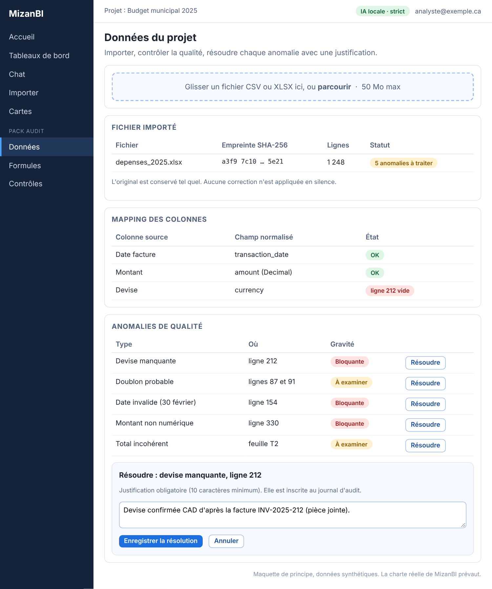
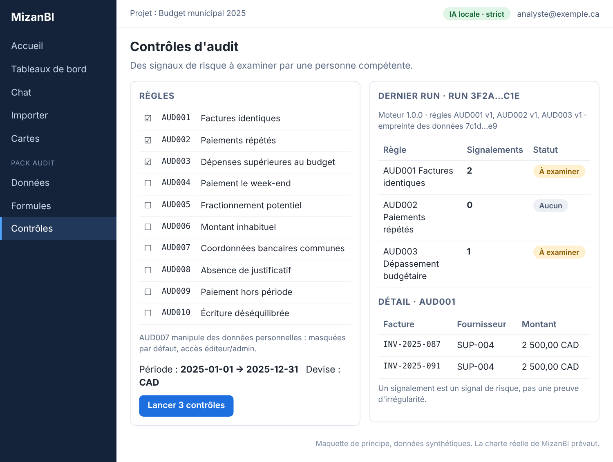
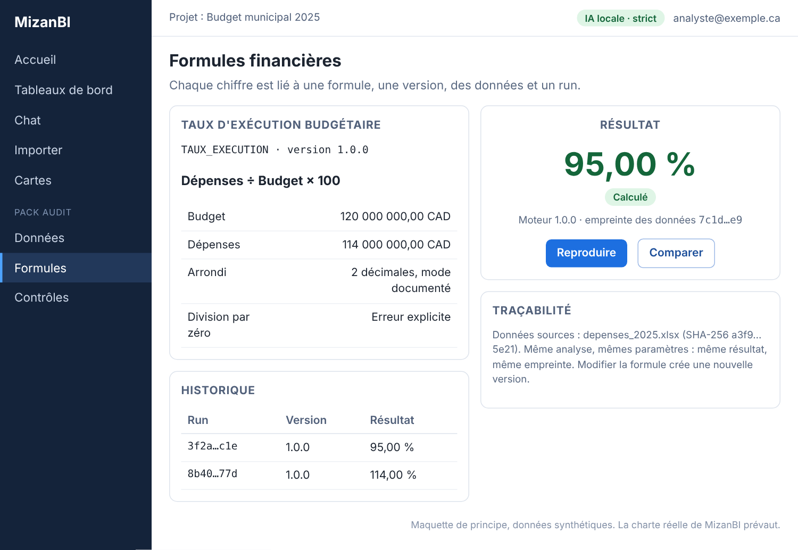
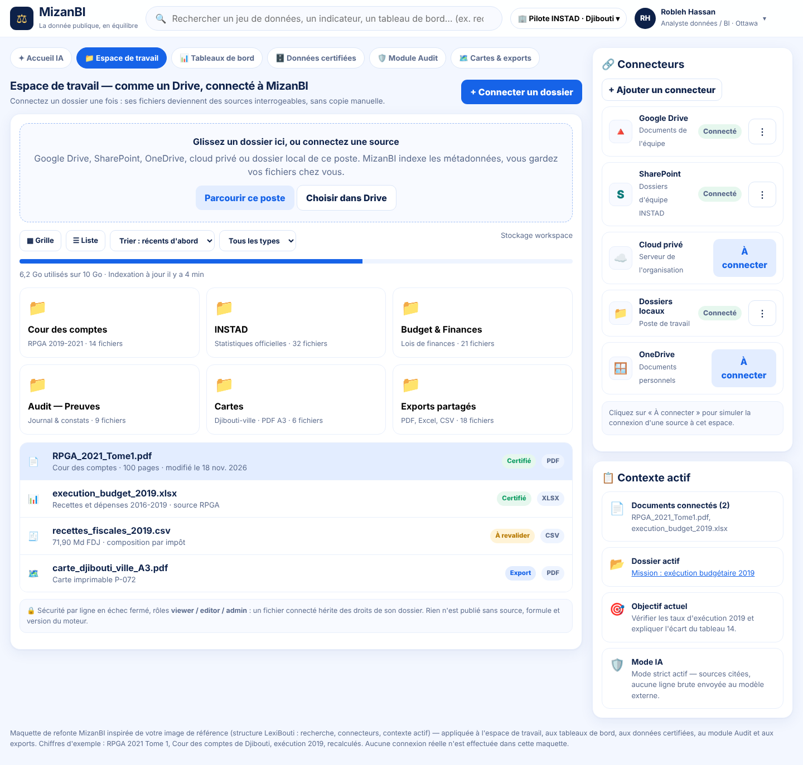
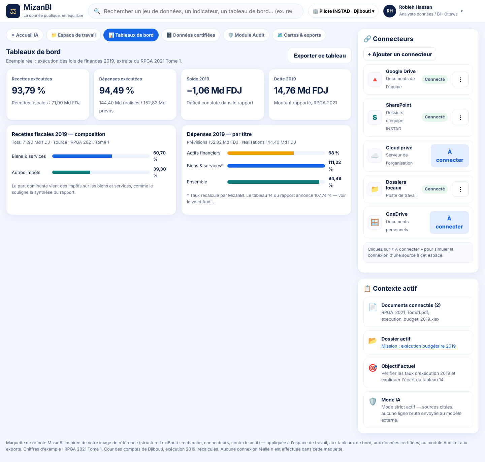
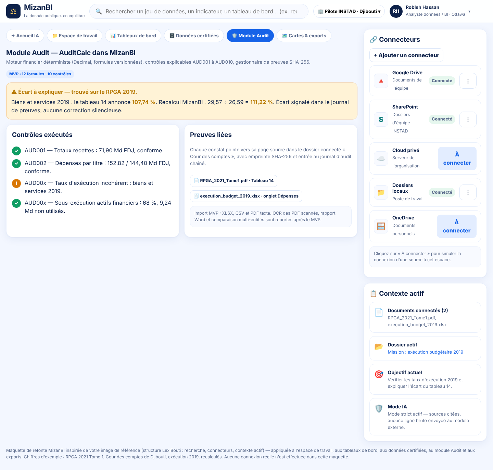
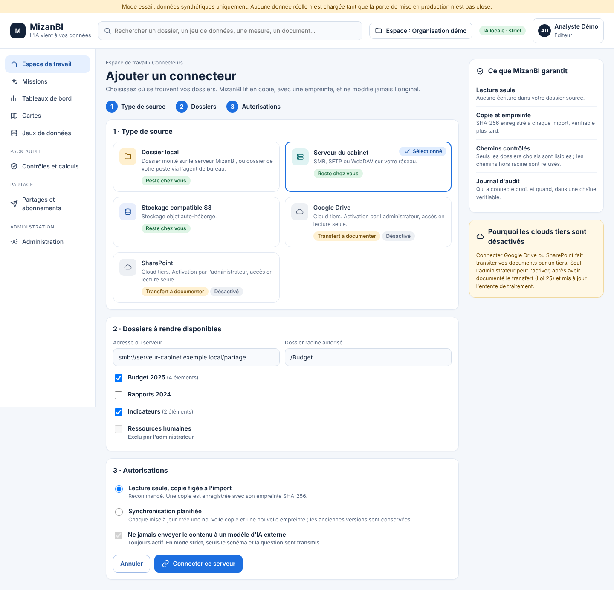
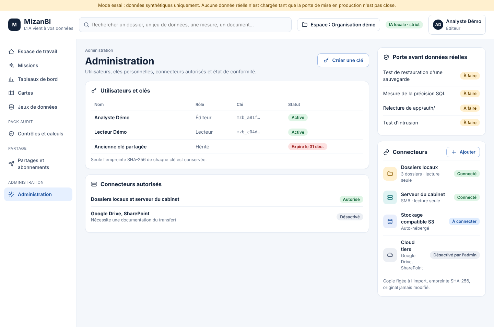

# Pack Audit (AuditCalc dans MizanBI) : propositions P-073 à P-086

> Document consolidé le 2026-11-19. À placer dans `docs/` (les images sont dans `docs/maquettes/`, chemins relatifs).
> Je n'ai pas vu `docs/proposals.md` : adapter les en-têtes à son format réel. Les routes (`/financial`, `/audit-data`, `/audit-rules`) et les statuts viennent des comptes rendus du propriétaire ; vérifier contre le code.
> Règle CLAUDE.md : hors plan, ne jamais implémenter sans accord. Statuts : `[x]` livré, `[ ]` en attente d'accord.

## 1. Synthèse

| Proposition | Titre | Statut | Dépendances |
|---|---|---|---|
| P-073 | Moteur de formules versionnées | Livré (API) | P-065, P-069 |
| P-074 | Import CSV/XLSX et qualité des données | Livré (API) | P-073 |
| P-075 | Contrôles d'audit AUD001 à AUD010 | Livré (API) | P-073, P-074 |
| P-076 | Preuves et revue humaine des anomalies | En attente | P-071, P-068, **P-083** |
| P-077 | Rapport d'audit documenté | En attente | P-073 à P-076, **P-082** |
| P-078 | Remplacement de Kimi, banc d'essai de modèles | En attente | P-070, P-065 |
| P-079 | Interface minimale du pack Audit | En attente (à confirmer) | P-073 à P-075 |
| P-080 | Chat branché sur le moteur de formules | Livré, vérification partielle | P-073, P-065, P-070 |
| P-081 | Packs pays (fiscalité et comptabilité) | En attente | P-073 à P-075, P-077 |
| P-082 | Neutralisation des formules à l'export | En attente | aucune |
| P-083 | Identité par personne (fin des clés partagées) | En attente | P-068, P-071 |
| P-084 | Porte « données réelles » | En attente | P-078, P-080, P-082, P-083 |
| P-085 | Téléversements : éditeurs seulement ou espace personnel | Ajoutée par le propriétaire (non reprise ici) ; **absorbée par P-086** | P-083 |
| P-086 | Espace de travail, connecteurs et assistant en bulle flottante | En attente | P-068, P-069, P-070, P-083 |

## 2. Décisions de cadrage

AuditCalc (cahier des charges v1.0, 2026-11-19) est intégré à MizanBI comme **pack optionnel « Audit »**, sous forme de modules dans le même dépôt. Il ne devient pas un produit séparé.

Déjà couvert par MizanBI (retiré du périmètre AuditCalc) : authentification et rôles, sécurité par ligne, tableaux de bord, exports PDF/Excel/bulletin, journal d'audit chaîné, certification de jeux de données, pages légales, déploiement Docker.

À construire (le cœur d'AuditCalc) : moteur de formules versionnées en Decimal, import et qualité des données, moteur de règles de contrôle, gestionnaire de preuves, rapport d'audit documenté.

**Principe central (non négociable)** : aucun résultat financier n'est publié sans formule identifiable, données sources, méthode de calcul, version du moteur et possibilité de reproduction.

### Décisions transversales à valider

- **D-1 IA locale pour le pack Audit.** Les données d'audit ne quittent jamais l'infrastructure. Le pack exige `LLM_PROVIDER=ollama`. Avec un fournisseur externe (Kimi), les fonctions IA du pack sont désactivées, même en mode strict. Le calcul reste déterministe, sans IA.
- **D-2 Distinction calcul certifié / exploration.** Un chiffre issu d'un run versionné reçoit la pastille « calculé » (liée à P-069). Un chiffre issu du text-to-SQL est étiqueté « exploratoire, non certifié ».
- **D-3 Lecture des données.** Toute lecture passe par `DataStore.execute` (sécurité par ligne P-068). Aucun `store.con.execute` pour des lignes. Tables du pack préfixées `audit_` (même logique que `sdmx_`).
- **D-4 Licences.** MIT/Apache/BSD uniquement. Éviter PyMuPDF (AGPL). Mettre à jour `THIRD_PARTY.md`.
- **D-5 Positionnement.** « Pack audit » optionnel de MizanBI, pas un nouveau produit. Il vise un autre acheteur (audit interne) que la BI souveraine Loi 25 : le valider avec un premier utilisateur avant de développer au-delà de P-075.

### Hors périmètre (volontairement)

Authentification et rôles (déjà faits, hors P-083), assistant IA dédié, tableaux de bord dédiés, packaging, PDF scannés et OCR, pack France (M57, M4, M21, M22), multi-utilisateur avancé, PostgreSQL, Qdrant. Ils pourront faire l'objet de propositions ultérieures.

## 3. Ordre recommandé (au 2026-11-19)

1. **Terminer P-080** : déclarer 2 ou 3 mesures avec `formula:` dans `semantic/model.yaml` ; vérifier le parcours du chat dans un navigateur.
2. **P-082** : neutraliser les formules à l'export (petit correctif, à faire avant tout rapport).
3. **P-083** : identité par personne (prérequis de P-076).
4. **P-079** (si non livré) puis **session d'essai avec un utilisateur réel** (règle D-5) : décide de la suite.
5. **P-076**, puis **P-077**.
6. **P-078** en parallèle dès que possible : le banc d'essai alimente aussi P-084.
7. **P-081a** (schéma et chargeur, sans pays), puis packs Canada, Djibouti, France, comparaisons.
8. **P-086** : après P-083. Faire **P-086a** (serveur, connecteurs de niveau A) avant la refonte de l'interface ; les clouds tiers (niveau B) restent désactivés. P-086 absorbe P-085. Le dossier réel n'est connecté qu'après la clôture de P-084.
9. **P-084** : planifier tôt (le test d'intrusion a un délai) ; **aucune donnée réelle avant sa clôture**.

## 4. Propositions

## P-073 — Moteur de formules financières versionnées

- [x] **Livré (API)**, d'après le compte rendu du propriétaire du 2026-11-19

**Raison.** C'est le cœur d'AuditCalc : des chiffres reproductibles et traçables. MizanBI a des mesures sémantiques (P-065), mais pas de registre de formules versionnées ni de runs reproductibles.

**Contenu.**
- `app/financial/` : registre lu depuis `rules/financial/*.yaml`. Chaque formule : code, version, variables, unités, précision, règle pour valeurs manquantes, comportement en division par zéro, négatifs.
- Calcul en `decimal.Decimal` hors pandas ; mode d'arrondi explicite et documenté ; montants sérialisés en chaînes dans l'API.
- Tables `audit_analysis_runs` (`engine_version`, `ruleset_version`, `input_snapshot_hash`, statut) et `audit_calculation_results`.
- Première bibliothèque : 8 formules budgétaires et 3 formules de recettes (taux d'exécution, dépassement, écart budget/réalisé, taux de recouvrement…). Les autres familles (dette, trésorerie, performance, comparaison) viennent plus tard.
- Exposition dans la couche sémantique : une mesure peut pointer vers une formule du registre. Le chat appelle le moteur au lieu de générer le calcul en SQL.
- Routes : lister les formules, détail d'une formule, lancer un calcul, lire un résultat, comparer. Toutes derrière `RequireRole`.

**Critères d'acceptation (tests de référence).**
- Budget 120 M, dépenses 114 M → 95 % d'exécution.
- Budget 50 M, dépenses 57 M → 114 %.
- Recettes prévues 60 M, encaissées 54 M → 90 % de recouvrement.
- Modifier une formule crée une nouvelle version, l'ancienne reste consultable.
- Même analyse et mêmes paramètres → même résultat (et même hash).
- Division par zéro et données manquantes traitées explicitement, jamais en silence.

**Impact.** Nouveau module et 2 tables. Aucune modification des routes existantes. Dépendance : P-065 (couche sémantique), P-069 (pastille).

---

## P-074 — Import tabulaire et contrôle de qualité des données

- [x] **Livré (API)**, d'après le compte rendu du propriétaire du 2026-11-19

**Raison.** Sans données normalisées et contrôlées, les formules et les règles ne valent rien. Le périmètre est volontairement limité à CSV/XLSX, sans PDF ni OCR (risque technique élevé, reporté).

**Contenu.**
- Import CSV et XLSX (openpyxl, MIT) : aperçu, détection de colonnes, mapping, reconnaissance des dates, montants et devises.
- Conservation de l'original, empreinte SHA-256, table `audit_documents`. Original jamais écrasé.
- Sécurité des fichiers : vérification réelle du type, limite de taille, noms neutralisés, protection contre la traversée de chemins (réutiliser le garde de l'import géo P-024), refus des exécutables.
- Table normalisée `audit_financial_records` (date, compte, montants Decimal, devise, exercice, document source).
- Contrôles qualité : valeurs manquantes, doublons, dates invalides, devises inconnues, montants non numériques, totaux incohérents, colonnes manquantes, valeurs hors limites. **Aucune correction silencieuse** ; chaque anomalie est listée et résoluble (`resolve`) avec justification.

**Critères d'acceptation.**
- Données sans devise → erreur ou validation requise.
- Réimport du même fichier → même empreinte, détecté comme doublon.
- Fichier aberrant (faux type, archive piégée, nom hostile) → refusé et journalisé.

**Impact.** 2 tables, 1 routeur. Dépendance : P-073 pour consommer les enregistrements normalisés.

---

## P-075 — Moteur de règles de contrôle d'audit (10 contrôles)

- [x] **Livré (API)**, d'après le compte rendu du propriétaire du 2026-11-19

**Raison.** Détecter des opérations à examiner, de façon explicable. On commence à 10 contrôles, pas 30 : la pertinence se valide avec de vrais utilisateurs avant d'en ajouter.

**Contenu.**
- `app/audit_rules/` : règles lues depuis `rules/audit/*.yaml` (code, version, paramètres, seuils, description, interprétation).
- Exécution déterministe en SQL paramétré via `DataStore.execute`. Aucune IA dans la détection.
- AUD001 factures identiques ; AUD002 paiements répétés ; AUD003 dépenses supérieures au budget ; AUD004 paiement le week-end ; AUD005 fractionnement potentiel ; AUD006 montant inhabituel ; AUD007 coordonnées bancaires communes ; AUD008 absence de justificatif ; AUD009 paiement hors période ; AUD010 écriture déséquilibrée.
- Table `audit_findings` : rattachée à un run, une règle et sa version, avec gravité et statut.
- Formulation : « signal de risque à examiner », jamais « fraude ». Pas de conclusion automatique.

**Critères d'acceptation.**
- Deux factures strictement identiques → signalement.
- Deux paiements distincts de même montant → pas de conclusion automatique.
- Dépenses sans budget disponible → signalement à examiner.
- Chaque anomalie renvoie à une règle identifiable et à sa version.
- AUD004 est présenté comme indicatif, pas comme une irrégularité.

**Impact.** 1 module, 1 table. AUD007 manipule des données personnelles : masquage par défaut, accès éditeur/admin, mention dans le registre de vie privée et le DPA.

---

## P-076 — Gestionnaire de preuves et revue humaine des anomalies

- [ ] En attente d'accord

**Raison.** Relier chaque conclusion à ses sources et exiger une validation humaine. Réutilise la chaîne d'audit P-071 au lieu de créer un nouveau journal.

**Contenu.**
- Tables `audit_evidence` et `audit_finding_evidence` (relation N–N) : document, page ou ligne, empreinte.
- Route de vérification d'intégrité d'une preuve (recalcul du SHA-256 et comparaison).
- Revue humaine d'une anomalie : statuts nouveau → en revue → confirmé / écarté, **justification obligatoire**, auteur et date. Rôles existants : editor revoit, admin valide ou révoque.
- Chaque action (import, run, revue, vérification) est écrite dans le journal chaîné P-071. Rappel de la limite connue : la chaîne n'est pas signée ; ancrer `entries` et `head` hors du serveur.

**Critères d'acceptation.**
- Modifier un fichier de preuve sur le disque fait échouer la vérification.
- Une anomalie ne peut pas passer « confirmée » sans justification et sans preuve liée.
- Aucun écrasement silencieux de données originales.

**Impact.** 2 tables. Dépendance : P-071 (chaîne), P-068 (sécurité par ligne).

---

## P-077 — Rapport d'audit documenté

- [ ] En attente d'accord

**Raison.** Le livrable final. Réutilise l'infrastructure d'export existante (PDF, Excel, bulletin HTML) au lieu d'un nouveau moteur de rapports.

**Contenu.**
- Gabarit « rapport d'audit » : méthodologie, version du moteur et des règles, sources avec empreintes, formules et calculs, anomalies avec statut de revue, limites, annexes.
- **Refus de publier** un résultat qui n'a pas de run, de formule, de version et de données sources (application du principe central).
- Mention fixe : l'outil fournit des signaux de risque ; il ne remplace ni un auditeur légal ni une institution de contrôle.
- Application de la décision D-1 : si `LLM_PROVIDER` n'est pas `ollama`, aucune fonction IA du pack n'est active ; la pastille `AiModeBadge` l'indique.

**Critères d'acceptation.**
- Générer deux fois le même rapport depuis le même run donne le même contenu chiffré.
- Un rapport sans run valide est refusé avec un message explicite.
- Le PDF indique la version du moteur, des règles et les empreintes des sources.

**Impact.** Extension de l'export existant, aucun nouveau service. Dépendance : P-073 à P-076.

---

## P-078 — Remplacement de Kimi pour le marché canadien : modèle local par défaut, option hébergée au Canada

- [ ] En attente d'accord

### Raison

- Kimi (via Groq) est un fournisseur externe. Même en mode strict (P-070), le schéma et la question quittent l'infrastructure du client, hors Canada. Pour des clients soumis à la Loi 25 ou du secteur public canadien, c'est un transfert à documenter et un point de friction à l'achat.
- Le pack Audit (P-073 à P-077, décision D-1) exige une IA locale.
- La précision text-to-SQL n'a jamais été mesurée (`eval.compare_strict` existe mais exige le modèle visé). Le choix du remplaçant doit se fonder sur une mesure, pas sur des comparatifs de blogues.

### Décision proposée

1. **Par défaut : Ollama local** avec un modèle sous licence MIT ou Apache 2.0 (cohérent avec la règle « Licences » de CLAUDE.md).
2. **Option : fournisseur hébergé au Canada** (candidat : Cohere via Bell AI Fabric) pour les clients sans GPU, activé par contrat, jamais par défaut.
3. **Kimi** : conservé uniquement pour le pilote Djibouti existant, retiré des déploiements canadiens. **DeepSeek** reste dev uniquement (`tools/dev_llm.py`), inchangé.

### Contenu

#### A. Banc d'essai (d'abord, avant tout changement de code produit)

- Jeu de questions : 60 à 100, **majorité en français**, le reste en anglais, sur des données synthétiques canadiennes (budgets municipaux, comptes publics). Inclure des questions destructives (doivent être refusées) et des questions avec synonymes de la couche sémantique.
- Modèles candidats (à confirmer au moment du test, la liste évolue vite) :
  - famille Qwen3-Coder (Apache 2.0), plusieurs tailles ;
  - OmniSQL 14B (Apache 2.0) ;
  - un modèle généraliste Apache 2.0 de taille comparable ;
  - Kimi, comme référence de comparaison.
- Mode : strict (schéma + question seulement) pour tous, puis ouvert pour Kimi seulement.
- Mesures par modèle : exactitude d'exécution (résultat identique à la requête de référence), taux de SQL invalide après 3 tentatives, taux de refus des requêtes destructives, latence médiane et p95, mémoire GPU/RAM, qualité des réponses en français.
- Outils : `python -m eval.run_eval` et `python -m eval.compare_strict`. Consigner le matériel de référence utilisé (aucune promesse de performance universelle).
- Point d'attention : certains modèles text-to-SQL spécialisés sont entraînés sur des questions en anglais seulement ; le français doit être testé explicitement.

#### B. Fournisseur hébergé au Canada (optionnel)

- Ajouter une valeur de `LLM_PROVIDER` pour le fournisseur retenu, derrière l'abstraction existante.
- Soumis au mode strict (`ai_policy.strict()`) : aucune ligne de données, résultat ni extrait de document envoyé.
- Toute nouvelle URL de base est ajoutée au lookahead de `tests/test_network_isolation.py` (règle CLAUDE.md).
- Avant d'écrire du code : vérifier par écrit les conditions du fournisseur (rétention des requêtes, entraînement sur les données clients, lieu de traitement, juridiction applicable, sous-traitants) et la licence d'usage. La résidence canadienne des données n'implique pas, à elle seule, l'absence d'accès par des autorités étrangères : à traiter dans le contrat et le DPA.

#### C. Alignement produit et conformité

- `LLM_PROVIDER` : valeur par défaut `ollama` pour toute nouvelle installation.
- `AiModeBadge` : distinguer « IA locale », « externe (Canada) » et « externe (hors Canada) ».
- `legalConfig.ts` : renseigner le fournisseur d'IA ; `docs/legal/dpa-fr.md` : ajouter le sous-traitant et les transferts le cas échéant.
- `THIRD_PARTY.md` : licences du ou des modèles retenus (les licences de modèles et les obligations de redistribution se vérifient une à une).
- Documenter le matériel minimal par taille de modèle dans `docs/` (guide d'installation).

### Critères d'acceptation

- Un rapport de banc d'essai versionné (`docs/eval-llm-2026-11.md`) avec les mesures ci-dessus, le matériel et les dates.
- Un modèle local par défaut retenu, avec un seuil d'exactitude fixé à l'avance par le propriétaire (aucun seuil annoncé tant que la mesure n'est pas faite).
- Une installation neuve sans variable d'environnement démarre en mode local, sans appel réseau externe (test d'isolation réseau vert).
- Si l'option hébergée est livrée : une requête n'emporte que schéma et question (test dédié), et le badge l'indique correctement.
- Suite verte : pytest, Vitest, `py_compile`.

### Impact

- Code : petit (nouveau fournisseur optionnel, badge, réglages). Le gros du travail est la mesure.
- Effet pour un client sans GPU : le mode local peut être lent ou imprécis sur petit matériel. D'où l'option hébergée.
- Changement visible pour le pilote Djibouti : aucun, tant que Kimi y reste configuré.

### Dépendances et risques

- Dépend de P-070 (mode strict) et P-065 (couche sémantique, dont le gain reste à mesurer).
- Risque : aucun modèle local ne répond au seuil sur le matériel cible. Dans ce cas, l'option hébergée devient le chemin principal pour ces clients, avec les conditions contractuelles ci-dessus.
- Les comparatifs de modèles trouvés en ligne (blogues) ne sont pas des sources fiables : seul le banc d'essai maison fait foi.

---

## P-079 — Interface minimale du pack Audit (mizanbi-client)

- [ ] En attente d'accord (**statut à confirmer** : le compte rendu du 2026-11-19 ne mentionne pas d'écrans livrés)

### Raison

P-073, P-074 et P-075 n'existent aujourd'hui que par appels d'API. Sans écran, personne ne peut essayer le pack, donc la validation par un premier utilisateur (décision D-5 de P-073 à P-077) est impossible. P-076 (preuves et revue) a aussi besoin d'un écran de signalements. On livre le strict minimum pour qu'un auditeur ou analyste puisse faire le parcours complet.

### Périmètre

Trois écrans et une section de navigation « Pack Audit » (Données, Formules, Contrôles), dans `mizanbi-client/`. Pages en `React.lazy` (comme le reste), titre d'onglet par écran (`lib/pageTitle.ts`), textes en français d'abord, anglais ensuite.

**Hors périmètre** : preuves et revue (P-076), rapport (P-077), édition de règles ou de formules, nouveaux tableaux de bord.

### Écran 1 — Données (`/audit-data`)



- Dépôt d'un fichier CSV ou XLSX (50 Mo max, extensions listées), avec affichage de l'empreinte SHA-256 et du nombre de lignes.
- Mapping des colonnes : colonne source → champ normalisé, avec l'état de chaque champ.
- Liste des anomalies de qualité : type, emplacement, gravité (Bloquante / À examiner).
- Résolution d'une anomalie : **justification obligatoire** (10 caractères minimum), inscrite au journal d'audit. Aucune correction silencieuse ; l'original n'est jamais modifié.
- Un fichier avec anomalie bloquante non résolue ne peut pas alimenter un calcul ni un contrôle.
- États à gérer : vide, chargement, fichier refusé (faux type, trop gros, nom hostile), erreur serveur.

### Écran 2 — Contrôles (`/audit-rules`)



- Choix des règles AUD001 à AUD010 (cases à cocher), période et devise, bouton « Lancer ».
- Résultat du run : identifiant, version du moteur, version de chaque règle, empreinte des données.
- Pour chaque règle, le nombre de signalements et le détail (facture, fournisseur, montant).
- Libellé fixe : « signal de risque, pas une preuve d'irrégularité ». Jamais le mot « fraude ».
- AUD007 : coordonnées bancaires masquées par défaut ; affichage réservé aux éditeurs et admins.
- AUD004 (week-end) est présenté comme indicatif.

### Écran 3 — Formules (`/financial`)



- Détail d'une formule : code, version, expression, variables, arrondi, comportement en division par zéro et en valeurs manquantes.
- Résultat avec pastille « Calculé », version du moteur, empreinte des données.
- Boutons « Reproduire » (relance le même run et vérifie que le résultat et l'empreinte sont identiques) et « Comparer » (deux versions ou deux périodes).
- Historique des runs d'une formule.

### Règles transversales

- Rôles : viewer lit ; editor importe, résout, lance ; admin a tout. Aucune action de mutation sans `RequireRole` côté serveur ; l'interface masque les boutons, elle ne remplace pas le contrôle serveur.
- Montants affichés depuis les chaînes Decimal de l'API : **aucun calcul financier dans React**, aucun `Number()` sur un montant.
- Accessibilité : navigation au clavier, libellés explicites, contraste vérifié (Lighthouse ou Playwright, comme noté dans l'audit web).
- Toute clé de stockage local ajoutée est documentée dans la page cookies (un test échoue sinon). Aucun service tiers chargé.

### Critères d'acceptation

- Parcours complet, vérifié en navigateur avec des données synthétiques : import → résolution des anomalies avec justification → lancement de 3 contrôles → lecture des signalements → affichage d'un calcul (95,00 % pour 114 M sur 120 M) → « Reproduire » donne le même résultat.
- Un viewer ne peut ni importer, ni résoudre, ni lancer (refus serveur vérifié, pas seulement boutons masqués).
- Tests Vitest sur les trois écrans (états vide, erreur, succès) ; `tsc --noEmit` propre ; build Vite propre ; suite pytest inchangée verte.
- Une session d'essai avec un utilisateur réel (auditeur, analyste ou comptable) ; retours consignés dans `docs/`. C'est la condition pour décider de continuer avec P-076 et P-077.

### Impact

Frontend seulement, aucune modification des règles ni des formules. Dépendance : P-073 à P-075. Risque : les retours de l'utilisateur d'essai peuvent remettre en cause le choix ou la formulation des contrôles ; c'est le but.

---

## P-080 — Chat branché sur le moteur de formules

- [x] **Livré, vérification partielle** (voir « État au 2026-11-19 » ci-dessous)

### Raison

Aujourd'hui le chat produit du text-to-SQL ; ses chiffres sont exploratoires. Si le moteur de formules et le chat donnent deux valeurs différentes pour la même notion, la confiance disparaît. Cette proposition applique la décision D-2 : un chiffre issu d'une formule versionnée est « Calculé » (avec formule, version et run) ; tout le reste est « Exploratoire, non certifié ».

### Contenu


- **Lien sémantique ↔ formule.** Une mesure de `semantic/model.yaml` peut déclarer `formula: TAUX_EXECUTION`. `GET /semantic/validate` échoue si la formule n'existe pas dans le registre (P-073).
- **Routage dans le pipeline.** Si la question correspond à une mesure liée à une formule, le pipeline appelle le moteur par une **fonction autorisée** (lire un résultat, lancer un calcul sur des paramètres résolus). Sinon, il suit le chemin text-to-SQL actuel et étiquette la réponse « Exploratoire, non certifié ».
- **Le modèle ne calcule jamais.** Il reconnaît la question et rédige la réponse ; les chiffres viennent du moteur. En mode strict (P-070), aucune ligne de données n'est envoyée au modèle.
- **Paramètres manquants** (période, projet, devise) : le chat pose la question, il ne devine pas.
- **Transparence** : chaque réponse « Calculé » affiche formule, version, run et un lien « Voir le calcul » vers l'écran Formules ; chaque réponse exploratoire permet de voir la requête SQL.
- **Sécurité** : liste blanche de fonctions, aucun SQL ni commande arbitraire fournis par le modèle ; `RequireRole` ; lectures par `DataStore.execute` (sécurité par ligne P-068, échec fermé) ; actions inscrites au journal chaîné ; les instructions contenues dans des documents importés sont traitées comme des données non fiables.

### Critères d'acceptation

- Pour une question liée à une formule, le chiffre du chat est **identique** à celui de `/financial` pour le même run (test automatisé).
- Question sans formule correspondante : réponse étiquetée « Exploratoire », jamais « Calculé ».
- Division par zéro ou donnée manquante : message d'erreur explicite, aucun chiffre inventé.
- Tentative d'injection dans un document importé : aucune fonction non autorisée n'est appelée.
- Jeu d'évaluation étendu dans `eval/` (cas calculés, exploratoires, ambigus, injections) ; résultats consignés par modèle testé dans P-078. Aucune précision annoncée avant mesure.
- Pastille visible dans l'interface (« Calculé » / « Exploratoire, non certifié ») et dans les exports qui reprennent une réponse du chat.

### Impact et risques

- Dépendances : P-073 (moteur), P-065 (couche sémantique), P-070 (mode strict) ; P-079 pour le lien « Voir le calcul ».
- Le chiffre lui-même ne dépend pas du modèle de langage, mais **la reconnaissance de la question en dépend** : mesurer avec le banc d'essai de P-078.
- Risque principal : associer la mauvaise formule à une question proche. Parades : toujours afficher la formule et les paramètres retenus, seuil de confiance, et dans le doute répondre « exploratoire » plutôt que « calculé ».
- Sans modèle local disponible, le calcul via l'interface reste utilisable ; seul le chat est dégradé.

### État au 2026-11-19 (compte rendu de fin de session)

- **Activation** : le chat ne calcule que si `semantic/model.yaml` déclare des mesures avec `formula:` et `formula_inputs:`. Le modèle actuel n'en contient aucune ; sans cela, le chat indique ce qui manque. **Action : déclarer 2 ou 3 mesures** (taux d'exécution, dépassement, recouvrement) et rejouer les cas de référence 120/114, 50/57 et 60/54.
- **Non vérifié** : parcours réel du chat dans un navigateur (la pastille n'est testée qu'en rendu statique) ; précision de reconnaissance sur formulations libres ; précision du text-to-SQL par modèle (mesure prévue par P-078).
- **Écart de séquence** : la règle D-5 prévoyait la session d'essai avant P-080 ; P-080 a été lancé sur accord explicite du propriétaire. La session d'essai reste la condition pour décider de P-076 et P-077.
- **Signalé par la revue, antérieur à P-080** : neutralisation des formules Excel absente à l'export (voir **P-082**) ; porteurs d'une même clé API éditeur confondus en un seul acteur (voir **P-083**).
- **Réserve consignée** : MOYEN-1, dans la section P-080 de `docs/proposals.md`.
- **Nettoyage** : la ligne « Commit » de `CLAUDE.md` mentionne encore la branche `feat/p073-financial-engine` ; à corriger. `ruff` n'a été lancé que sur les fichiers touchés (propres) ; les 66 erreurs préexistantes subsistent.

---

## P-081 — Packs pays : référentiels fiscaux et comptables versionnés (Canada, Djibouti, France)

- [ ] En attente d'accord

### Raison

Chaque pays a ses impôts, ses taxes, son plan comptable et son calendrier fiscal. Si ces règles sont écrites dans le code, chaque changement de taux oblige à modifier l'application, et les anciens résultats ne sont plus reproductibles. On sépare donc :

- **le moteur universel** (formules, contrôles de qualité, contrôles d'audit sans droit fiscal), déjà livré par P-073 à P-075 ;
- **le pack pays**, un ensemble de données versionnées, datées, sourcées et approuvées, qui paramètre le moteur.

Cela réalise la table `standard_packs` du cahier des charges AuditCalc (section 5 et 11) : « référentiels versionnés, datés, appliqués selon la catégorie d'organisme, développés à partir de sources officielles ».

### Principes (non négociables)

1. **Aucune valeur fiscale en dur dans le code.** Tout taux, seuil ou règle locale vient d'un pack.
2. **Aucune valeur de mémoire.** Chaque taux et chaque règle cite une source officielle consultée, avec date.
3. **Aucun défaut silencieux.** Pas de taux applicable à la date de la transaction → erreur explicite, jamais un taux « par défaut ».
4. **Reproductibilité.** Chaque run enregistre la version du pack (et son empreinte). Un changement de taux crée une nouvelle version ; les anciens runs restent inchangés et rejouables.
5. **L'outil détecte des écarts. Il ne donne ni conseil fiscal ni avis juridique.** Mention reprise dans les rapports (P-077).
6. **Pas de copie de textes protégés.** On stocke des paramètres et des références, pas les textes de loi.

### Contenu d'un pack

Arborescence (reprend `standards/` du cahier des charges, avec Djibouti ajouté) :

```
standards/
  common/                 # catégories standard, formats communs
  canada/<pack>/          # ex. fédéral + une province
  djibouti/<pack>/
  france/<pack>/
    pack.yaml             # identité, version, statut, approbation
    taxes.yaml            # taxes, taux, dates d'effet, sources
    accounts_map.yaml     # comptes locaux → catégories standard (modèle)
    fiscal_calendar.yaml  # exercice, échéances, date du fait générateur
    formats.yaml          # dates, nombres, devise, formats d'identifiants
    rules/                # règles de contrôle locales (YAML)
    provenance.md         # sources, dates de consultation, auteur, relecteur
```

#### `pack.yaml` (exemple de structure)

```yaml
code: CA-FED-QC            # exemple de forme, à définir avec le premier client
country: CA
subdivisions: [FED, QC]
accounting_framework: PSAS # cadre applicable à la catégorie d'organisme
version: 0.1.0
status: draft              # draft | reviewed | approved
effective_from: "[À RENSEIGNER]"
reviewed_by: "[À RENSEIGNER]"
approved_by: "[À RENSEIGNER]"
languages: [fr, en]
```

#### Fiche de taux (`taxes.yaml`) — structure uniquement, aucune valeur réelle

```yaml
- tax_code: "[À RENSEIGNER]"      # code interne du pack
  jurisdiction: "[À RENSEIGNER]"  # fédéral, province, région…
  label_fr: "[À RENSEIGNER]"
  rate: "[À RENSEIGNER]"          # chaîne Decimal, jamais un flottant
  base_type: "[À RENSEIGNER]"     # sur quoi la taxe se calcule
  effective_from: "[À RENSEIGNER]"
  effective_to: null              # null = toujours en vigueur
  tax_point: "[À RENSEIGNER]"     # date qui détermine le taux (facture, livraison, paiement…)
  rounding: "[À RENSEIGNER]"      # mode d'arrondi et tolérance de contrôle
  source_ref: "[À RENSEIGNER]"    # référence officielle
  source_url: "[À RENSEIGNER]"
  source_consulted_on: "[À RENSEIGNER]"
```

**Garde-fou, comme `legalConfig.ts`** : tant qu'un champ contient `[À RENSEIGNER]`, le pack ne peut pas passer au statut `reviewed` ni `approved`, et un test échoue.

### Modèle de données (tables préfixées `audit_`)

- `audit_standard_packs` : id, pays, code, version, statut, dates d'effet, approbateur, date d'approbation, empreinte du contenu.
- `audit_tax_rates` : pack, juridiction, code de taxe, taux (chaîne Decimal), base, `effective_from`, `effective_to`, source.
- `audit_account_mappings` : projet, pack, compte local, catégorie standard, auteur, justification.
- `audit_fx_rates` : date, devise source, devise cible, taux, **source**.
- `projects` : ajouter pays, subdivision, cadre comptable, pack et version.
- `audit_analysis_runs` : ajouter la version et l'empreinte du pack.

### Fonctionnement d'une analyse

1. À la création du projet : pays, subdivision, cadre comptable, exercice, devise → un pack et une version sont liés.
2. Import (P-074) puis **mapping des comptes locaux vers les catégories standard**, validé avec justification, réutilisable ensuite.
3. Exécution :
   - formules universelles sur les catégories standard ;
   - formules et règles du pack (ex. taxe recalculée = base × taux applicable à la date) ;
   - contrôles d'audit existants (AUD001 à AUD010).
4. Rapport (P-077) : version du moteur, des règles **et du pack**, statut du pack (`draft` affiche un bandeau « référentiel non validé »).

#### Contrôles locaux proposés (à confirmer avec un expert par pays)

- **Écart de taxe** : taxe déclarée ≠ taxe recalculée au-delà de la tolérance d'arrondi du pack.
- **Taux inapplicable** : taux utilisé absent du pack pour la date et la juridiction.
- **Format d'identifiant** : numéro d'enregistrement fiscal ne respecte pas le format du pack. Le contrôle porte sur le format uniquement : il ne confirme pas l'existence de l'entité.

### Comparaison entre pays

- Devise commune obligatoire avec taux de change datés et sourcés ; taux manquant → erreur.
- Cadres comptables différents (ex. PSAS, M57, plan comptable local) : tant qu'aucune table de correspondance validée n'existe, l'indicateur est marqué **« non comparable »**, jamais calculé en silence.
- Changements de périmètre, de devise ou de méthode signalés (exigence AC-05).

### Gouvernance d'un pack

- Statuts : `draft` → `reviewed` (relu par une personne compétente du pays) → `approved`.
- En production, seuls les packs `approved` sont sélectionnables par défaut ; un `draft` est utilisable en test avec bandeau visible.
- Un changement de taux ou de règle = nouvelle version, avec date d'effet et fiche de provenance mise à jour. Une veille périodique sur les sources officielles est planifiée par pack.
- Les données propres à un pays peuvent être pilotées par un expert local sans toucher au code : il édite des fichiers YAML relus et testés.
- Pour Djibouti, les textes officiels peuvent provenir de la veille du projet Lex.Dji, sous réserve de leur statut de publication ; certaines données ne sont pas disponibles sous forme exploitable et devront être saisies à partir de la source officielle.

### Livraison par étapes

| Étape | Contenu | Condition de sortie |
|---|---|---|
| P-081a | Schéma, tables, migrations, chargeur de pack, garde-fou `[À RENSEIGNER]`, pack `common` (catégories standard) | Tests verts, aucun taux dans le code |
| P-081b | Pack Canada : fédéral + **une** province (choisie avec le premier client) | Relu par une personne compétente |
| P-081c | Pack Djibouti | Relu par une personne compétente localement |
| P-081d | Pack France | Relu par une personne compétente |
| P-081e | Comparaisons entre pays | Table de correspondance validée |

Ordre suggéré : Canada, Djibouti (pilote), France. Un pays à la fois.

### Critères d'acceptation

- Même fichier analysé avec deux versions d'un pack → deux runs distincts, chacun reproductible (même résultat, même empreinte).
- Transaction hors de toute plage de dates de taux → erreur explicite.
- Pack contenant `[À RENSEIGNER]` → impossible à passer en `reviewed` ou `approved` (test automatisé).
- Taux de change absent pour une comparaison → erreur ; cadres non mappés → « non comparable ».
- Aucun taux, seuil ou règle fiscale ne figure dans `app/` (test de recherche dans le code).
- Le rapport indique le pays, le pack, sa version et son statut.
- Suite verte : pytest, Vitest, `py_compile`.

### Impact

- Backend : nouveau module, 4 tables, migration de `audit_analysis_runs`.
- Interface (P-079) : choix du pays et du pack à la création du projet, écran de correspondance des comptes. Hors maquettes de P-079 ; à ajouter après P-081a.
- Dépendances : P-073, P-074, P-075 ; P-077 pour l'affichage dans le rapport.
- Licences : les sources de référence ne sont pas redistribuées ; seuls les paramètres et références sont stockés.

### Hors périmètre

Déclarations fiscales, transmission aux administrations, calcul complet de l'impôt sur le revenu ou sur les sociétés, paie, retenues à la source, conseil fiscal.

### Risques

- **Coût de validation** : chaque pack exige une relecture par une personne compétente du pays. C'est le facteur limitant, pas le code.
- **Disponibilité des données** : variable selon le pays, en particulier Djibouti.
- **Obsolescence** : taux et plans comptables changent ; sans veille, un pack approuvé devient faux. La date de dernière vérification doit être visible.
- **Dérive de périmètre** : le pack ne doit pas devenir un outil de conformité fiscale. Les rapports le rappellent.

---

## P-082 — Neutralisation des formules dans tous les exports (injection CSV/Excel)

- [ ] En attente d'accord

### Raison

Signalé par la revue lors de P-080, antérieur à cette proposition : les exports ne neutralisent pas les cellules texte qui commencent par `=`, `+`, `-` ou `@`. Le pack Audit importe des fichiers de tiers (fournisseurs, bénéficiaires, descriptions) puis les ré-exporte. Une cellule du type formule peut alors s'exécuter à l'ouverture dans Excel ou LibreOffice (appel externe, fuite de données, lancement d'une commande selon la configuration). C'est un vecteur réaliste dans un outil d'audit.

### Contenu

- Une **fonction unique de neutralisation**, appliquée à toute cellule de type texte avant écriture dans un export : si la valeur commence par `=`, `+`, `-`, `@`, tabulation ou retour chariot, elle est préfixée d'une apostrophe.
- Exports à couvrir (inventaire à confirmer dans le code) : CSV, Excel, export de tuiles, bulletin, **SDMX-CSV** (P-066), pièces jointes des **abonnements courriel** (P-067), et tout futur export du pack Audit (P-077).
- Pour Excel, écrire les textes comme cellules de type chaîne explicite, en plus du préfixe.
- Les **valeurs numériques réelles** (types numériques, montants Decimal exportés comme nombres) ne sont pas modifiées : seule une cellule de type texte est neutralisée.
- L'import reste intact : l'original n'est jamais modifié (principe d'AuditCalc). La neutralisation se fait uniquement à la sortie.
- Documenter la limite : un texte comme `-5` stocké comme chaîne apparaîtra avec une apostrophe, par prudence.

### Critères d'acceptation

- Jeu de charges de test (formules d'appel de lien, appel externe, `@SUM`, `+1`, `-1`, tabulation, retour chariot) : aucune cellule d'un export ne commence par un caractère déclencheur, dans chaque format.
- Aller-retour visible : le texte lisible par l'utilisateur reste identique, hors l'apostrophe.
- Les montants numériques exportés restent des nombres exploitables.
- Test d'inventaire : tout nouvel export qui n'utilise pas la fonction fait échouer la suite.
- pytest, Vitest, `py_compile` verts.

### Impact

Petit correctif transversal, sans nouvelle table. Peut toucher des tests existants qui comparent le contenu exact des exports. Dépendances : aucune. À faire avant que le pack Audit ne produise des rapports (P-077).

---

## P-083 — Identité par personne pour les actions éditeur (fin des clés partagées)

- [ ] En attente d'accord

### Raison

Signalé par la revue lors de P-080, antérieur à cette proposition : les porteurs d'une même clé API éditeur partagent le même acteur. Le journal d'audit chaîné (P-071) ne peut donc pas dire **qui** a résolu une anomalie, lancé un contrôle ou revu un signalement. P-076 exige un auteur identifiable avec justification pour chaque résolution et revue, et le rapport d'audit (P-077) s'appuie sur cette attribution. Sans identité individuelle, la traçabilité promise n'est pas tenue.

### Contenu

- **Une clé API = un propriétaire** (un utilisateur nommé), avec date de création, dernière utilisation, révocation et rotation. Aucune clé « d'équipe ».
- **Actions sensibles par session nominative** : résolution d'anomalie (P-074), revue et validation (P-076), lancement de run de l'audit, modification de formules ou de packs (P-081) exigent une session utilisateur, pas une clé partagée.
- **Journal** : chaque événement enregistre l'identifiant de la personne, la méthode (session ou clé) et l'identifiant de la clé.
- **Migration** : les clés existantes reçoivent un propriétaire, ou sont marquées « partagée (héritée) » avec droits réduits (lecture) puis retirées après une période annoncée.
- **Sécurité par ligne (P-068)** : une clé hérite des périmètres de son propriétaire ; sans périmètre, l'accès reste refusé (échec fermé, comportement existant).
- **Relecture** : la règle Sécurité de `CLAUDE.md` s'applique (relecture par `security-reviewer`, puis relecture humaine du propriétaire, voir `docs/auth-review.md`).

### Critères d'acceptation

- Deux personnes avec deux clés produisent deux acteurs distincts dans le journal ; `/audit/verify` reste valide.
- Résolution ou revue avec une clé partagée héritée : refusée avec un message explicite.
- Révoquer une clé la rend inutilisable immédiatement ; la rotation ne casse pas les périmètres de l'utilisateur.
- Aucune route de mutation sans `RequireRole` ; tests de non-régression sur les rôles viewer / editor / admin.
- pytest, Vitest, `py_compile` verts.

### Impact

Touche `app/auth/` : changement sensible, relecture obligatoire. Dépendances : P-068, P-071. **Prérequis de P-076.** Alimente aussi la relecture d'auth de P-084.

---

## P-084 — Porte « données réelles » : points à régler avant toute donnée non synthétique

- [ ] En attente d'accord

### Raison

Plusieurs points restent ouverts dans la section « Reprise » de `CLAUDE.md` et le résumé du projet. Le pack Audit promet la reproductibilité et la restauration ; MizanBI promet que les données restent chez le client. Tant que les quatre points suivants ne sont pas réglés, **aucune donnée réelle** (client, organisme, dossier non synthétique) ne doit être chargée. Cette proposition est surtout une liste de contrôle, avec des critères de sortie vérifiables.

### Les quatre points

**1. Restauration d'une sauvegarde testée.** Jamais testée à ce jour.
- Procédure écrite (`docs/`) : sauvegarde, restauration sur une copie, vérification.
- Vérifications après restauration : empreintes SHA-256 des originaux, `GET /audit/verify` (chaîne du journal), pastilles de certification (P-069), un run rejoué donne le même résultat et la même empreinte.
- Mesure du temps de restauration sur le matériel de référence documenté (aucune promesse universelle).
- Sauvegardes chiffrées ; clés conservées séparément.
- À refaire après chaque changement de schéma (migrations).

**2. Précision SQL mesurée.** Aucune mesure exploitable à ce jour.
- Banc d'essai de **P-078** sur le modèle visé, en mode strict, avec un jeu de questions majoritairement françaises.
- Ajouter la mesure de **reconnaissance des formulations libres** de P-080 (bonne formule, bons paramètres, repli « exploratoire » en cas de doute).
- Seuils fixés **par le propriétaire avant** la mesure, consignés dans `docs/eval-llm-2026-11.md`. Aucune précision annoncée avant ces mesures.

**3. Relecture humaine de `app/auth/`.** Règle Sécurité de `CLAUDE.md` : en attente du propriétaire (`docs/auth-review.md`).
- Inclure les changements de **P-083** (clés par personne, actions par session).
- Inclure `erase_account` (P-064), qui attend la relecture `security-reviewer` et du propriétaire, et la sécurité par ligne (P-068) : relecture du propriétaire due.

**4. Test d'intrusion par un tiers.**
- Portée proposée : API et sessions, import de fichiers (types, archives, noms), exports (**P-082**), sécurité par ligne, partage public, abonnements courriel, injection d'instructions dans des documents importés (chat et IA).
- Corriger les constats critiques et élevés avant d'accepter des données ; conserver le rapport et les preuves de correction.

### Autres points déjà notés dans le projet (à traiter avant production, pas bloquants pour un essai sur données synthétiques)

- **Chiffrement au repos** (base, fichiers, sauvegardes) : non traité dans le cahier des charges d'AuditCalc ni dans le résumé de MizanBI ; à décider. *(Point ajouté par ce document, pas tiré du dépôt.)*
- Envoi SMTP jamais testé sur un vrai serveur ; pas de double opt-in.
- Ancrer `entries` et `head` du journal hors du serveur (la chaîne n'est pas signée).
- Pages juridiques et DPA : compléter `legalConfig.ts`, validation par un juriste, puis `draft: false`.
- Licences : CERD (écrite), BIE et BCD (Q-001) ; ne jamais écrire « certifié INSTAD » sans confirmation écrite.
- `LLM_PROVIDER` sur Oracle, rebuild de l'image, `VITE_SITE_URL`, HSTS et Lighthouse sur l'URL publique.

### Critères de sortie

- Liste de contrôle signée par le propriétaire, avec dates, pour chacun des quatre points, et références aux preuves (procédure, rapport de mesure, compte rendu de relecture, rapport de test d'intrusion).
- Tant qu'un point reste ouvert : mention « données synthétiques uniquement » dans la documentation d'installation et dans l'interface d'administration.

### Impact

Peu de code. Beaucoup de temps de relecture, de mesure et de dépendance à un tiers (test d'intrusion). Dépendances : P-078, P-080, P-082, P-083 ; s'applique aussi à tout connecteur de P-086 pointant vers des fichiers réels. À planifier tôt, car le délai d'un test d'intrusion n'est pas compressible.

---

## P-086 — Espace de travail et connecteurs (refonte des volets)

- [ ] En attente. Dépend de P-068, P-069, P-070, P-083. Remplace et élargit **P-085** (qui ne couvrait que les téléversements).

### Raison

Aujourd'hui, un utilisateur doit importer ses fichiers un par un, et seuls les éditeurs peuvent le faire. Les utilisateurs veulent un **espace de travail de type Drive** : connecter leurs dossiers une fois, puis interroger les fichiers depuis le chat, les tableaux de bord et le pack Audit. La disposition retenue reprend l'image de référence (LexiBouti) : barre de recherche, zone centrale, colonne de droite « Connecteurs » et « Contexte actif ».

La difficulté est la souveraineté. MizanBI promet que les données ne quittent pas l'infrastructure (isolation réseau testée, décision D-1). Un connecteur Google Drive ou SharePoint contredit cette promesse. La proposition range donc les connecteurs en deux niveaux.

### Décision proposée : deux niveaux de connecteurs

| Niveau | Connecteurs | État par défaut | Pourquoi |
|---|---|---|---|
| **A, reste chez vous** | Dossier local (monté côté serveur), serveur du cabinet (SMB, SFTP, WebDAV), stockage compatible S3 auto-hébergé | Disponible | Aucun tiers dans le chemin des données |
| **B, cloud tiers** | Google Drive, SharePoint, OneDrive | **Désactivé**, activable par un administrateur seulement | Les documents transitent par un tiers : transfert à documenter (Loi 25), entente de traitement à mettre à jour, `tests/test_network_isolation.py` à adapter |

Règles communes aux deux niveaux :
- **Lecture seule.** MizanBI n'écrit jamais dans la source.
- **Copie figée à l'import**, avec empreinte SHA-256 enregistrée. Une mise à jour crée une nouvelle copie et une nouvelle empreinte ; les anciennes versions restent.
- **Chemins contrôlés** : seuls les dossiers choisis sont lisibles, avec une racine autorisée ; tout chemin hors racine est refusé (y compris `..` et liens symboliques).
- **Droits hérités** : un fichier connecté hérite des rôles du dossier (viewer, editor, admin) et passe par `DataStore.execute` (sécurité par ligne, P-068).
- **IA** : le contenu d'un fichier n'est jamais envoyé à un modèle externe. En mode strict (P-070), seuls le schéma et la question sont transmis. Avec le pack Audit, IA locale uniquement (D-1).
- **Journal d'audit chaîné** : qui a connecté quoi, quand, avec quelle empreinte.
- **Pas de secrets dans les réponses** : les identifiants des connecteurs sont chiffrés au repos et jamais renvoyés par l'API.

### Écrans (refonte de chaque volet)

Tous les écrans gardent la même colonne de droite. Données synthétiques.

**1. Espace de travail** (Drive-like : dossiers, fichiers, statuts, glisser-déposer, stockage)



**2. Assistant : bulle flottante conversationnelle** (présente sur chaque écran, ouverte ici sur les tableaux de bord ; plan d'action, chiffres « Calculé » ou « Exploratoire, non certifié »)


**3. Tableaux de bord** (tuiles liées aux mesures P-080, source et formule affichées)



**4. Module Audit** (signaux de risque, preuves liées, écart signalé et non corrigé en silence)



**5. Ajout d'un connecteur** (3 étapes ; les clouds tiers apparaissent désactivés avec l'explication)



**6. Administration** (utilisateurs, clés personnelles P-083, connecteurs autorisés, porte « données réelles »)



Les volets Jeux de données, Cartes et Partages et abonnements suivent le même gabarit (canevas de conception, planches 4 à 8).

### Assistant en bulle flottante

L'IA n'est plus une page « Missions » : c'est une **bulle conversationnelle flottante**, en bas à droite de tous les écrans.
- Fermée, elle affiche « Assistant MizanBI » ; ouverte, un panneau de chat se superpose à l'écran sans le quitter.
- Elle lit le **contexte de l'écran** (tableau de bord affiché, fichier sélectionné, projet actif) et l'indique dans son en-tête (« Contexte : 2 documents · mode strict »).
- Elle affiche son plan d'action, et chaque chiffre porte la pastille « Calculé » (formule, version, run) ou « Exploratoire, non certifié ».
- L'état ouvert ou fermé et la conversation persistent quand on change d'écran ; le panneau se réduit avec le bouton « – ».
- Accessibilité : ouverture au clavier, focus visible, fermeture par Échap, annonce des nouvelles réponses aux lecteurs d'écran ; sur mobile, le panneau occupe tout l'écran.
- L'historique des missions passe dans le panneau (liste des conversations), pas dans une page dédiée.

### Contenu

**Serveur (`app/workspace/`)**
- Table `workspace_sources` (type, nom, racine autorisée, mode, `enabled_by`, état) et `workspace_files` (chemin relatif, taille, SHA-256, version, statut, source). Préfixe de tables cohérent avec D-3.
- Interface `Connector` (lister, lire un flux, empreinte) avec une implémentation par type ; niveau A en premier.
- Import en copie : lecture en flux, calcul SHA-256, écriture dans le stockage de l'espace, enregistrement du statut (Importé, Indexé, Anomalies, Certifié, Périmé).
- Indexation : CSV, XLSX, SDMX et PDF texte pour commencer. OCR et PDF scannés hors périmètre.
- Variable `WORKSPACE_ALLOW_THIRD_PARTY=false` par défaut. Tant qu'elle est fausse, les connecteurs de niveau B n'existent pas côté API (pas seulement masqués côté interface).
- Endpoints sous `RequireRole` : lecture (viewer), import (editor), création et activation des connecteurs (admin).

**Client (`mizanbi-client/`)**
- Nouvelle navigation latérale : Espace de travail, Tableaux de bord, Cartes, Jeux de données, Pack Audit, Partages, Administration.
- Colonne de droite commune : composants `ConnectorsPanel`, `ActiveContext` et `AssistantBubble` (monté une fois à la racine, partagé par tous les écrans) (documents, projet actif, objectif).
- Statuts en pastilles avec texte (jamais la couleur seule), navigation clavier, contraste AA.

**Question ouverte : « Dossiers locaux »**
Une application web ne lit pas le disque de l'utilisateur. Deux options :
1. Dossier monté côté serveur (volume Docker en lecture seule), simple et sûr. **Recommandé pour la première version.**
2. Agent de bureau sur le poste qui pousse les copies. Plus proche de l'image, mais plus de surface d'attaque et un composant de plus à maintenir.

### Critères d'acceptation

- Un administrateur connecte un dossier de niveau A ; un viewer voit ses fichiers, un editor les importe, un viewer ne peut pas les importer.
- Un chemin hors de la racine autorisée (`../`, lien symbolique, chemin absolu) est refusé et journalisé.
- Chaque import enregistre un SHA-256 ; modifier le fichier source crée une nouvelle version sans écraser l'ancienne.
- Avec `WORKSPACE_ALLOW_THIRD_PARTY=false`, un appel pour créer un connecteur Google Drive ou SharePoint renvoie une erreur, et `tests/test_network_isolation.py` passe.
- Un utilisateur sans droit sur un dossier ne voit ni ses fichiers ni leurs noms (test de non-régression sécurité par ligne).
- Aucun identifiant de connecteur n'apparaît dans les réponses API ni dans les journaux.
- Aucun contenu de fichier n'est envoyé à un modèle externe (test avec un faux fournisseur qui échoue si appelé).
- Les 9 écrans respectent le gabarit commun et passent une vérification d'accessibilité de base (clavier, contrastes).

### Hors périmètre

Écriture dans la source, édition en ligne des fichiers, synchronisation temps réel, OCR, partage externe de dossiers, agent de bureau (à décider), connecteurs de niveau B (proposition séparée si un client l'exige et signe l'entente).

### Impact

Gros chantier côté client (refonte de la navigation et de chaque volet), modéré côté serveur. À découper : **P-086a** serveur et niveau A (dossier monté, SMB/SFTP), **P-086b** espace de travail et colonne de droite, **P-086c** refonte des autres volets, **P-086d** (optionnel) niveau B.

### Dépendances et risques

- **P-083** (identité par personne) d'abord : sans clés personnelles, impossible de savoir qui a connecté ou importé quoi.
- **P-084** : un connecteur lit des fichiers qui peuvent contenir des données réelles. Aucune connexion à un dossier réel avant la clôture de la porte.
- **Risque de licence** : les données géographiques (couches de cartes) ont une licence CERD non confirmée ; la planche Cartes l'affiche.
- **Risque d'image de marque** : la maquette de départ montrait Google Drive et SharePoint comme « Connecté ». Les présenter ainsi à un client qui exige la souveraineté serait trompeur ; ils doivent apparaître désactivés tant que l'administrateur ne les active pas.
- **Chiffres de la maquette 05 à 08** : ils viennent de votre fichier (RPGA 2021, tome 1) et n'ont pas été revérifiés ici. L'écart 107,74 % contre 111,22 % doit être recalculé sur le document source avant toute démonstration.

---

## Annexe A : prompts Claude Code pour P-086a et P-086b

À lancer dans cet ordre, dans deux sessions séparées. P-086b dépend de P-086a et de P-083. Ne pas les fusionner en une seule session : la première touche des chemins de fichiers, des droits et des identifiants (relecture de sécurité obligatoire) ; la seconde est de l'interface, avec un autre risque.

### Prompt 1 : P-086a, serveur et connecteurs de niveau A

````text
/model opus

Tâche : P-086a (serveur de l'espace de travail et connecteurs de niveau A). Lis d'abord CLAUDE.md et la section P-086 de docs/proposals_pack-audit_P073-P086.md (si le fichier n'est pas dans docs/, dis-le-moi). Cette tâche touche des chemins de fichiers, les droits et les identifiants : changement sensible.

Avant de coder
1. Vérifie que P-083 (clés par personne) est livré. Sinon, arrête-toi et dis-le-moi : P-086a en dépend pour le journal (qui a connecté quoi).
2. Montre-moi un plan court (fichiers touchés, tables, endpoints, tests) et attends mon accord. Rien hors de ce plan sans accord.
3. Deux choix à me faire valider dans le plan :
   - le format du stockage des copies figées (répertoire, nommage, versions) ;
   - la façon de refuser les chemins dangereux (`..`, liens symboliques, chemins absolus, noms avec octet nul).

Périmètre (P-086a seulement)
- `app/workspace/` : interface `Connector` (lister, lire en flux, empreinte) avec deux implémentations : dossier monté côté serveur (volume en lecture seule) et SMB/SFTP si une bibliothèque sous licence MIT/Apache/BSD existe (sinon, dossier monté seulement, et dis-le-moi).
- Tables `workspace_sources` (type, nom, racine autorisée, mode, enabled_by, état) et `workspace_files` (chemin relatif, taille, SHA-256, version, statut, source). Préfixe de tables cohérent avec D-3.
- Import en copie figée : lecture en flux, SHA-256, nouvelle version si le fichier source change (l'ancienne reste), statuts Importé / Indexé / Anomalies / Certifié / Périmé.
- Indexation CSV, XLSX, SDMX, PDF texte. Pas d'OCR, pas de PyMuPDF (AGPL).
- `WORKSPACE_ALLOW_THIRD_PARTY=false` par défaut : les types Google Drive, SharePoint et OneDrive n'existent pas côté API (erreur explicite), pas seulement masqués côté client.
- Endpoints sous RequireRole : lecture = viewer, import = editor, création et activation de connecteurs = admin.
- Toute lecture de lignes passe par `DataStore.execute` (sécurité par ligne, P-068). Les droits d'un fichier sont ceux de son dossier.
- Entrées dans le journal d'audit chaîné pour chaque connexion, import et refus.
- Identifiants de connecteurs : chiffrés au repos, jamais renvoyés par l'API ni écrits dans les journaux.
- Le contenu d'un fichier n'est jamais envoyé à un modèle externe.

Hors périmètre (ne pas faire)
Client (mizanbi-client), niveau B (clouds tiers), agent de bureau, écriture dans la source, OCR, synchronisation temps réel.

Critères d'acceptation, chacun avec un test
- Admin connecte un dossier ; viewer voit les fichiers mais ne peut pas importer ; editor importe.
- Chemin hors racine (`../`, lien symbolique, absolu) refusé et journalisé.
- Un import enregistre un SHA-256 ; modifier la source crée une version sans écraser l'ancienne.
- Avec `WORKSPACE_ALLOW_THIRD_PARTY=false`, créer un connecteur Google Drive ou SharePoint renvoie une erreur, et `tests/test_network_isolation.py` passe.
- Un utilisateur sans droit sur un dossier ne voit ni ses fichiers ni leurs noms.
- Aucun identifiant de connecteur dans les réponses API ni dans les journaux (test qui le vérifie).
- Faux fournisseur LLM qui fait échouer le test s'il reçoit du contenu de fichier.

Fin de tâche
- Lance toute la suite pytest et donne-moi le nombre de tests avant et après.
- Lance le sous-agent security-reviewer sur `app/workspace/` et sur les changements d'authentification ; donne-moi ses constats par gravité.
- Mets à jour docs/proposals.md (statut de P-086a) et THIRD_PARTY.md si une dépendance est ajoutée.
- Termine par un résumé : ce qui est fait, ce qui n'est pas vérifié, les fichiers non suivis laissés de côté, et ce qui reste avant P-084.
- Ne commite pas sans mon accord.
````

### Prompt 2 : P-086b, espace de travail, colonne de droite et bulle flottante (mizanbi-client)

````text
Tâche : P-086b (interface : espace de travail, colonne de droite commune, assistant en bulle flottante) dans mizanbi-client. Lis d'abord CLAUDE.md, la section P-086 de docs/proposals_pack-audit_P073-P086.md et les maquettes docs/maquettes/05-assistant-bulle.png, 06-espace-de-travail.png et 09-ajout-connecteur.png. Les maquettes montrent la disposition ; l'identité visuelle, les composants et les chaînes de caractères existants du client priment.

Avant de coder
1. Vérifie que P-086a est livré (endpoints de l'espace de travail). Liste ceux que tu utiliseras. Si un endpoint manque, arrête-toi et dis-le-moi : n'invente pas d'API et ne modifie pas le serveur.
2. Montre-moi un plan court (routes, composants, état partagé, tests) et attends mon accord.

Périmètre (P-086b seulement)
- Espace de travail (route principale) : dossiers, liste de fichiers, statuts (Importé, Indexé, Anomalies, Certifié, Périmé) en pastille avec texte, glisser-déposer pour l'import (réservé aux editors), indicateur de stockage, état vide, état d'erreur, chargement.
- Colonne de droite commune à tous les écrans : `ConnectorsPanel` (liste des connecteurs et leur état, bouton Ajouter) et `ActiveContext` (documents connectés, projet actif, objectif actuel). Elle lit l'état réel depuis l'API.
- Ajout d'un connecteur en 3 étapes (type, dossiers, autorisations). Seuls les types disponibles côté API sont actifs. Les clouds tiers (Google Drive, SharePoint, OneDrive) apparaissent désactivés avec l'explication, sans aucun bouton de connexion tant que le serveur ne les expose pas.
- `AssistantBubble` : bulle flottante en bas à droite de tous les écrans, montée une fois à la racine de l'application.
  - fermée : bouton « Assistant MizanBI » ; ouverte : panneau de chat non modal qui se superpose ;
  - la conversation et l'état ouvert ou fermé persistent quand on change de route (état partagé à la racine, pas par page) ;
  - elle lit le contexte de l'écran (fichier ou tableau de bord affiché, projet actif) via un fournisseur de contexte, et l'affiche dans son en-tête avec le mode strict ;
  - elle réutilise le chat existant (P-080) : plan d'action, pastille « Calculé » (formule, version, run) ou « Exploratoire, non certifié » selon la réponse du serveur. Le client n'invente jamais une pastille « Calculé » ;
  - accessibilité : ouverture et fermeture au clavier, focus visible, Échap ferme, `aria-live` poli pour les nouvelles réponses, nom accessible sur le bouton ; sur mobile, le panneau occupe tout l'écran.
- Navigation latérale : Espace de travail, Tableaux de bord, Cartes, Jeux de données, Pack Audit, Partages, Administration. L'ancienne route « Missions » redirige vers l'espace de travail avec la bulle ouverte ; l'historique des conversations passe dans le panneau.
- Français et anglais comme le reste du client.

Hors périmètre (ne pas faire)
Changements serveur, connecteurs de niveau B, agent de bureau, refonte visuelle des autres volets (Tableaux, Cartes, Jeux, Audit, Partages, Administration : ils reçoivent seulement la nouvelle navigation, la colonne de droite et la bulle), OCR.

Critères d'acceptation, chacun avec un test (utilise le framework de test déjà en place)
- Un viewer voit les fichiers mais n'a pas de zone d'import ; un editor peut importer.
- La bulle est présente sur chaque route, garde sa conversation et son état quand on change d'écran.
- Échap ferme la bulle ; le focus revient au bouton ; la nouvelle réponse est annoncée.
- Aucune pastille « Calculé » sans formule, version et run fournis par le serveur.
- Les clouds tiers sont désactivés dans l'interface quand le serveur ne les expose pas.
- Aucun identifiant ni jeton n'est stocké dans le navigateur ni écrit dans la console.
- Les états vide, chargement et erreur existent pour l'espace de travail et la colonne de droite.

Fin de tâche
- Lance les tests du client, le contrôle de types et le lint ; donne les nombres avant et après.
- Ouvre l'application dans un navigateur et vérifie le parcours : connexion, espace de travail, ajout d'un connecteur, ouverture de la bulle, changement d'écran, fermeture. Dis ce que tu as réellement vérifié et ce que tu n'as pas pu vérifier.
- Mets à jour docs/proposals.md (statut de P-086b).
- Termine par un résumé : ce qui est fait, ce qui n'est pas vérifié, les fichiers non suivis laissés de côté.
- Ne commite pas sans mon accord.
````

---

*Fin du document.*
